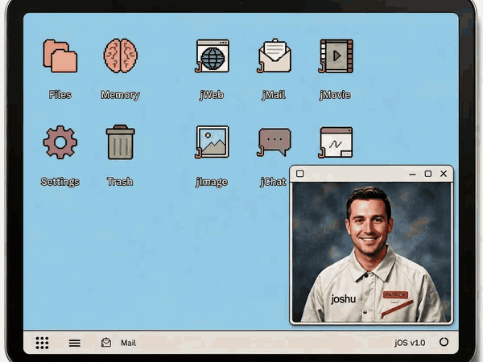
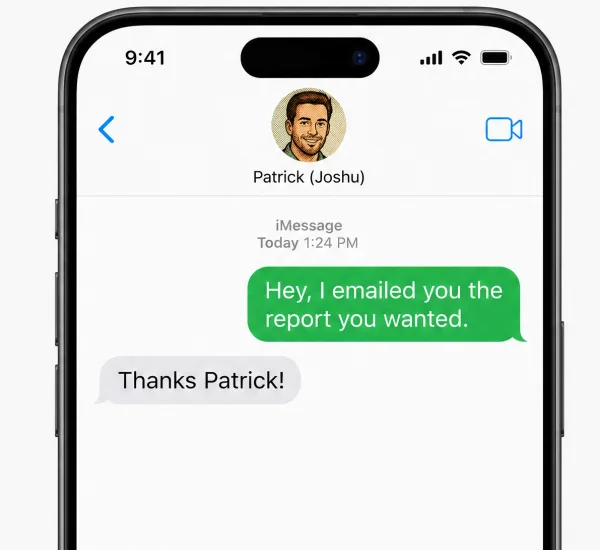
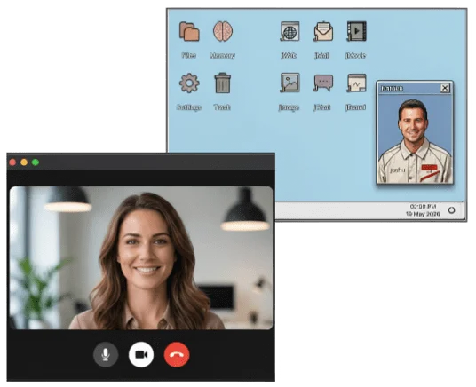
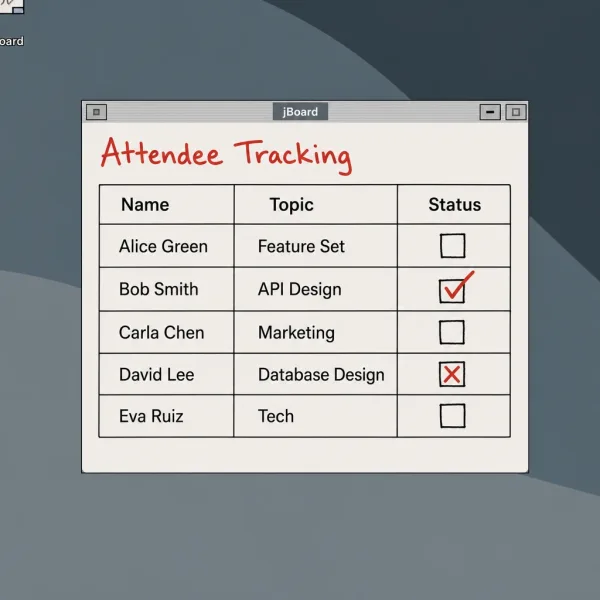

<div align="center">
  <picture>
    <source media="(prefers-color-scheme: dark)" srcset="public/joshu-mark.svg">
    
  </picture>

  <h1>Joshu</h1>

  <p>The open-source AI executive assistant with its own computer, phone number, and email.<br>
  Text it, call it, or copy it on an email, the same way you would a colleague.</p>

  [](https://github.com/db-aeon/joshu-oss/releases/latest)
  [](https://github.com/db-aeon/joshu-oss/pkgs/container/joshu-oss)
  [](LICENSE)
  [](CONTRIBUTING.md)

  [Website](https://joshu.me) | [Self-host guide](docs/vps-sandbox/hetzner-quickstart.md) | [User manual](docs/user-manual/README.md) | [Documentation](docs/README.md)

  <br>

  
</div>

> [!NOTE]
> Joshu is early. The self-hosted stack runs, but expect rough edges and breaking changes. The code is provided as is, with no warranty. If you would rather not run a server, [joshu.me](https://joshu.me) hosts a box for you with a 14-day free trial.

## Why Joshu

Most AI tools answer a question in a chat box, and then the box closes. Joshu does the work for you, e.g., the inbox, the calendar, the calls, the research, and the follow-up. You hand it a goal, and it keeps going until the goal is done.

Each Joshu gets its own desk, which is a cloud computer with a browser, apps, files, and memory. You and your companion use the same desktop, so you can watch it work, plan on the same whiteboard, or take the keyboard at any time. Joshu also has its own email address and phone number, so you reach it the same way you reach a person.

Joshu is open source under the AGPL. You run the box on your own server, you bring your own AI keys, and your files, mail, and memory stay on that server.

## Reach it the way you reach a colleague

<table>
  <tr>
    <td width="33%" valign="top">
      
      <h4>Text it</h4>
      Send a text from your phone, and get the answer back the same way.
    </td>
    <td width="33%" valign="top">
      
      <h4>Call it</h4>
      Call your companion's phone number and talk the work through, like you would with an assistant.
    </td>
    <td width="33%" valign="top">
      
      <h4>Work on its desk</h4>
      Plan together on the shared whiteboard, or open any app on its desktop.
    </td>
  </tr>
</table>

You can also email your companion, copy it on a thread, or message it in jChat, Slack, or Telegram.

<sub>The pictures show the hosted Joshu theme. A self-hosted box uses the plain Vanilla theme, with the same apps.</sub>

## A short walkthrough

The examples below show a normal day with Joshu. You talk to your companion in your own words, on whichever channel is easiest.

### Schedule a meeting

> **You:** Can you find an hour with Dana and Marcus next week? A video call is fine.
>
> **Joshu:** On it. I'll check your calendar and email them a few times that work.
>
> **Joshu:** They both picked Thursday at 10. The invite is out with a video link, and it's on your calendar.

Your companion checks your calendar and emails the other people. When they answer, it sends the invite and puts the meeting on your calendar. You can also start the same work by email, if you copy your companion on the thread and write "I'm copying Mina, who will find a time for us next week."

### Find out what people are saying

> **You:** What are people saying about meal-kit delivery this month? I want something I can read on the train.
>
> **Joshu:** I'll search the web and social sites, group what people said, and save a report on my desktop.
>
> **Joshu:** Done. The report is on my desktop. Do you want me to watch the topic every week?

The last30days app on the desktop makes the same reports, and it can watch a topic every day or every week.

### Let it keep you on track

> **You:** Remind me at 4 pm to call Sam.
>
> **Joshu:** Done. I'll remind you at 4.

Your companion also sends you a morning brief, an evening brief, and a weekly brief, which it plans from the working hours that you give it on the first day. When something waits for your answer, it sends you a nudge.

## What is on the box

| Part | What it does |
|------|--------------|
| [Hermes Agent](https://github.com/NousResearch/hermes-agent) | Runs the model, the channels (chat, text messages, phone calls, and voice), and the skills of your companion. |
| Desktop | A full cloud desktop in your web browser, built on ArozOS. You and your companion use the same apps, e.g., jChat, jMail, Files, Schedules, and jNotes. |
| jWeb | A browser on the desktop that you and your companion share. It keeps its own cookies, apart from your laptop. When a site asks for a login or a 2FA code, you type it in the same window. |
| Connectors | Connects Gmail, Google Calendar, Slack, and many other accounts through your own Composio account. |
| File Brain | Searches your files, saved mail, and uploads by meaning, with [GBrain](https://github.com/garrytan/gbrain). |
| Memory | Long-term memory with Hindsight, so your companion remembers your people, projects, and preferences. |
| Kanban | Boards that show each piece of work that your companion is doing. |
| App SDK | Lets you build your own desktop app. See [docs/app-sdk.md](docs/app-sdk.md). |

## Work as a team with Multiplayer


Multiplayer lets your companion work with the companions of the people you work or live with. Each morning, the companions in a team hold a short stand-up of their own, where they ask each other for what they need and promise the work they will do. Your companion then does its part, and it tells you only what you need to know. The boxes talk to each other directly, so Multiplayer works between self-hosted boxes. See [How to use Multiplayer](docs/user-manual/08-boss-mode.md).

## You stay in charge

You decide what your companion can do without asking you. When approvals are on, your companion texts you before it emails somebody outside, sends a calendar invite, or posts in Slack, and it waits for you to reply Y or N. If you say no, or you do not answer, nothing is sent. Your companion also copies your work email on each message that it sends, so you see everything.

On a self-hosted box, approvals are off until you turn them on in the Safety app, and they need a Twilio number for the text messages. See [Safety and approvals](docs/user-manual/07-safety-and-approvals.md).

## Built on Hermes Agent

<a href="https://github.com/NousResearch/hermes-agent"></a>

[Hermes Agent](https://github.com/NousResearch/hermes-agent) by Nous Research is the engine under Joshu. It is an open-source AI agent that is built in the open. Joshu adds the desktop, the apps, the phone and email channels, and the skills of an executive assistant.

<br clear="left">

## Run your own box

You need an Ubuntu server with 8 GB of RAM (for example on Hetzner or DigitalOcean), a domain name, and an [OpenRouter](https://openrouter.ai/keys) API key. The [VPS quickstart](docs/vps-sandbox/hetzner-quickstart.md) has the full walkthrough.

1. Create the server, and point a DNS record for your domain (for example `mybox.example.com`) at its IP address.
2. On the server, as root, clone Joshu and make the settings file:

   ```bash
   git clone --depth 1 --branch main https://github.com/db-aeon/joshu-oss.git /opt/joshu
   mkdir -p /etc/joshu/secrets
   cp /opt/joshu/deploy/.env.vps.example /etc/joshu/instance.env
   nano /etc/joshu/instance.env
   ```

   Set `CUSTOMER_DOMAIN`, `VPS_IPV4`, `ACME_EMAIL`, and `JOSHU_AROZ_USER`, and copy the image version from [`deploy/RELEASE.json`](deploy/RELEASE.json).
3. Run the bootstrap script. The first run takes 10 to 20 minutes.

   ```bash
   cd /opt/joshu && ENV_FILE=/etc/joshu/instance.env bash deploy/scripts/bootstrap-vps.sh
   ```

4. Open `https://mybox.example.com` in your browser, and create your account with the same username as `JOSHU_AROZ_USER`. The Welcome app opens and asks for your OpenRouter key. You can also paste a Gemini key, which turns on voice in jChat and on phone calls.

Other ways to install, e.g., Docker Compose, are in the [self-host guide](docs/self-host.md).

### Your first ten minutes

After Welcome, you can chat with your companion in jChat. Then connect the rest, in this order:

1. In the Connectors app, connect Gmail and Google Calendar. Connectors needs your own [Composio](https://composio.dev) key.
2. In the Telephone app, enter your mobile number. Phone calls and text messages need your own [Twilio](docs/vps-sandbox/twilio-self-host.md) number.
3. In the jMail app, create your companion's own mailbox. The mailbox needs your own [Nylas](docs/nylas-agent-mailbox.md) account.

Then try these:

- In jChat, ask "What's on my calendar tomorrow?"
- Forward an email to your companion, and ask "What does this person want from me?"
- In jChat, say "morning review" to plan your day together.

The [user manual](docs/user-manual/README.md) explains each feature, and each chapter says which of your accounts the feature needs.

## Run it on your laptop

For development, you need Node.js 22 or later, npm, Docker, and Go 1.24 or later.

```bash
git clone https://github.com/db-aeon/joshu-oss.git
cd joshu-oss
npm ci
cp .env.example .env    # set at least OPENROUTER_API_KEY
npm run dev:arozos
```

The last command starts the shared Chromium browser, builds the desktop when needed, and starts the Joshu backend. Then open [http://127.0.0.1:8787](http://127.0.0.1:8787). See [docs/local-installation.md](docs/local-installation.md) for Hermes, Hindsight, and GBrain.

## Documentation

| Topic | Document |
|-------|----------|
| How to use your companion | [User manual](docs/user-manual/README.md) |
| Install a box on a server | [VPS quickstart](docs/vps-sandbox/hetzner-quickstart.md) and [self-host guide](docs/self-host.md) |
| Install for development | [local-installation.md](docs/local-installation.md) |
| How the platform is built | [platform-architecture.md](docs/platform-architecture.md) |
| Build a desktop app | [app-sdk.md](docs/app-sdk.md) and [app-agent.md](docs/app-agent.md) |
| Executive assistant skills | [executive-assistant.md](docs/executive-assistant.md) |
| Connectors and mail | [connectors.md](docs/connectors.md) |
| last30days research app | [last30days-user-guide.md](docs/last30days-user-guide.md) |

Everything else is in the [documentation index](docs/README.md).

## Releases

Each release is on the [Releases page](https://github.com/db-aeon/joshu-oss/releases/latest), with notes. Each release publishes two Docker images, and [`deploy/RELEASE.json`](deploy/RELEASE.json) names the current version:

- `ghcr.io/db-aeon/joshu-oss:<version>` (and `:latest`)
- `ghcr.io/db-aeon/joshu-oss-voice-realtime:<version>` (and `:latest`)

## Contributing

Community pull requests land in this repository. See [CONTRIBUTING.md](CONTRIBUTING.md).

## License

Joshu is dual licensed under the AGPL-3.0 or a commercial license. See [LICENSE](LICENSE), [COMMERCIAL_LICENSE.md](COMMERCIAL_LICENSE.md), and [TRADEMARK.md](TRADEMARK.md).
