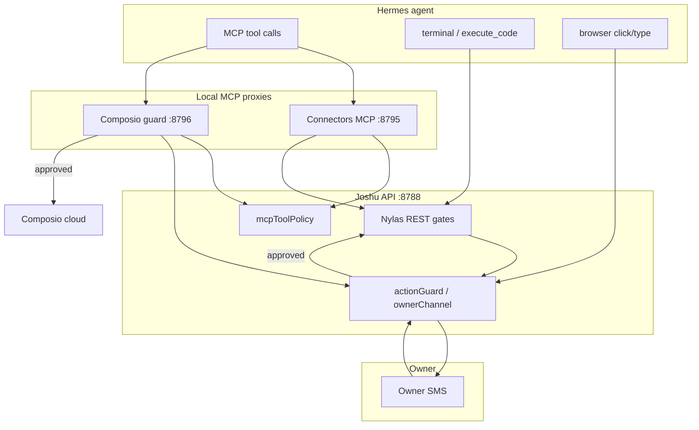

# Agent safety (write policy, HITL, owner channel)

Joshu owns **agent write safety** end-to-end. Composio is OAuth and transport; Hermes is the agent runtime. All enforcement lives in Joshu code, MCP proxies, and REST gates — not in Composio SDK modifiers alone.

**Related docs**

| Topic | Doc |
|-------|-----|
| Safety desktop app (configure policy in UI) | [`safety-settings-arozos-app.md`](safety-settings-arozos-app.md) |
| Safety UI (owner channel, policy) | [`safety-settings-arozos-app.md`](safety-settings-arozos-app.md) |
| Mail/calendar MCP + cron | [`connectors.md`](connectors.md) |
| Browser HITL (shared browser, live view) | [`hitl-camofox-notes.md`](hitl-camofox-notes.md) |

---

## Design principle

1. **Joshu decides** what is blocked, gated, or allowed — deterministically where possible.
2. **Owner channel** is notification + approve/deny ingress only; it does not replace policy.
3. **One HITL gate** — every gated path (`awaitOwnerApproval` in [`gate.ts`](../src/actionGuard/gate.ts)) shares one pending store and one resolve path. Inbound SMS Y/N replies via [`smsIngress.ts`](../src/actionGuard/smsIngress.ts) call `resolvePending` — not separate safety systems.
4. **Same gate for every agent path** — Hermes MCP, `execute_code`, `curl`, browser writes, and Composio SDK calls that hit Joshu should converge on the same rules.
5. **Owner human UI bypasses** — jMail compose and owner browser sessions (jWeb and the browser handoff page) are not agent paths.

---

## Three enforcement tiers

| Tier | When | Owner sees | Agent sees on block/deny |
|------|------|------------|--------------------------|
| **1 — Hard block** | Always-on policy (`mcpToolPolicy`) | Nothing (tool never listed or explicit error) | Error: use Nylas send / no delete / no Nylas calendar write |
| **2 — HITL (action guard)** | Enabled + owner SMS configured (Telephone mobile or `TWILIO_OWNER_CALLER`) | Approve / Deny by SMS (reply Y/N) | Success-shaped stub (no side effect) or timeout stub |
| **3 — Soft deny (LLM classifier)** | Optional; ambiguous actions only | Same as tier 2 if escalated to HITL | Classifier may skip gate when below threshold |

Hard blocks run **before** HITL. Example: Composio `GMAIL_SEND_EMAIL` is hard-blocked by MCP policy — it never reaches the approval flow. Agent mail must use `nylas_send_message` (tier 2 when guard is on).

---

## Architecture



| Layer | Port | Role |
|-------|------|------|
| Connectors MCP | `:8795` | Joshu connectors tools; `nylas_send_message` → REST (gate on API) |
| Composio MCP guard | `:8796` | Pass-through to Composio cloud; hard blocks always; write tools → `POST …/owner-channel/await`; checks each inner tool call of `COMPOSIO_MULTI_EXECUTE_TOOL` |
| Joshu API | `:8788` | Policy, owner channel, Nylas send gate, webhooks |

When Composio is on, Hermes `mcp_servers.composio.url` points at `http://127.0.0.1:8796/mcp`, not at Composio cloud, also when the action guard is off. The Composio MCP guard applies the tier 1 hard blocks on each call, and it asks the owner only when the action guard is on. The Hermes configuration has no Composio credentials. The `connect_timeout` is 1,800 seconds with the action guard on (the approval wait) and 120 seconds with the action guard off. The Composio MCP guard reads the hard block policy and the action guard policy again after 30 seconds, so a change in the Safety app applies with no restart.

Each box has two Composio sessions for the same Composio user. The main session has all app tools and the Composio workbench off. The read session has only the tools that Composio marks with the MCP hint `readOnlyHint`, and it has the Composio workbench on. The Composio MCP guard sends `COMPOSIO_REMOTE_WORKBENCH`, `COMPOSIO_REMOTE_BASH_TOOL`, and each `COMPOSIO_MULTI_EXECUTE_TOOL` call whose inner tool calls all read (by name) to the read session, so a large result lands in the sandbox that the workbench can read. Composio refuses each write on the read session with `[Session Restriction]`, and the guard then runs the call again on the main session. The guard sends every other call to the main session.

The Composio session of a box preloads no app tools, so Hermes gets only the Composio meta tools, and a worker runs each app tool as an inner tool call of `COMPOSIO_MULTI_EXECUTE_TOOL`. The Composio MCP guard checks each inner tool call as if Hermes had called the app tool directly, also inside a nested `COMPOSIO_MULTI_EXECUTE_TOOL`. One hard block refuses the whole call. Each gated inner tool call asks the owner with a summary of its own arguments, and one denial or timeout runs no inner tool call and returns a success-shaped stub with one stub result for each inner tool call. A `COMPOSIO_MULTI_EXECUTE_TOOL` call with no `tools` list, or an inner tool call with no `tool_slug`, is refused.

**Code map**

| Area | Path |
|------|------|
| Hard MCP policy | [`src/mcpToolPolicy.ts`](../src/mcpToolPolicy.ts) |
| Action guard core | [`src/actionGuard/`](../src/actionGuard/) |
| Owner 1:1 channel | [`src/ownerChannel/`](../src/ownerChannel/) |
| Composio SDK modifier (direct execute paths) | [`src/composio/modifiers/ownerChannelBeforeExecute.ts`](../src/composio/modifiers/ownerChannelBeforeExecute.ts) |
| Composio MCP guard proxy | [`scripts/composio-mcp-guard-proxy.mjs`](../scripts/composio-mcp-guard-proxy.mjs) |
| Connectors MCP | [`scripts/joshu-connectors-mcp-http-server.mjs`](../scripts/joshu-connectors-mcp-http-server.mjs) |
| Terminal mail bypass block | [`scripts/patch-hermes-terminal-mail-guard.mjs`](../scripts/patch-hermes-terminal-mail-guard.mjs) |
| Terminal secrets guard (secret reads, runtime files, `execute_code` scripts) | [`scripts/patch-hermes-terminal-secrets-guard.mjs`](../scripts/patch-hermes-terminal-secrets-guard.mjs) |
| No permanent approvals in Hermes approval prompts | [`scripts/patch-hermes-approval-no-permanent.py`](../scripts/patch-hermes-approval-no-permanent.py) |
| HERMES.md section "Box problems" | [`src/hermesContextFile.ts`](../src/hermesContextFile.ts) |
| Browser write gate (Hermes) | [`scripts/patch-hermes-browser-cdp-guards.mjs`](../scripts/patch-hermes-browser-cdp-guards.mjs) → `POST …/api/action-guard/browser` |
| Browser gate logic | [`src/actionGuard/browserGate.ts`](../src/actionGuard/browserGate.ts) |
| SMS approval ingress | [`src/actionGuard/smsIngress.ts`](../src/actionGuard/smsIngress.ts) (via [`twilioSmsGateway.ts`](../src/twilioSmsGateway.ts)) |
| Approval reply parse | [`src/actionGuard/approvalReply.ts`](../src/actionGuard/approvalReply.ts) — short Y/N/`ok` only |
| SMS send (GSM fold + 640-char cap) | [`src/twilioSmsSend.ts`](../src/twilioSmsSend.ts) |
| Safety settings API + UI | [`src/safetySettings/`](../src/safetySettings/), [`apps/safety-settings/`](../apps/safety-settings/) |

---

## Tier 1 — MCP tool policy (hard blocks)

Default **on** when unset. Enforced in the Composio MCP guard (also when the action guard is off, and for each inner tool call of `COMPOSIO_MULTI_EXECUTE_TOOL`), Connectors MCP, and Joshu REST (defense in depth).

| Rule | Blocked | Use instead |
|------|---------|-------------|
| Outbound mail via Composio Gmail | `GMAIL_SEND_*`, `GMAIL_REPLY_*`, send heuristics | `mcp_joshu_connectors_nylas_send_message` |
| Nylas calendar writes | `nylas_create_event`, `nylas_update_event`, `nylas_delete_event` | `mcp_joshu_connectors_google_calendar_create_event` / `…_update_event` (owner Google calendar) |
| Deletes | Composio tools matching `DELETE` / `TRASH` | — (not available to agents) |

Blocked tools are removed from `listTools` where the proxy supports it. Owner **jMail** Gmail send still works (`X-Joshu-Mail-Client: jmail` + same-origin browser).

**Configure:** `JOSHU_MCP_TOOL_POLICY_ENABLED` or **Safety** app → Hard policy → MCP tool policy → writes `mcpToolPolicyEnabled` in `.joshu/action-guard/policy.json`.

API: `GET /joshu/api/mcp-tool-policy`

---

## Tier 2 — Action guard (HITL)

Before an **agent write** that affects third parties, Joshu texts the owner on **SMS** (Telephone owner mobile, or `TWILIO_OWNER_CALLER`) with a Y/N approval prompt. Deny and timeout return **success-shaped stubs** so the agent does not retry blindly; no write occurs.

### Gate modes

| Mode | Behavior |
|------|----------|
| **`external_writes`** (default) | Gates Composio write heuristics (`_SEND_`, `_CREATE_`, `_UPDATE_`, `_PATCH_`, `_POST_`, `_REPLY_`), `nylas_send_message`, and browser writes when enabled |
| **`allowlist`** | Skips write heuristics; only actions in `guardedActions` (default includes Nylas send + Gmail send ids — Gmail send is hard-blocked anyway) |

### What is gated vs not

| Path | Gated? |
|------|--------|
| `mcp_joshu_connectors_nylas_send_message` → REST | **Yes** |
| `execute_code` / `curl` → `POST …/nylas/messages/send` | **Yes** (same REST gate) |
| Composio proxy → `GOOGLECALENDAR_CREATE_EVENT`, `SLACK_SEND_MESSAGE`, etc. | **Yes** (`external_writes`) |
| `mcp_joshu_connectors_google_calendar_create_event` / `…_update_event` → REST → Composio | **Yes** (`external_writes`; Joshu runs the Composio write through the same before-execute gate) |
| Composio `GMAIL_SEND_EMAIL` | **Hard-blocked** (tier 1) |
| Composio read/meta tools (`COMPOSIO_SEARCH_TOOLS`, list/read) | **No** |
| Composio `COMPOSIO_MULTI_EXECUTE_TOOL` | Each inner tool call is gated as a direct call (for example `GOOGLECALENDAR_CREATE_EVENT` inside it is gated) |
| jMail owner compose | **No** |
| Mail to owner `primaryWorkEmail` only | **No** when `bypassOwnerOnlyRecipients: true` (default) |
| External mail (counterparty recipients) | **Auto-CC** owner primary work email (API-enforced); approval SMS warns when owner was not on prior thread messages |
| Browser click/type/press | **Yes** when `browserGateWrites: true` (default **off**) |
| Browser navigate/scroll/snapshot | **No** |
| Browser evaluate/submit | Classified as writes; Hermes patch does not hook them yet |

### Browser write gate

When **`browserGateWrites: true`** (Safety app → **Gate browser writes**, or `JOSHU_ACTION_GUARD_BROWSER_GATE=true`), the Hermes browser tools **click**, **type**, and **press** call Joshu before they run:

```text
browser_click / browser_type / browser_press
  → POST /joshu/api/action-guard/browser
  → gateBrowserWriteRequest → awaitOwnerApproval (same HITL as mail)
```

**Requirements (all):** action guard enabled, owner channel linked, browser gate on, Hermes `tools/browser_tool.py` patched with the CDP browser guards (`scripts/patch-hermes-browser-cdp-guards.mjs`; `deploy/scripts/vps-start.sh` applies it on the box, `scripts/apply-hermes-hitl-patch.sh` in local development), gateway restarted so `JOSHU_ACTION_GUARD_BROWSER_GATE=true` is in `~/.hermes/.env` (synced from policy on gateway boot).

**Scheduling links:** confirming a Calendly/Google booking is a **`browser:click`** — gated when browser gate is on.

**Not gated:** owner clicking in the live view (jWeb or the browser handoff page); agent **navigate** to open a scheduling page (only the confirm click is gated).

### Browser handoff lock (owner mobile checkout)

Separate from the optional browser **action guard**. When `browser_handoff_request` creates a **pending** handoff, Joshu pauses the browser-use sidecar and **refuses `browser_task`** until the owner completes via the signed handoff URL or the handoff is cancelled. On an SMS-originated realtime goal the owner does not get that URL from the worker’s chat reply. They get the Kanban completion, after [`formatOwnerCompletion`](../src/realtimeGoals/ownerDelivery.ts) appends the pending handoff link if the summary never pasted it. See [channel delivery](realtime-goals.md#channel-delivery). **I'm done** completes the handoff and starts an SMS continuation. If the worker minted the record without `hermesSessionKey`, that continuation uses the owner phone from Telephone settings. The form overlay includes shadow-DOM fields whose host is visible, including Alaska's 1×0 inputs, and writes the custom element's `value`. The lock for the Hermes browser tools is in `tools/browser_tool.py` if that toolset is loaded. Form fill and screencast clicks stay available to the owner while the agent is paused. Skill `joshu-browser-handoff` tells the companion to never ask the owner to send a password, passcode, PIN, recovery code, or one-time code by SMS, chat, email, or voice. The owner types a secret on the browser handoff page, so the secret is not in the SMS log, the Hermes session, or the traces.

| Path | Role |
|------|------|
| [`src/browserHandoff/`](../src/browserHandoff/) | Pending record, HMAC URL tokens, lock API |
| Hermes `patch-hermes-browser-cdp-guards.mjs` | Pre-flight `GET /api/browser-handoff/lock`, plus the browser write gate, in `tools/browser_tool.py` (`browser_navigate`, `browser_click`, `browser_type`, `browser_back`, `browser_press`). `browser_snapshot` is left unlocked. |
| [`src/actionGuard/browserGate.ts`](../src/actionGuard/browserGate.ts) | Also returns `browser_handoff_locked` stub before action-guard HITL |

**Allowed during lock:** `browser_handoff_status`, the owner's screencast clicks, and the form overlay (`fill-form`, paste). `browser_task` is refused. `browser_snapshot` still works if the built-in browser toolset is loaded.

**Fail-open:** if Hermes cannot reach the lock endpoint, the handoff patch logs and allows the write (same as action guard).

**Fail-open:** if Hermes cannot reach Joshu (`POST …/browser` errors), the patch logs a warning and allows the write (same pattern as other Hermes guards).

**Deny/timeout:** Hermes receives a success-shaped browser stub; no click/type/press occurs.

### Owner visibility on external mail

Joshu enforces that the owner stays visible on counterparty mail:

1. **Auto-CC** — `POST …/nylas/messages/send` appends the owner's **primary work email** to `cc` on any send that includes external recipients (not owner-only, not agent-only). jMail owner compose bypasses this path.
2. **Ingress flag** — mail ingress tasks include `owner_on_thread: true|false` from the thread mirror. When `false`, agents should summarize the counterparty ask in the first external reply.
3. **Action-guard SMS** — when `ownerOnThread: false`, the approval message includes a note and a short context snippet from the latest non-agent message on the thread.

This is **soft policy** (no hard 403 block). Action guard remains the approval gate.

### Mail during a text conversation

Joshu does not hold or refuse a mail of the companion because the owner texted the box recently, or because a browser handoff that started from a text is open. The action guard is the only check of a mail of the companion, and it asks the owner in the same way whether or not the owner texts.

Before October 2026, `gateNylasSendRequest` refused each mail of the companion for 60 minutes after the last text of the owner, and for 60 minutes after a browser handoff that started from a text. The refusal was meant to stop the companion from answering a text by mail. It also refused mail that the owner asked for by text, for example a forward with an attachment, so the owner waited until the 60 minutes were over. Each new text started the 60 minutes again.

The reply of the companion to a text goes back as an SMS without any rule, because the SMS gateway texts the reply text of the Hermes turn. The SMS continuation after **I'm done** does the same. So the refusal was removed, and the companion decides whether an answer goes in its reply text or in a mail. Two narrower rules were considered and rejected:

- **Let some kinds of mail through** (a mail with an attachment, a forward, or a mail to a person other than the owner). The rule would still depend on time, and each new kind of mail that the owner asks for would need one more case.
- **Refuse only a mail to the owner that repeats the reply text of the same Hermes turn.** The Joshu API would have to compare the mail with a reply that Hermes has not sent yet. That is new code for a mistake that the skills already tell the companion not to make.

The box skills did not change. The skill `joshu-browser-handoff` still tells the companion to put the result of a handoff that started from a text in its reply text. A change to a factory skill changes the seed key of the factory skills and starts LLM merges of the box skills on every box, so a change of wording alone does not justify one.

To find a box where the companion answers a text by mail, compare the times of the mail from the companion to the owner (Nylas) with the times of the SMS replies (Twilio) on that box. A mail to the owner within a few minutes of an SMS reply is the sign to look again.

### Enable conditions

Action guard is active when **all** of:

1. `enabled: true` (`JOSHU_ACTION_GUARD_ENABLED` or `policy.json`)
2. Owner SMS configured (owner mobile in **Telephone** / Welcome, or `TWILIO_OWNER_CALLER`, plus Twilio account/number/webhook — `twilioSmsGatewayEnabled()`)

If guard is enabled but SMS is not configured, agent sends return **503** `owner_channel_sms_not_configured` (Joshu stays up).

### MCP timeout vs approval wait

REST and proxy calls **block synchronously** until approve, deny, or policy timeout (default **30 minutes**). Hermes MCP per-tool timeout (~120s) can expire first — workers should `kanban_block(reason="awaiting owner approval")` rather than treat as MCP outage. See [`connectors.md` — Action guard timeout](connectors.md#action-guard--mcp-tool-timeout-vs-approval-wait-2026-06-23).

### Audit

Owner-only audit log: `.joshu/action-guard/audit.jsonl`  
Status: `GET /joshu/api/action-guard/status`

---

## Owner approval (SMS)

Action-guard write approvals use **owner SMS only** — the same Twilio gateway as owner ↔ Joshu chat.

The owner mobile is captured on the box:

1. **Telephone** → Your mobile (`.joshu/telephone/settings.json` `ownerCaller`)
2. **Welcome** Schedule & email (same file on complete)
3. Fallback: `TWILIO_OWNER_CALLER` in `instance.env` (ops `rotate_secrets`)

| Step | Behavior |
|------|----------|
| Notify | `notifyOwnerForApproval` sends a plain-text SMS summary + “Reply Y to approve or N to deny”, then waits at most 45 s for the delivery receipt. An undelivered SMS (for example Twilio 30034 or 30007) returns `unavailable` with `owner_channel_sms_delivery_failed` at once, so the action does not wait for an answer that cannot come. |
| Ingress | Inbound SMS on `/api/twilio/sms/inbound` → `handleSmsApprovalIngress` before Hermes chat routing |
| Resolve | Short Y/N (also `yes`/`no`/`ok`/`approve`/`deny`) → `resolvePending` on the newest open pending. Conversational SMS starting with “Ok …” / “Yes …” is **not** an approval. If nothing is pending, the message falls through to Hermes chat. |

**Configure:** Twilio subaccount vars on the box — see [`vps-sandbox/twilio-self-host.md`](vps-sandbox/twilio-self-host.md). Enable action guard in **Safety** or `JOSHU_ACTION_GUARD_ENABLED=1`. Test: **Safety → Test approval** — reply Y or N by SMS. Parser tests: `npm run test:sms-send`.

Approval and chat SMS share [`sendSms`](../src/twilioSmsSend.ts): Unicode is folded to GSM-7 and bodies are capped at **640 characters** so US carriers do not drop the message (Twilio **30019**).

**Not Hermes Slack/Telegram chat:** those remain separate agent chat surfaces in **Safety → Slack chat with the companion** (**Connect Slack**) / `TELEGRAM_BOT_TOKEN` ([hermes-integration](hermes-integration.md)).

**Storage:** optional `.joshu/owner-channel/owner-channel.json` for `gateMode` override only. Owner mobile lives in Telephone settings (then `TWILIO_OWNER_CALLER`).

**Slack / Telegram integrations (agent tools & chat — not action guard)**

| Integration | Config | Purpose |
|-------------|--------|---------|
| Composio Slack | Connectors OAuth (`slack`) | Agent MCP tools (`SLACK_SEND_MESSAGE`, …) |
| Hermes Slack chat | Safety → **Connect Slack** (`SLACK_BOT_TOKEN` + `SLACK_APP_TOKEN`) | Full agent chat (Socket Mode) |
| Hermes Telegram chat | Safety → `TELEGRAM_BOT_TOKEN` | Owner ↔ agent chat |
| Share-chat Slackbot | Connectors toolkit **`slackbot`** | KB-scoped channel Q&A ([share-chat.md](share-chat.md)) |

---

## Terminal mail guard

Hermes `terminal` could bypass REST by calling `nylas email send` or `curl …/api/nylas/messages/send` directly.

**Fix:** `scripts/patch-hermes-terminal-mail-guard.mjs` patches Hermes `terminal_tool.py` to hard-block known mail-send shell patterns. Default **on** (`JOSHU_TERMINAL_MAIL_GUARD=1`).

**Configure:** **Safety** app → Terminal mail guard, or env / `.joshu/safety-settings/local-env.json`. Hermes reads the value on gateway dotenv sync (restart gateway after change).

---

## Runtime files and Hermes approval prompts

The companion must not change the software of its own box, also when the owner asks it to fix the box. The runtime files are the Hermes checkout and venv (`/opt/hermes-agent`), the code of Joshu (`/opt/joshu/dist`, `/opt/joshu/scripts`, `/opt/joshu/packages`), the Hermes configuration (`~/.hermes/config.yaml` and `config.user.yaml`), and the Telephone settings file (`telephone/settings.json`). Three parts keep the companion away from them.

First, the terminal secrets guard (`scripts/patch-hermes-terminal-secrets-guard.mjs`) refuses a terminal command that changes a runtime file. The function `_joshu_runtime_write` in the patched `tools/terminal_tool.py` treats a command as a change when the command names a runtime file and one of these holds:

1. A `pip` or `uv pip` install, uninstall, or sync, when the command names `/opt/hermes-agent`.
2. One simple command (split on `|`, `;`, `&`, and new lines) starts with a file write program (`cp`, `mv`, `rm`, `ln`, `install`, `tee`, `truncate`, `dd`, `patch`, `rsync`, `chmod`, `chown`, `touch`, or `sed -i`) and names the runtime file.
3. A shell redirect writes to the runtime file.
4. The text uses a Python write call (`open` with a write mode, `write_text`, `write_bytes`, `shutil.copy`, `shutil.move`, `os.replace`, `os.rename`, `os.remove`, `os.unlink`).

The terminal secrets guard also refuses a request to `/api/telephone` with `PUT`, `POST`, `PATCH`, `DELETE`, or a body, because a direct localhost request to the Telephone routes needs no desktop session. It also refuses reads of the Telephone settings file, which holds the passphrase and the PIN of the call gate. Reads of the runtime files and runs of the programs in them stay allowed, for example `/opt/hermes-agent/venv/bin/hermes kanban list | tee /tmp/joshu-scratch/k.txt`. The refusal tells the companion to report the box problem. `JOSHU_TERMINAL_SECRETS_GUARD=0` turns the whole terminal secrets guard off.

Second, the same patch script patches `tools/code_execution_tool.py`, so `execute_code` calls `_joshu_terminal_secrets_blocked` with the source of each script before the approval and before Hermes runs the script. The `terminal()` calls inside a script already go through `terminal_tool.py`.

Third, HERMES.md has section "Box problems". The section tells the companion and each worker to check read-only, to tell the owner what it found and that the Joshu team fixes box problems, to block a Kanban task with a `system:` block reason, and never to save a memory entry or a skill that tells how to get around a guard.

A Hermes approval prompt on a box has no permanent approval. Hermes asks for an approval before a dangerous terminal command or an `execute_code` script. In smart mode, an auxiliary model approves most of them, and Hermes sends a Hermes approval prompt to the owner when the auxiliary model escalates. The patch `scripts/patch-hermes-approval-no-permanent.py` changes `tools/approval.py` in four places:

1. `_await_gateway_decision` sets `allow_permanent` to false, so Telegram, Slack, the text fallback, and jChat show once, session, and deny, with no Always.
2. `approve_permanent` does nothing. Each caller calls `approve_session` first, so an answer "always" (an older client, or a typed `/approve always`) gives a session approval.
3. `save_permanent_allowlist` does nothing, so Hermes never writes `command_allowlist`.
4. `load_permanent` keeps no entry, so the entries that `command_allowlist` already has stop working, and the Hermes log says how many entries it ignores.

The sandbox image applies the patch at build time, and `vps-start.sh` applies it again at each start. The build fails when one of the four places is missing, so a Hermes update that moves the code cannot ship half a patch.

---

## Composio SDK paths (beforeExecute)

Hermes always uses the **:8796 Composio MCP guard**. Joshu REST routes that call Composio `tools.execute` directly (e.g. some connector helpers) use [`ownerChannelBeforeExecute`](../src/composio/modifiers/ownerChannelBeforeExecute.ts):

1. Hard block via `mcpToolPolicy`
2. If action-guarded → `awaitOwnerApproval`
3. On deny/timeout → throw (no execute)

This keeps SDK and MCP paths aligned without relying on Composio-hosted modifiers.

---

## Bypass defense matrix

| Vector | Mitigation | Residual risk |
|--------|------------|---------------|
| Hermes → connectors MCP → Nylas send | REST gate | — |
| Hermes → Composio MCP → writes | Composio MCP guard (each inner tool call) + owner channel | — |
| Hermes → Composio workbench code → any tool | The workbench runs only on the read session, where Composio refuses each tool without `readOnlyHint` | Tools that Composio marks read-only by mistake (seen: `SLACK_SET_USER_ACTIVE`); workbench code can send data that it read to any internet host |
| `execute_code` / `curl` → Joshu Nylas send | REST gate | — |
| Hermes `terminal` → `nylas email send` | Terminal mail guard patch | Custom/obfuscated shell |
| Hermes `terminal` → pip install, file write, or config edit on a runtime file | Terminal secrets guard (runtime files) + HERMES.md section "Box problems" | A path built from parts at run time; a program the guard does not list |
| `execute_code` script → write to a runtime file | Terminal secrets guard on the script source | Same as the terminal row |
| One owner tap on Always → scripts run with no question | No permanent approvals (session scope at most) | One prompt in each new session for an escalated pattern |
| `curl` on loopback → `PUT /api/telephone` | Terminal secrets guard (Telephone settings requests) | A request that the guard does not recognize as a write |
| `execute_code` / `curl` → arbitrary external URL | Not gated by Joshu | Egress allowlist (out of scope v1) |
| Hermes `mcp_servers` **stdio** (`command` / `args`) | Stripped on gateway sync (`hermesMcpAllowlist.ts`) | Extra **HTTP** MCPs still allowed |
| Public Hermes Admin without basic auth | Caddy omits `hermes-admin` vhost; dashboard does not start | **Password in `instance.env` ≠ live lock** — unauth curl must be **401**. Stale host compose can still publish the vhost |
| Composio Gmail send | Hard MCP policy | — |
| Agent delete/trash | Hard MCP policy | — |
| Hermes browser click/type/press | Browser gate + owner channel when `browserGateWrites` | navigate-only; evaluate/submit unhooked; Hermes fail-open if Joshu unreachable |
| jMail owner UI | Client header + same-origin bypass | By design |
| Owner-only recipient mail | `bypassOwnerOnlyRecipients` | By design |

---

## Configuration reference

### Environment variables

| Variable | Purpose |
|----------|---------|
| `JOSHU_MCP_TOOL_POLICY_ENABLED` | Tier 1 hard blocks (default on) |
| `JOSHU_ACTION_GUARD_ENABLED` | Tier 2 master switch |
| `JOSHU_ACTION_GUARD_GATE_MODE` | `external_writes` \| `allowlist` |
| `JOSHU_ACTION_GUARD_BROWSER_GATE` | Gate browser writes (click, type, press) |
| `JOSHU_ACTION_GUARD_LLM` | Soft classifier for ambiguous actions |
| `JOSHU_ACTION_GUARD_TIMEOUT_MS` | Approval wait (default 30m) |
| `TWILIO_ACCOUNT_SID`, `TWILIO_AUTH_TOKEN`, `TWILIO_PHONE_NUMBER`, `TWILIO_SMS_WEBHOOK_URL` | Twilio SMS gateway — see managed fleet A2P runbook (not in OSS) |
| `TWILIO_OWNER_CALLER` | Optional env fallback for owner mobile (Telephone / Welcome preferred) |
| `JOSHU_TERMINAL_MAIL_GUARD` | Terminal mail bypass block (default on) |
| `JOSHU_TERMINAL_SECRETS_GUARD` | Terminal secrets guard: secret reads, runtime file writes, and the same check on `execute_code` scripts (default on) |
| `TELEGRAM_BOT_TOKEN` | Hermes chat bot (separate from action guard) |
| `SLACK_BOT_TOKEN`, `SLACK_APP_TOKEN` | Hermes Slack chat (Socket Mode) |
| `SLACK_ALLOWED_USERS` | Allowlist of Slack member IDs (`U…`) for Hermes chat. Connect Slack, the owner email lookup, or a pairing code fills it in |
| `SLACK_HOME_CHANNEL`, `SLACK_ALLOWED_CHANNELS` | Optional Hermes Slack routing |
| `JOSHU_COMPOSIO_MCP_GUARD_PORT` | Guard proxy port (default 8796) |
| `JOSHU_HERMES_DASHBOARD_PASSWORD` | Caddy basic auth for `hermes-admin.*`; empty → vhost and dashboard stay off |

See [`.env.example`](../.env.example) for full list.

### On-disk files

| File | Contents |
|------|----------|
| `.joshu/action-guard/policy.json` | Gate mode, timeouts, browser gate, LLM, MCP policy toggle |
| `.joshu/owner-channel/owner-channel.json` | Optional `gateMode` override (`provider` is always `sms`) |
| `.joshu/safety-settings/local-env.json` | Hermes Slack/Telegram chat tokens, terminal guard when not in `.env` |
| `.joshu/action-guard/audit.jsonl` | Approval audit trail |

**Precedence:** process `.env` overrides UI for keys present at boot. Policy file merges with env for non-env-locked fields.

### REST API summary

| Endpoint | Method | Purpose |
|----------|--------|---------|
| `/joshu/api/safety-settings` | GET/PUT | Read/write all safety settings (Safety app); a messaging change restarts the Hermes gateway in the background |
| `/joshu/api/safety-settings/restart-gateway` | POST | Sync messaging env and restart Hermes gateway |
| `/joshu/api/safety-settings/slack-setup` | GET | Hermes Slack setup steps + status |
| `/joshu/api/safety-settings/slack-manifest` | POST | Box Slack manifest + prefilled "create app" link |
| `/joshu/api/safety-settings/slack-verify` | POST | Check Slack bot/app tokens with Slack |
| `/joshu/api/safety-settings/slack-connect` (+ `/start`, `/cancel`) | GET/POST | Slack connect run (see [safety-settings-arozos-app.md](safety-settings-arozos-app.md#slack-chat-with-the-companion)) |
| `/joshu/api/safety-settings/pairing/approve` | POST | Approve a Hermes pairing code (Slack, Telegram) |
| `/joshu/api/safety-settings/test-approval` | POST | Send test approval SMS |
| `/joshu/api/action-guard/status` | GET | Guard + SMS owner-channel status |
| `/joshu/api/connectors/owner-channel` | GET/PUT | Owner channel status (`provider: sms`) |
| `/joshu/api/owner-channel/await` | POST | Internal: MCP proxy approval wait |
| `/joshu/api/action-guard/browser` | POST | Internal: Hermes browser write gate |
| `/joshu/api/mcp-tool-policy` | GET | Hard policy snapshot for proxies |

---

## Safety desktop app

The **Safety** ArozOS app is the operator UI for tiers 1–2 and SMS approval status. Full detail: [`safety-settings-arozos-app.md`](safety-settings-arozos-app.md).

Quick start:

```bash
npm run dev:arozos          # builds app + installs desktop shortcut
# or
npm run dev:safety-settings # Vite only on :3010
```

**Troubleshooting:** If the desktop icon does nothing, ensure `arozos/subservice/safety-settings/.startscript` exists and restart `dev:arozos` (ArozOS loads subservices at boot). You should see `[joshu-safety-settings] serving …` in logs.

---

## Operational checklist

1. Enable action guard in **Safety** or env; set owner mobile in **Telephone** (or `TWILIO_OWNER_CALLER`) and Twilio SMS.
2. **Test:** Safety → Test approval — reply Y or N by SMS.
3. Confirm: `curl -fsS http://127.0.0.1:8788/joshu/api/action-guard/status | jq .` → `ownerChannelLinked: true`, `smsConfigured: true`.
4. **Browser writes (optional):** enable **Gate browser writes** in Safety; run `scripts/apply-hermes-hitl-patch.sh`; restart Hermes gateway.
5. Verify Composio guard: Hermes config `mcp_servers.composio.url` → `http://127.0.0.1:8796/mcp` (on each box with Composio, also with the action guard off).
6. After policy/browser-gate/messaging changes affecting Hermes: **Safety → Restart gateway**, or `GET …/hermes-chat/status?after_mcp_boot=1` on VPS.

---

## Hermes Admin incident (2026-09)

Fleet incident: **unauthenticated public Hermes Admin** let an attacker add a **stdio MCP dropper** (`lab-beacon-*`) that mined XMR and could read secrets via the dashboard **`env/reveal`** API. Full operator timeline: troubleshooting — Hermes Admin unauthenticated.

### Attack surface (now mitigated in code)

| Vector | What happened | Mitigation (2026-09-07+) |
|--------|---------------|---------------------------|
| Public `hermes-admin.*` with **empty** `JOSHU_HERMES_DASHBOARD_PASSWORD` | Caddy published the vhost; `header_up Host 127.0.0.1:9119` bypasses Hermes DNS-rebind check | No vhost without bcrypt password; dashboard does not start |
| **Password set, Caddyfile still unauth** (Clara 2026-09-16) | Host compose bind-mounted an **Aug 14** `Caddyfile` with **no `basicauth`**. Health `0.1.44` and `JOSHU_HERMES_DASHBOARD_PASSWORD` did not re-render the edge. Unauth stayed **200** | Current compose uses `caddy-entrypoint.sh` (render from `instance.env` on every start). Recreate Caddy only after the **caddy service** has that entrypoint. Source of truth: unauth **401** |
| **`hermes mcp add --command python3`** (stdio) | RCE + persistence via crontab; miner under `/usr_*vt/…/dns-filter` | **`hermesMcpAllowlist.ts`** strips unknown stdio MCPs on every gateway sync; test: `npm run test:hermes-mcp-allowlist` |
| Dashboard **MCP form** + in-memory registry | Cleaning `config.yaml` alone was insufficient — dashboard respawned the server | Remove MCP from config **and** restart gateway **and** dashboard |
| Dashboard **`env/reveal`** | Leaked OpenRouter, Exa, `API_SERVER_KEY`, Slack tokens, Telegram allow-list | Rotate vendor keys; regenerate Slack at api.slack.com (not CP-mintable) |

### Compromise vs exposure (Sep 2026 fleet scan)

| Status | Boxes |
|--------|--------|
| **Confirmed malware** (miner or `lab-beacon` in logs) | **2 boxes** (one **reinfected 2026-09-15** via `/etc/.dd` crontab after the Sep 7 config cleanup) |
| **Exposed** (unauth admin HTTP 200, empty dashboard password; rotate keys as precaution) | **10 boxes** |
| **Fleet re-scan 2026-09-16** | All **11** live boxes unauth **401**, no live miner. One box still had the **old Caddy bind-mount** — patched to `caddy-entrypoint` that night |
| **Not this campaign** | Owner HTTP MCP **`known_quantity`** (legitimate) |

Best marker on one infected box: dashboard logout **2026-09-06 09:52Z** from **`149.102.245.71`** (Datacamp VPN). Treat that IP as hostile unless confirmed otherwise.

### Post-incident checklist (existing fleet box)

1. **Lock admin:** password in `instance.env` is not enough. Unauth `https://hermes-admin.<slug>.<suffix>/` must return **401**. Caddy must use **`caddy-entrypoint.sh`** (not a static `./Caddyfile` bind). Recreate **Caddy** after that compose change.
2. **Contain MCP/miner:** strip stdio extras; kill miner; remove `/usr_bwvt`, `/usr_npvf`, `/etc/.dd` **and** root crontab (`*/45 … cron-fetch`). **Reboot is not enough** — dropper files live in the container writable layer; **`--force-recreate joshu-stack`**. Restart **gateway and dashboard**. Keep `config.yaml.bak-malware-*` — do not restore. Do **not** `POST /joshu/api/hermes/reset` while a dropper is live (Clara: load 5 → 172).
3. **Rotate secrets:** OpenRouter, Exa, `API_SERVER_KEY` / `HERMES_API_KEY` / `JOSHU_READ_API_KEY` via control-plane `scripts/rotate-exposed-vendor-keys.ts`. **Slack:** regenerate bot + app tokens in Slack app settings → Safety or `~/.hermes/.env`.
4. **Verify allowlist:** after gateway sync, `mcp_servers` in `config.yaml` must have **no** `command`/`args` stdio entries except Joshu-managed servers.
5. **Dist integrity:** `dist/` comes only from the sandbox image, so a recreate cannot load a mixed tree. On a box that still has a git clone at `/opt/joshu`, upgrade it first with `scripts/upgrade-fleet-box-image.sh`.
6. **Re-scan the fleet** after any Clara-class incident: unauth 401 on every `hermes-admin`, Caddy entrypoint contains `caddy-entrypoint`, no `/etc/.dd`, no stdio MCP. See troubleshooting.

### Provision hardening (control plane)

New boxes: CP mints **`JOSHU_HERMES_DASHBOARD_PASSWORD`** in `instance.env` (`sandboxEnv.ts`). See [zero-touch-provisioning.md](https://github.com/db-aeon/joshu-control-plane/blob/main/docs/zero-touch-provisioning.md) in the control-plane repo.

---

## Design decisions

### 2026-10-20: The Composio MCP guard checks each inner tool call

Decision: the Composio MCP guard turns a `COMPOSIO_MULTI_EXECUTE_TOOL` call into its list of inner tool calls, also nested ones, and it applies the hard blocks and the action guard to each inner tool call. The strictest result wins, and a call with no list of inner tool calls is refused, because the Composio MCP guard cannot tell what the call does. Before, the guard checked only the outer name, and the action guard treated each name that starts with `COMPOSIO_` as a read, so no app tool got a hard block or an owner approval. Langfuse showed calendar events that workers made this way with no owner approval.

Alternatives: block `COMPOSIO_MULTI_EXECUTE_TOOL` (then workers cannot read mail or calendars through Composio), or preload the app tools in the Composio session (Composio still offers `COMPOSIO_MULTI_EXECUTE_TOOL`, so the gap stays).

### 2026-10-20: One denial stops a whole multi execute call

Decision: when the owner denies one inner tool call, or the approval times out, no inner tool call runs, and the worker gets one success-shaped stub result for each inner tool call. Running only the approved inner tool calls would give the worker a mix of real results and stubs, and the worker could not tell which result is real.

### 2026-10-20: The Composio workbench runs on a read session

Decision: the main Composio session of a box has the Composio workbench off, and a second Composio session of the same user, the read session, has it on. The read session has only the tools that Composio marks with `readOnlyHint`, proxy execution off, and connection management off. A new main session starts with the workbench off, and the Joshu API turns it off one time on a saved main session, in the same session update that sends changed auth configs (`workbenchOff` in `.joshu/composio-session.json`). The store keeps the read session under `readSession`.

Code in the Composio workbench can call Composio tools, and the Composio MCP guard cannot see those calls. A test on 2026-10-20 with a Composio user that had no connected accounts showed that the read session holds:

1. Workbench code reaches Composio only through its own session. Composio applied the tag filter to each call, so `GMAIL_SEND_EMAIL`, `GMAIL_DELETE_MESSAGE`, `SLACK_SEND_MESSAGE`, and `GOOGLECALENDAR_CREATE_EVENT` were refused, and `GMAIL_FETCH_EMAILS` passed the filter.
2. The workbench holds no Composio API key. Composio answered 401 for each other endpoint (the execute endpoint of another session, `POST /api/v3/tools/execute`, a new session, a session update, proxy execute, and the meta tools).

The test also found a trap. A per-toolkit `enable` or `disable` list replaces the tag filter for that toolkit, so the read session config must never have one. A few tools have `readOnlyHint` by mistake (for example `SLACK_SET_USER_ACTIVE`). The workbench can reach any internet host, so workbench code could send data that it read elsewhere. Workers on the box can already do that with the terminal.

Alternatives: the workbench off (live Gmail search then had to ask for small results, and the workbench is useful for large results), a hard block only (Composio could still save a large result to a workbench that the worker cannot read), or an owner approval for each workbench call (the owner cannot judge code, and the requests would be frequent).

### 2026-10-20: Hermes always calls Composio through the Composio MCP guard

Decision: the Hermes configuration points at the Composio MCP guard whenever Composio is on. Before, it pointed at Composio cloud when the action guard was off, and so no tier 1 hard block ran for Composio on those boxes. The Joshu API checks the action guard again for each approval request, so the routing does not depend on the action guard. Each box with `COMPOSIO_API_KEY` already runs the Composio MCP guard.

Alternative: list the hard-blocked tools in the Composio session config, so that Composio refuses them on its side. The hard blocks include name patterns (each tool name with `DELETE` or `TRASH`), and a session config needs exact tool names, so the list would miss new tools.

### 2026-10-20: The Composio MCP guard reads its policies again after 30 seconds

Decision: the Composio MCP guard keeps each policy for at most 30 seconds. Before, it kept the first policy until its connection to Composio failed. Once every box routes through the Composio MCP guard, a box can start with the action guard off, and the owner can turn it on later. A read on each call would add two local HTTP requests to each Composio call, and a reset call from the Safety app would tie the Safety app to the Composio MCP guard.

### 2026-10-21: Hermes approval prompts have no permanent approval

Decision: on a box, Hermes approval prompts offer once, session, and deny. An answer "always" counts as session, Hermes writes no permanent approval, and Hermes ignores the entries that `command_allowlist` already has. On one box, one tap of the owner on Always added `execute_code` and two script patterns to `command_allowlist`, and the companion then ran 42 `execute_code` calls and 54 terminal calls in 13 minutes with no question while it changed its own runtime files. The owner cannot judge a script, and Hermes asks only about dangerous patterns, so no pattern class is safe for a permanent approval by the owner.

Alternatives: Always with an expiry (Hermes would need a time for each entry, and the owner would need a page to see and revoke entries, and the owner still could not judge the entry), or Always only for safe classes (no class that Hermes asks about is safe). Joshu ignores the old entries instead of deleting them, so the fix needs no write to `config.yaml` on the boxes. The patch hides the button in `_await_gateway_decision`, the one function that hands an approval to each gateway platform and to jChat, and it also turns `approve_permanent` into nothing, so an older client cannot add an entry.

### 2026-10-21: The terminal secrets guard protects the runtime files

Decision: the terminal secrets guard refuses a write to a runtime file from the terminal and from an `execute_code` script, and HERMES.md tells the companion to report a box problem instead of a repair. Before, the guard blocked only writes to `config.yaml`. When the owner asked the companion to fix voice notes, which the box does not support, the companion downgraded a package in the Hermes venv, edited `config.user.yaml`, told the owner that voice notes were fixed, and saved memory entries that tell it to change the Hermes configuration with an `execute_code` string replace.

The checks look at the text of the command, as the other rules of the terminal secrets guard do. The rule for file write programs looks at the start of each simple command, because workers run the Hermes program by its full path many times each day, also piped into `tee`. A script that builds a path from parts gets past the checks. The checks stop the direct attempts, and HERMES.md tells the companion not to look for a way around a refusal.

Alternatives: a separate Linux user for the companion with no write access to the runtime files (the right long-term fix, but a change of the whole box), or a second Hermes patch (two lists of paths and two switches for one rule).

---

## Out of scope (v1)

- Egress allowlist for `execute_code` / arbitrary `curl`
- Stripping extra **HTTP** MCP servers the owner added (stdio is stripped)
- Stripping API keys from shell environment
- Full owner ↔ agent chat demux on approval SMS (chat and approvals share one inbound webhook; Y/N is handled first)
- Composio-hosted `beforeExecute` modifiers (Joshu-owned only)
- Slack Events API / thread replies for approvals (SMS only for HITL)
- Slack Block Kit interactive **buttons** for approvals
- Browser `evaluate` / `submit` Hermes hooks (click/type/press only)
