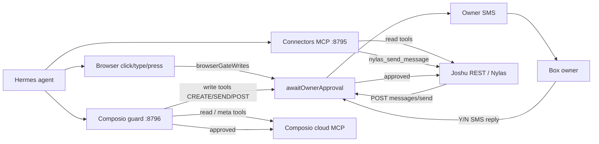

# Deterministic connector apps

> **App developers:** use [`@joshu/platform-data`](platform-data.md) and [`platform-architecture.md`](platform-architecture.md).
> This doc is the **implementation detail** for the mail/calendar platform data plane.

Connector apps sync mail and calendar into **markdown under `joshu's files`**, index via **gbrain**, and expose **human UIs** plus a **thin local MCP** for actions—not for routine mail search.

**Desktop app:** **Connectors** — canonical UI for OAuth (Composio), Gmail account management, and sync health. See [`docs/connectors-arozos-app.md`](connectors-arozos-app.md).

**VPS / multi-box:** Composio OAuth is keyed by **`(COMPOSIO_API_KEY project, COMPOSIO_USER_ID)`**. Fleet boxes get a **per-box Composio project + API key**; provision also sets `COMPOSIO_USER_ID=<customer-slug>`. ArozOS login stays `JOSHU_AROZ_USER` (owner email). Without per-slug `COMPOSIO_USER_ID`, every sandbox sharing the same Composio project and owner email shows the same Gmail connections. A laptop `.env` `COMPOSIO_API_KEY` is often a **different project** than the VPS key — same `COMPOSIO_USER_ID` alone does not mirror prod connections. See [connectors-arozos-app.md — Local laptop vs fleet box](connectors-arozos-app.md#local-laptop-vs-fleet-box-composio).

**App-wide status:** `GET /joshu/api/connectors/status` returns Nylas + per-Gmail account sync/mirror stats and a `registry` object (also written to `.joshu/connectors-registry.json`). jMail, cron, and Hermes MCP use the same API.

## Layout

```text
joshu's files/connectors/
  mail/nylas/threads/{thread_id}.md           # agent inbox (Nylas)
  mail/gmail/{account_key}/threads/{thread_id}.md   # per Gmail account (Composio)
  calendar/nylas/events/{event_id}.md
  calendar/google/events/{event_id}.md
  _state/nylas-sync.json
  _state/gmail-sync.{account_key}.json
```

Registry (metadata only): `.joshu/connectors-registry.json` — which accounts are connected; OAuth tokens stay in Composio.

Filing guide (EA v2): [`templates/ea/FILING.md`](../templates/ea/FILING.md) (seeded as `${JOSHU_FILES_ROOT}/FILING.md`).

## REST API

| Method | Path | Purpose |
|--------|------|---------|
| GET | `/joshu/api/connectors/status` | Registry + providers + per-account sync/mirror |
| POST | `/joshu/api/connectors/mail/nylas/sync` | Mirror agent inbox |
| GET | `/joshu/api/connectors/mail/nylas/search?q=` | App-local search over mirror |
| POST | `/joshu/api/connectors/mail/gmail/sync` | Mirror Gmail (`{ connectedAccountId? }` — omit = all accounts) |
| GET | `/joshu/api/connectors/mail/gmail/search?q=&connectedAccountId=` | Search Gmail mirror |
| GET | `/joshu/api/connectors/mail/gmail/messages/:id?connectedAccountId=` | Mirror + live body |
| POST | `/joshu/api/connectors/mail/gmail/send` | Send (`connectedAccountId` in body) |
| POST | `/joshu/api/connectors/mail/gmail/reply` | Reply in thread |
| POST | `/joshu/api/connectors/mail/gmail/attachments/fetch` | Save one mail attachment to `Projects/<projectSlug>/attachments/` (`{ messageId, filename?, attachmentId?, projectSlug?, connectedAccountId? }`) — see [Mail attachments](#mail-attachments) |
| GET | `/joshu/api/connectors/composio/*` | Composio OAuth (see connectors app) |
| GET | `/joshu/api/connectors/cron/jobs` | Joshu scheduler jobs |
| POST | `/joshu/api/connectors/cron/jobs/:id/run` | Run job now |

**Composio toolkit versions.** The Joshu app has a toolkit pin for each Composio toolkit that the app calls directly. Thus a schema change on the Composio side does not reach the boxes until a Joshu release changes the pin. Each environment variable overrides its toolkit pin on one box, for example to test a new version before the release.

| Toolkit | Pinned version | Override | Pin in |
|---|---|---|---|
| `gmail` | `20260506_01` | `JOSHU_COMPOSIO_GMAIL_TOOLKIT_VERSION` | [`gmailConfig.ts`](../src/connectors/composio/gmailConfig.ts) |
| `onenote` | `20260507_00` | `JOSHU_COMPOSIO_ONENOTE_TOOLKIT_VERSION` | [`onenoteConfig.ts`](../src/connectors/composio/onenoteConfig.ts) |
| `googlecalendar` | `20261009_00` | `JOSHU_COMPOSIO_GOOGLECALENDAR_VERSION` | [`googleCalendarConfig.ts`](../src/connectors/composio/googleCalendarConfig.ts) |
| `slackbot` (share chat, also its triggers) | `20261008_00` | `JOSHU_COMPOSIO_SLACKBOT_TOOLKIT_VERSION` | [`slackbotConfig.ts`](../src/connectors/composio/slackbotConfig.ts) |

Google Calendar `20261009_00` rejects input keys that are not in the schema of the tool ("Extra inputs are not permitted"). Each new toolkit pin is the version that the boxes ran when the pin was added, so the release that added the pin did not change the tools under the boxes. For Google Calendar, version `20261007_00` has the same input keys but accepts unknown keys. We chose the strict version `20261009_00`, because a wrong key then fails at once, and Composio does not drop the key without a sign. The Composio client in [`client.ts`](../src/connectors/composio/client.ts) passes the toolkit pins in `toolkitVersions`, and the Composio SDK sends these versions also when it creates a trigger, so the Slackbot trigger `SLACKBOT_CHANNEL_MESSAGE_RECEIVED` uses the Slackbot toolkit pin. No direct Composio call may send `dangerouslySkipVersionCheck: true`, and `npm run test:composio-toolkit-pins` fails when a file in `src/` does. `GET /api/connectors/status` reports the Google Calendar version in use in field `googleCalendar.toolkitVersion`, so you can see an override on a box. Before you change a toolkit pin, get the schema of each tool that Joshu calls at the new version, `GET https://backend.composio.dev/api/v3.1/tools/<SLUG>?version=<version>` with header `x-api-key: $COMPOSIO_API_KEY`, and check the arguments in the code against `input_parameters`. Tests: `npm run test:composio-toolkit-pins`, `npm run test:composio-calendar-args`. Tools that Hermes calls through the Composio MCP (for example `GOOGLECALENDAR_CREATE_EVENT` and `SLACK_SEND_MESSAGE`) do not use these toolkit pins, and they cannot have a pin: a Composio tool-router session has no toolkit version setting (checked 2026-10-09 in the v3 and v3.1 API and in `@composio/core` 0.10 and 0.22). These calls run the latest version. The model reads the live schema of the tool through the Composio meta tools, so a schema change can break only arguments that a skill writes out. When you write tool arguments in a skill, check them against the live schema.

Gmail sync hydrates full thread bodies via `GMAIL_FETCH_MESSAGE_BY_THREAD_ID` with `include_payload` on list fetch.

**Nylas (agent inbox):** sync uses the Nylas **Threads API** (`threads.list` with `latest_message_after`) for discovery and full `message_ids`, then hydrates bodies via paginated `messages.list` scoped to `thread_id` ([`fetchMessagesInThread`](../src/nylas/client.ts), up to **50** messages per thread). Agent Account grants reject `search_query_native` (including Gmail-style `newer_than:Xd`) with **400**. Mirrors use the same `###` section layout and frontmatter fields as Gmail (`message_ids`, `thread_messages`, `message_count`).

**Message bodies:** Gmail has no “plaintext only” API — Composio returns MIME (`text/plain` + `text/html`) or sometimes HTML in a top-level `body` field. Joshu prefers MIME `text/plain`, then runs deterministic HTML simplification ([`src/connectors/emailPlaintext.ts`](../src/connectors/emailPlaintext.ts), used by [`gmailBodies.ts`](../src/connectors/composio/gmailBodies.ts)). Nylas HTML bodies use the same simplifier via `stripHtmlToText` in [`mirror.ts`](../src/connectors/mirror.ts). Per-message caps at mirror write: Gmail **8k** chars, Nylas **4k** chars.

### Mail attachments

The Gmail mail mirror records the attachment metadata of each message. Front matter: `thread_messages[].attachments` with `filename`, `content_type`, `size` (bytes), `message_id`, and `attachment_id`. Body: an `**Attachments:**` list under the text of the message, one line for each mail attachment. Inline images (signature logos) are not recorded. A mail mirror gets the list when the Gmail sync writes the mail mirror again, so threads without a new message since the release have no list. Code: [`gmailAttachments.ts`](../src/connectors/composio/gmailAttachments.ts).

The files are not mirrored. A worker fetches one file on demand with the connectors MCP tool `gmail_fetch_attachment`. The tool reads the message live (`GMAIL_FETCH_MESSAGE_BY_MESSAGE_ID`), so the tool also works for an old mail mirror. The tool downloads the file with `GMAIL_GET_ATTACHMENT` and saves the file to `<files>/Projects/<projectSlug>/attachments/` (`Projects/other/` without a project slug). The response has `path` (relative to `JOSHU_FILES_ROOT`) and `desktopPath` (for `nylas_send_message` `attachments`). A second fetch of the same bytes keeps one file; a different file with the same name gets `-2`, `-3`, … Size limit: **`JOSHU_GMAIL_MAX_ATTACHMENT_BYTES`** (default 25 MiB). Without `filename` or `attachmentId`, the tool lists the mail attachments of the message and saves nothing (a message with one mail attachment saves that one). Test: `npm run test:gmail-attachments`. Mail attachments of the agent Nylas mailbox are not supported yet.

**LLM previews** ([`src/connectors/mirrorBodyPreview.ts`](../src/connectors/mirrorBodyPreview.ts)):

| Use | Helper | Behavior |
|-----|--------|----------|
| Day 0 / scheduling context | `buildThreadBodyPreview` / `readMirrorBodyPreview` | Latest `###` section, with optional **tail of the prior** section so short replies retain thread context |
| **EA mail disposition** (noise / info / track) | `buildClassifierBodyPreview` / `readClassifierBodyPreview` | Latest section **only**, with **reply quotes stripped** (`On … wrote:`, Original Message, trailing `>` lines) via [`emailReplyQuotes.ts`](../src/connectors/emailReplyQuotes.ts) |

Substantive owner mail on the agent Nylas inbox is forced to `track` / `owner_note` — never silently archived as `info` or left as `owner_sent_update` (includes thread replies with DONE/KEEP status). Pure one-line acks may stay `info`. **Exception:** owner mail with external recipients (a reply-all to a counterparty with the companion CC'd) is not an owner→agent note — it goes to the classifier (owner bias still blocks `info`), and a scheduling hand-off by companion name ("Clara can help schedule", "Copying Clara to find a time") is classified `scheduling` deterministically so `scheduling_create_meeting_task` is eligible. Delegation phrases match the profile `assistantName` and the agent mailbox local part ([`agentAuthorization.ts`](../src/ea/agentAuthorization.ts)). See [`ownerAgentInboxMail.ts`](../src/ea/ownerAgentInboxMail.ts) and [`biasOwnerAgentInboxClassification`](../src/ea/classifier.ts). Test: `npm run test:mail-classifier-routing`.

Test (plaintext): `npx tsx scripts/test-email-plaintext.mjs`.

## gbrain indexing and mail search

Connector mirrors are indexed by **gbrain** as page type **`connector-mail`** (path prefix `connectors/mail/`). This is **not** a separate mail search engine — recall uses the same hybrid **`query`** as journals and workspace files.

### How pages are classified

| On-disk path | gbrain type | Notes |
|--------------|-------------|--------|
| `connectors/mail/gmail/…/threads/*.md` | `connector-mail` | Principal Gmail (Composio), per-account subfolder |
| `connectors/mail/nylas/threads/*.md` | `connector-mail` | Agent inbox (Nylas) |
| `connectors/calendar/…/*.md` | `connector-calendar` | Synced events |
| `inbox/*.md` | `inbox` | Human quick capture — **not** synced mail |

Classification is **path-based** (`setup-gbrain-schema.sh`); YAML frontmatter does not need `type: connector-mail`.

### Indexed slugs and searchable content

After Desktop git sync, federated slugs look like:

```text
joshus-files/connectors/mail/gmail/{account_key}/threads/<thread_id>
joshus-files/connectors/mail/nylas/threads/<thread_id>
```

Each file is **one thread**. Search hits include **from**, **subject**, and **plain-text bodies** (per-message `###` sections). Use **`mcp_gbrain_query`** with `source_id: "__all__"`, `recency: "on"`, `since: "90d"`, and mail keywords — see skill [`joshu-mail`](../integrations/hermes/skills/mail/joshu-mail/SKILL.md).

**Two-tier mail search:** (1) **Local cache** — gbrain + mirror markdown on the box (fast). (2) **Deep server-side search** — Composio live Gmail against Google when the cache misses (pre-connect history never mirrored, stale mirrors, or exact subject absent from disk). Composio responses may offload to `/mnt/files/…` in a **remote sandbox** — use `COMPOSIO_REMOTE_WORKBENCH` / `COMPOSIO_REMOTE_BASH`, not local `grep`. The workbench runs on the read-only Composio session of the box, so its code can read but not send or write; see [`agent-safety.md`](agent-safety.md#architecture). Multiple Gmail accounts: scope via `connectedAccountId` from `connectors_status`; `GMAIL_FETCH_EMAILS` uses `user_id: "me"`.

Inspect type: `GET /joshu/api/brain/pages?type=connector-mail`.

Full gbrain doc: [`docs/file-brain.md`](file-brain.md#connector-mail-and-calendar-gbrain).

### Indexing pipeline (automatic)

Mirrors become searchable after **git commit + `sync_brain`** on the Desktop tree (automatic via the gbrain MCP HTTP bridge — no manual git steps). Full trigger table, debounce, and periodic reindex: [`file-brain.md` — Indexing cadence](file-brain.md#indexing-cadence-summary).

Connector cron (`JOSHU_CONNECTORS_CRON=true`, default): Nylas and Gmail **every 10m** (all connected Gmail accounts). Both use **`syncMode: incremental`** on the cron path (Gmail `historyId` + mirror skip; Nylas `latest_message_after` ≈ last 1 day + skip). Jobs: `.joshu/connectors-cron.json`; implementation: [`src/connectors/scheduler.ts`](../src/connectors/scheduler.ts).

**Gmail OAuth connect** (`POST …/composio/post-connect`) only **seeds** the Gmail `historyId` cursor — it does **not** backfill inbox mail. Historical sync (30 days mail + calendar) runs only via **Day 0** (`day0-cold-start.md`). Manual `POST …/mail/gmail/sync` without `days` is incremental (new mail since connect); pass `"days": 30` for an explicit backfill window.

## Hard factory reset

Connector state spans **local files** and **Composio cloud**:

| What | Where | Hard reset |
|------|-------|------------|
| Mail/calendar mirror markdown | `joshu's files/connectors/` | Deleted (Desktop wipe) |
| Sync cursors | `connectors/_state/*.json` | Deleted |
| Registry snapshot | `.joshu/connectors-registry.json` | Deleted |
| OAuth tokens | Composio cloud (`user_id` = sandbox ArozOS user) | **Disconnected** via Composio API before local wipe |

If only local files are removed (e.g. manual `rm -rf` on Desktop) while Composio accounts stay connected, the **Gmail cron job re-syncs mirrors within ~10 minutes**. Hard factory reset avoids this by running Composio disconnect first.

After hard reset: Connectors shows no connected Gmail accounts; mail mirrors and gbrain `connector-mail` pages stay empty until you connect and sync again. Full procedure: [`docs/box-state.md`](box-state.md#hard-factory-reset).

Manual disconnect without full reset: `npx tsx scripts/box-wipe-connectors.ts` (requires `COMPOSIO_API_KEY` in env).

## Hermes

- **Recall** (find/search mail): load skill **`joshu-mail`** — **local cache** (`mcp_gbrain_query` over indexed `connectors/` mirrors, optional `connectors_sync_now`, disk grep) then **deep server-side** Composio Gmail when cache misses. Not Composio list/search as the first hop.
- **Facts from an email:** the postal address in the sender footer of a newsletter ("This email was sent by …") is the address of the sending service, not of the business. When the email does not give a detail that the owner asked for, the worker says so and searches the web. See skill `joshu-mail`, section "Facts from an email".
- **Refresh mirrors:** **`mcp_joshu_connectors_connectors_sync_now`** (`provider: gmail` / `nylas` / `all`), then query again.
- **Actions** (send, live get by id): toolset **`mcp-joshu-connectors`** → `http://127.0.0.1:8795/mcp` (`mcp_servers.joshu_connectors` in `~/.hermes/config.yaml`).
- **Composio MCP**: available when OAuth is connected; mail recall is skill-driven via **`joshu-mail`**; Composio is primary for Slack/GitHub/etc.
- **fal.ai MCP** (`mcp-fal`): image/video/audio/3D via hosted MCP. **Fleet (paid):** prepaid usage wallet on CP; box local relay `:8797` → CP → `mcp.fal.ai` (no `FAL_KEY` on box). **OSS:** paste `FAL_KEY` in Connectors → **AI providers**. Full design: [`metered-providers.md`](metered-providers.md) · CP [metered-providers.md](https://github.com/db-aeon/joshu-control-plane/blob/main/docs/metered-providers.md).

### Connectors MCP HTTP (`:8795`)

Thin MCP server: [`scripts/joshu-connectors-mcp-http-server.mjs`](../scripts/joshu-connectors-mcp-http-server.mjs). Started by [`scripts/start-joshu-connectors-mcp.sh`](../scripts/start-joshu-connectors-mcp.sh). **Not** used for mail search — use gbrain `query`.

| Hermes tool name (model / Langfuse) | MCP wire name | REST |
|-------------------------------------|---------------|------|
| `mcp_joshu_connectors_connectors_sync_now` | `connectors_sync_now` | `POST …/connectors/mail/{nylas\|gmail}/sync` |
| `mcp_joshu_connectors_connectors_status` | `connectors_status` | `GET …/connectors/status` |
| `mcp_joshu_connectors_nylas_send_message` | `nylas_send_message` | `POST …/nylas/messages/send` — replies need matching parent `subject` or **`400` `reply_subject_mismatch`**; optional **`attachments`** (Desktop paths — [nylas-agent-mailbox.md — Outbound attachments](nylas-agent-mailbox.md#outbound-attachments)) |
| `mcp_joshu_connectors_nylas_get_message` | `nylas_get_message` | `GET …/nylas/messages/:id` |
| `mcp_joshu_connectors_gmail_fetch_attachment` | `gmail_fetch_attachment` | `POST …/connectors/mail/gmail/attachments/fetch` — save one owner Gmail mail attachment to `Projects/<slug>/attachments/` ([Mail attachments](#mail-attachments)) |
| `mcp_joshu_connectors_nylas_get_profile` | `nylas_get_profile` | `GET …/nylas/profile` |
| `mcp_joshu_connectors_nylas_update_profile` | `nylas_update_profile` | `POST …/nylas/profile` |
| `mcp_joshu_connectors_google_calendar_find_free_slots` | `google_calendar_find_free_slots` | `GET …/connectors/calendar/google/free-slots` — **live FreeBusy** (`GOOGLECALENDAR_FIND_FREE_SLOTS`) of **all calendar accounts** when `connectedAccountId` is omitted. Omit `items` for the default calendars of each calendar account; response includes **`calendars.combined`** (union busy — use `combined.free` for scheduling), `accounts[]`, and `incomplete` |
| `mcp_joshu_connectors_google_calendar_list_events` | `google_calendar_list_events` | `GET …/connectors/calendar/google/events` — event titles + `blocksAvailability` / transparency (not busy/free). Merges all calendar accounts when `connectedAccountId` is omitted; each event has `calendarId` + `accountKey` |
| `mcp_joshu_connectors_google_calendar_create_event` | `google_calendar_create_event` | `POST …/connectors/calendar/google/events` — create an owner calendar event with the calendar account that can write the target calendar ([Owner calendar writes](#owner-calendar-writes)) |
| `mcp_joshu_connectors_google_calendar_update_event` | `google_calendar_update_event` | `PATCH …/connectors/calendar/google/events/:eventId` — change the given fields of an owner calendar event, add a Google Meet link, or set busy or free |
| `mcp_joshu_connectors_google_calendar_get_event` | `google_calendar_get_event` | `GET …/connectors/calendar/google/events/:eventId?calendarId=` — one owner calendar event with guests, organizer, location, and Meet link ([Read one event](#read-one-event)) |
| `mcp_joshu_connectors_scheduling_list_meeting_tasks` | `scheduling_list_meeting_tasks` | `GET …/ea/scheduling/meetings` — includes `block_reason` + `recent_comments` per task |
| `mcp_joshu_connectors_coordination_scope_resolve` | `coordination_scope_resolve` | `GET …/api/coordination/scope?channel=mail&threadId=…` — RFC/thread alias union; preflight before spawn |
| `mcp_joshu_connectors_coordination_list_active` | `coordination_list_active` | Same endpoint; returns `active` tasks on scope (`meeting_negotiation`, `owner_deliverable`) |
| `mcp_joshu_connectors_scheduling_create_meeting_task` | `scheduling_create_meeting_task` | `POST …/ea/scheduling/meetings` — returns `action: existing_coordination` on cross-board mutex |
| `mcp_joshu_connectors_scheduling_handoff_meeting_task` | `scheduling_handoff_meeting_task` | `POST …/ea/scheduling/meetings/:taskId/handoff` |
| `mcp_joshu_connectors_owner_reply_list_tasks` | `owner_reply_list_tasks` | `GET …/ea/owner-reply/tasks` |
| `mcp_joshu_connectors_owner_reply_create_task` | `owner_reply_create_task` | `POST …/ea/owner-reply/tasks` — returns `action: existing_coordination` when scheduling owns scope |
| `mcp_joshu_connectors_owner_reply_handoff_task` | `owner_reply_handoff_task` | `POST …/ea/owner-reply/tasks/:taskId/handoff` |
| `mcp_joshu_connectors_mail_list_track_tasks` | `mail_list_track_tasks` | `GET …/ea/mail/tracks?projectSlug=&threadId=&taskId=` — without `threadId`/`taskId`: compact list of open tracks (no bodies); `threadId`: the open track of the thread with its body, else `done_match`; `taskId`: one track with its body |
| `mcp_joshu_connectors_mail_create_track_task` | `mail_create_track_task` | `POST …/ea/mail/tracks` |
| `mcp_joshu_connectors_mail_handoff_track_task` | `mail_handoff_track_task` | `POST …/ea/mail/tracks/:taskId/handoff` — unblocks a blocked track, reopens a done track (`evaluation_queued: true`) |
| `mcp_joshu_connectors_scheduling_comment_meeting_task` | `scheduling_comment_meeting_task` | `POST …/ea/scheduling/meetings/:taskId/comment` |
| `mcp_joshu_connectors_nylas_list_events` | `nylas_list_events` | `GET …/nylas/events` — agent **ledger** only; not owner availability |
| `mcp_joshu_connectors_nylas_get_event` | `nylas_get_event` | `GET …/nylas/events/:id` |
| `mcp_joshu_connectors_nylas_create_event` | `nylas_create_event` | `POST …/nylas/events` — **`date`, `startLocal`, `endLocal`, `timezone`** or epochs |
| `mcp_joshu_connectors_nylas_update_event` | `nylas_update_event` | `PATCH …/nylas/events/:id` |
| `mcp_joshu_connectors_nylas_delete_event` | `nylas_delete_event` | `DELETE …/nylas/events/:id` |
| `mcp_joshu_connectors_archive_scheduling_stubs` | `archive_scheduling_stubs` | `POST …/ea/triage/archive-stubs` |
| `mcp_joshu_connectors_reconcile_triage_stubs` | `reconcile_triage_stubs` | `POST …/ea/triage/reconcile-stubs` |
| `mcp_joshu_connectors_project_kanban_ensure_board` | `project_kanban_ensure_board` | `POST …/ea/project-kanban/boards` |
| `mcp_joshu_connectors_project_kanban_create_triage_root` | `project_kanban_create_triage_root` | `POST …/ea/project-kanban/triage-root` |

**EA scheduling (v4.19+):** Universal mail ingress → file project, then **`scheduling_*`** child on `ea-scheduling`. **Owner→agent asks:** **`owner_reply_*`** child on `ea-owner-reply` (ready; worker sends). **Coordination scope (2026-09):** one owner-facing ask mutexes cross-board spawns — preflight with **`coordination_list_active`** before `scheduling_create_meeting_task` / `owner_reply_create_task`; API returns `existing_coordination` when another worker owns the scope. Ingest classifies a **quote-stripped** latest message; owner→Nylas `info` with a real ask is forced to `track` ([`ea-for-joshu.md`](hermes-integration.md#phase-1--deterministic-ingest-joshu-app)). Owner availability → **`google_calendar_find_free_slots`** (default: all calendar accounts; **`calendars.combined.free`**; respects transparent events). Book with **`google_calendar_create_event`**; move with **`google_calendar_update_event`**. Cross-board → **`scheduling_*`** / **`mail_*`** / **`owner_reply_*`** / **`coordination_*`** MCP (not Hermes `kanban_create`). Skills: [`ea-scheduling`](../integrations/hermes/skills/executive-assistant/ea-scheduling/SKILL.md), [`ea-owner-reply`](../integrations/hermes/skills/executive-assistant/ea-owner-reply/SKILL.md), [`ea-playbook`](../integrations/hermes/skills/executive-assistant/ea-playbook/SKILL.md). Tests: `npm run test:coordination-scope`, `npm run test:owner-reply`.

#### `GET /api/connectors/calendar/google/free-slots`

| Query | Notes |
|-------|-------|
| `date` + `timezone` | One local day (preferred) |
| `timeMin` + `timeMax` | ISO window (alternative) |
| `items` | Optional comma-separated calendar ids. Joshu asks each calendar account for these calendar ids, and uses the busy time of each calendar account that can read the calendar. **Omit** for the default calendars of each calendar account: `primary` + `personalEmail` + selected Gmail calendars of that account |
| `connectedAccountId` | Optional. Query only this calendar account (the response shape before 2026-10: `accountKey` + `email`, no `accounts[]`) |
| `minDurationMinutes` | Filter `free[]` intervals (default 30) |

Without `connectedAccountId`, Joshu queries every enabled calendar account (spec `owner-calendar`). An owner can connect more than one Google account for calendars (for example personal Gmail and a work account). The response includes per-calendar `busy`/`free` (the key `primary` of each calendar account is renamed to the email of that account), **`calendars.combined`** (union of busy across all calendars of all calendar accounts), **`accounts[]`** (`connectedAccountId`, `accountKey`, `email`, `ok`, `error`), and **`incomplete`**. `incomplete: true` means a calendar account failed and its busy time is missing. When all calendar accounts fail, the status is 502. **Use `combined.free` for scheduling slot picks.** Transparent Google events (Show as free) are absent from `busy[]`.

```bash
curl -fsS "http://127.0.0.1:8788/joshu/api/connectors/calendar/google/free-slots?date=2026-06-25&timezone=America/Los_Angeles&minDurationMinutes=15" \
  | jq '{accounts, incomplete, combined: .calendars.combined}'
```

`GET /api/connectors/calendar/google/events` follows the same rule: without `connectedAccountId`, Joshu merges the events of all enabled calendar accounts in start-time order. Each event has `connectedAccountId` and `accountKey`. When two calendar accounts read the same event (same `calendarId` and `id`), the list keeps one copy: the copy from the calendar account with the highest access role (`owner`, `writer`, `reader`, `freeBusyReader`), which usually has the real title.

#### Owner calendar writes

The Composio Tool Router (`COMPOSIO_MULTI_EXECUTE_TOOL`) cannot choose a calendar account: it ignores `connected_account_id` and writes with the newest connection. The companion books through Joshu instead.

| Endpoint | Body | Composio tool |
|----------|------|---------------|
| `POST /api/connectors/calendar/google/events` | `calendarId`, `summary`, `start`, `end` (local `YYYY-MM-DDTHH:MM:SS`, or RFC3339 with an offset), `timezone`; optional `endTimezone`, `attendees`, `description`, `location`, `sendUpdates` (`all` / `externalOnly` / `none`), `createMeetingRoom` (default: see [Meet links](#meet-links)), `transparency`, `connectedAccountId` | `GOOGLECALENDAR_CREATE_EVENT` |
| `PATCH /api/connectors/calendar/google/events/:eventId` | `calendarId`; optional `start`, `end`, `timezone`, `endTimezone` (needs `end`), `summary`, `attendees` (replaces the guest list), `description`, `location`, `sendUpdates`, `createMeetingRoom` (true adds Meet), `transparency` (`opaque` busy, `transparent` free), `connectedAccountId` | `GOOGLECALENDAR_PATCH_EVENT` (only the given fields change) |

`timezone` is the IANA time zone of `start`, and of `end` when the caller gives no `endTimezone`. `endTimezone` is the IANA time zone of `end` for an event that ends in another time zone, for example a flight that lands in another time zone. The companion gives the departure airport as `timezone` and the arrival airport as `endTimezone`, because airline times are local times.

The Composio tools have one `timezone` for both ends, and Composio toolkit versions `20261009_00` and later reject unknown fields, so Joshu cannot send Google a separate end time zone. Composio keeps an explicit offset in a start or end time. So when the caller gives `endTimezone` and a local `end`, Joshu turns `end` into an RFC3339 time with the offset of `endTimezone` on that date (for example `2026-10-20T16:50:00-05:00`, with the daylight saving rules of the zone), and Google stores the correct instant. Joshu does the conversion because the companion would otherwise have to know the daylight saving rules of each zone, and a wrong offset gives a wrong instant. A direct call to the Google Calendar API was not an option, because the write must go through `composioToolsExecute` for the MCP tool policy and the action guard. The limit is that Google labels both ends with `timezone`, so the event details show the arrival converted to the departure time zone. The instants and the calendar grid are correct. Joshu answers 400 when `endTimezone` is not an IANA time zone, when `endTimezone` comes without `end`, or when a local `end` is not `YYYY-MM-DDTHH:MM:SS`.

Joshu chooses the calendar account for the target calendar (`calendarId`): an enabled calendar account with access role `owner` or `writer` on it. When several qualify, `owner` wins over `writer`, then the calendar account whose email is the target calendar, then the default calendar account. `connectedAccountId` forces one calendar account. `calendarId: primary` without `connectedAccountId` works only with one calendar account.

| Status | Meaning |
|--------|---------|
| 200 `ok: true` | Event written; response has `accountKey`, `connectedAccountId`, `email`, `calendarId`, `event` (`id`, `htmlLink`, `start`, `end`, `meetLink`) |
| 200 `ok: false, denied: true` | The owner denied the action guard approval, or it timed out. No event. The companion must not retry |
| 400 | Missing field, wrong `endTimezone`, unknown `connectedAccountId`, or `primary` with more than one calendar account |
| 409 | No calendar account can write the target calendar; `writableCalendars` (and `hint`) list the calendars each calendar account can write |
| 502 | Composio or Google error |

##### Meet links

A remote meeting needs a video link, and the companion forgot to ask for one when the default was off. Now, when the caller gives no `createMeetingRoom`, Joshu adds Google Meet to an event that has at least one guest and no `location` (`wantsMeetingRoom` in `calendarOwner.ts`). A street address or another meeting link (Zoom, Teams) goes in `location`, which turns the default off. An event without guests is a hold or a focus block and needs no link. The value that the caller gives always wins. We did not choose Meet on every event (the Composio default), because holds and in-person meetings would get links that nobody uses. We did not look for a URL in the description, because descriptions often have links that are not meeting links.

An update with `createMeetingRoom: true` adds Meet with `GOOGLECALENDAR_PATCH_EVENT`: `conference_data.createRequest` (a new random `requestId`, `conferenceSolutionKey.type` `hangoutsMeet`) and `conference_data_version: 1`. Google makes the link from the create request. Joshu first reads the event, and sends no create request when the event already has a meeting link, so guests keep the link that they have. We did not use `GOOGLECALENDAR_UPDATE_EVENT` with `create_meeting_room`, because that tool replaces the whole event and clears the guests, reminders, and recurrence that the caller does not send.

##### Read one event

`GET /api/connectors/calendar/google/events/:eventId?calendarId=` (optional `timezone`, `connectedAccountId`) runs `GOOGLECALENDAR_EVENTS_GET` with a calendar account that can read the target calendar: access role `owner`, `writer`, or `reader`. A calendar account with `freeBusyReader` sees only busy time, not the event. Joshu chooses among several calendar accounts as for a write (`chooseCalendarAccount` with access `read`). The response has `event` with `attendees` (`email`, `displayName`, `responseStatus`, `organizer`, `optional`, `self`), `organizer`, `location`, `meetLink` (from `hangoutLink` or the video entry point of `conferenceData`), `status`, and `transparency`. Status 404 means Google did not find the event on that calendar; status 409 means no calendar account can read the calendar, with the readable calendars in `writableCalendars`. The read does not ask the owner. The Composio Tool Router cannot do this read: it uses the newest connection, which answers "event not found" for an event on another calendar account.

The writes run through `composioToolsExecute`, so the MCP tool policy and the action guard apply as on the Composio guard proxy. Code: `src/connectors/composio/calendarOwner.ts`. Test: `npm run test:owner-calendar`.

**EA project Kanban (2026-06):** User-initiated multi-step / HITL work on boards `project-<slug>` — **not** the `scheduling_*` MCP tools above.

| Context | Preferred tools |
|---------|-----------------|
| **jChat kickoff** (ensure board + triage root) | **`project_kanban_ensure_board`**, **`project_kanban_create_triage_root`** (connectors MCP → Joshu bridge) |
| **jChat / voice** (list, complete, block cards) | Native Hermes **`kanban_*`** (`platform_toolsets.api_server` includes `kanban`) |
| **Workers / dispatcher** (list, block, complete cards) | Native Hermes **`kanban_*`** when in the worker toolset |
| **Fallback** (only if MCP missing) | `hermes kanban …` CLI — avoid in jChat when connectors tools are registered |

Outbound steps still go through **`nylas_send_message`** (action guard). Skill: [`ea-project-kanban`](../integrations/hermes/skills/executive-assistant/ea-project-kanban/SKILL.md). Product spec: [`ea-for-joshu.md`](hermes-integration.md#project-kanban-multi-step--hitl-2026-06).

**Tool naming:** Hermes exposes **prefixed** names to the model (`mcp_<server>_<tool>`). On a healthy path it routes to MCP with the **short** name (`nylas_send_message`). Langfuse metadata often shows the prefixed name even when the wire call succeeded. The MCP server also accepts prefixed names (strips `mcp_joshu_connectors_`) for clients that forward the display name verbatim.

**EA summary sends** (morning brief / end of day) use `nylas_send_message` → agent Nylas mailbox only. The Joshu API converts `body` to HTML (linkified URLs, light markdown) and appends the companion signature automatically. See [`ea-for-joshu.md`](hermes-integration.md#summary-email).

### Troubleshooting `Unknown tool: mcp_joshu_connectors_*`

Symptom in Langfuse / Hermes traces: `{ "error": "Unknown tool: mcp_joshu_connectors_nylas_send_message" }` (or similar) while **inputs** (`to`, `subject`, `body`) look valid.

**Do not assume bad email args.** The failure is tool dispatch, not Nylas validation.

| Pattern | Likely cause |
|---------|----------------|
| **Intermittent** — same tool worked earlier that day (e.g. morning brief OK, EOD send failed) | Connectors MCP on `:8795` **down or unreachable** for that Hermes session (process exit, stale PID, boot race). Primary hypothesis for “worked once, failed later.” |
| **Always fails** for prefixed names | Client forwarded Hermes display name to MCP without stripping prefix (MCP server now normalizes; image **0.1.13+** or host bind-mount of `joshu-connectors-mcp-http-server.mjs`). |
| **Always fails** even when `curl :8795/health` is OK | Hermes missing `mcp-joshu-connectors` toolset or `mcp_servers.joshu_connectors` in config — run gateway sync / check `~/.hermes/config.yaml`. |

**Diagnose (inside `joshu-stack` container or local dev):**

```bash
curl -fsS http://127.0.0.1:8795/health
cat /root/.joshu/connectors-mcp.pid    # or ~/.joshu locally
tail -50 /root/.joshu/connectors-mcp.log
grep -A4 'joshu_connectors:' /root/.hermes/config.yaml
grep toolsets /root/.hermes/config.yaml   # expect mcp-joshu-connectors
```

**Bypass MCP** (confirm Nylas + Joshu API only):

```bash
curl -s -X POST http://127.0.0.1:8788/joshu/api/nylas/messages/send \
  -H 'Content-Type: application/json' \
  -d '{"to":"…","subject":"smoke","body":"test"}'
```

### Multiplayer tools on the connectors MCP

The same process serves the Multiplayer chat tools (`team_list`, `team_create`, `team_invite`, `team_join`, `team_leave`, `team_remove_member`, `team_set_charter`) on `/mcp`, and one team MCP for each team at `/team/<slug>/mcp` (Hermes server `joshu_team_<slug>`: `team_read`, `team_blockers`, `team_post`, `team_card`, `team_commit`, `team_tell_owner`). See [`teams.md`](teams.md#the-team-mcp).

### Partial MCP catalog (jChat / Telegram)

Hermes registers MCP `tools/list` **once at gateway boot**. If `:8795` / `:8796` are not healthy when the gateway first starts, the gateway keeps a **partial catalog** (often only `nylas_send_message`) until restart — agents may fall back to shell/`curl`/`execute_code`.

**Why boot order matters:** Connectors MCP (`:8795`) calls back to Joshu `:8788`, so Joshu must listen first. That creates a race: Joshu used to warm the Hermes gateway on listen **before** `vps-start.sh` finished starting connectors.

**Mitigation (2026-06):**

| Layer | Behavior |
| ----- | -------- |
| **`vps-start.sh`** | Sets `JOSHU_DEFER_HERMES_GATEWAY_WARM=true`; starts Joshu → connectors MCP → composio guard → `wait_for_mcp_http_health` → nudges `GET …/hermes-chat/status?after_mcp_boot=1` |
| **`src/server.ts`** | When defer env is set, skips gateway warm on listen; starts MCP recovery watchdog only |
| **`src/hermesApi.ts`** | `prepareGatewayAfterMcpBoot()` waits for MCP HTTP health, then starts/restarts gateway; 30s watchdog reloads gateway when connectors recovers |
| **`src/mcpSupervisor.ts`** | Joshu process supervises gbrain/connectors/composio MCP every 30s — restarts dead processes; nudges gateway on recovery (`JOSHU_MCP_SUPERVISOR=false` to disable) |
| **`src/mcpDependencyHealth.ts`** | Shared probes for gbrain `:8794`, connectors `:8795`, composio guard `:8796` |
| **`scripts/joshu-connectors-mcp-http-server.mjs`** | `/health` probes Joshu `GET …/api/instance/version` — reports **503** when Joshu API is down (prevents false-healthy MCP while tools would 404) |
| **`src/instanceHealth.ts`** | `components.connectorsMcp` — box `healthy: false` when `:8795` is down (unless `JOSHU_CONNECTORS_MCP_OPTIONAL=true`) |
| **`scripts/lib/hermes-gateway.sh`** | `nudge_joshu_hermes_gateway` uses `after_mcp_boot=1`; retries up to 3× |

**Local dev (`dev:arozos`):** Connectors MCP starts **before** Joshu in `start_gbrain_if_needed()` — `/health` returns **503** until Joshu listens; gateway watchdog + **`src/mcpSupervisor.ts`** reload when ready.

### Joshu connectors API base (local dev)

Connectors MCP proxies tool calls to Joshu REST via **`JOSHU_CONNECTORS_API_BASE`**. Default: `http://127.0.0.1:8788/joshu` (Joshu private port).

| Misconfiguration | Symptom |
|------------------|---------|
| `JOSHU_CONNECTORS_API_BASE=http://127.0.0.1:8787/joshu` in `~/.hermes/.env` | ArozOS `:8787` returns HTML 404 for `/joshu/api/*`; `:8795/health` may still look alive while every tool fails |
| Joshu not listening on `:8788` | `/health` **503**; supervisor restarts MCP when Joshu recovers |

[`scripts/start-joshu-connectors-mcp.sh`](../scripts/start-joshu-connectors-mcp.sh) warns and rewrites when the base URL contains `:8787`. After fixing, restart connectors MCP and nudge gateway (`GET …/hermes-chat/status?after_mcp_boot=1`).

**Manual fix on a running box:**

```bash
bash scripts/start-joshu-connectors-mcp.sh
curl -fsS http://127.0.0.1:8795/health
curl -fsS --max-time 120 'http://127.0.0.1:8788/joshu/api/hermes-chat/status?after_mcp_boot=1'
```

If tools are still missing, restart the stack or gateway. Open a **new** jChat session or Telegram turn after fix. Nudge `GET /joshu/api/hermes-chat/status?after_mcp_boot=1` and confirm `:8795/health` before starting chat.

## MCP tool policy (hard agent blocks)

> **Canonical doc:** [`agent-safety.md`](agent-safety.md) — tiers, bypass matrix, Safety app, and full configuration reference.

Deterministic routing enforced in **both MCP proxies** and Joshu REST (closes `execute_code` / `curl` bypass). Default **on** (`JOSHU_MCP_TOOL_POLICY_ENABLED` unset = true). Policy source: [`src/mcpToolPolicy.ts`](../src/mcpToolPolicy.ts); proxies load `GET /joshu/api/mcp-tool-policy`.

| Rule | Blocked | Allowed instead |
|------|---------|-----------------|
| Outbound mail | Composio `GMAIL_SEND_*`, `GMAIL_REPLY_*`, and Gmail send heuristics | `mcp_joshu_connectors_nylas_send_message` |
| Calendar create | Connectors `nylas_create_event` (+ update/delete on Nylas calendar) | Connectors `google_calendar_create_event` / `google_calendar_update_event` (owner Google calendar, right calendar account) |
| Deletes | Any Composio tool matching `DELETE` / `TRASH` | — (agents cannot delete via MCP) |

Blocked tools are **removed from `listTools`** and return an explicit error on `callTool`. Owner **jMail** Gmail send/reply still works (`X-Joshu-Mail-Client: jmail` + browser `Sec-Fetch-Site`).

Disable for debugging only: `JOSHU_MCP_TOOL_POLICY_ENABLED=false` (restart connectors + Composio guard MCP after change).

## Owner 1:1 channel

> **Canonical doc:** [`agent-safety.md` — Owner approval (SMS)](agent-safety.md#owner-approval-sms). Status in the **Safety** desktop app.

Action-guard approvals use **owner SMS only** (Telephone owner mobile or `TWILIO_OWNER_CALLER`). Linking is on-box — there is no Telegram/Slack approval path. Optional `.joshu/owner-channel/owner-channel.json` stores a `gateMode` override only.

API: `GET /joshu/api/connectors/owner-channel/status`, `POST /joshu/api/owner-channel/await` (MCP proxy), `POST /joshu/api/owner-channel/test`.

Gate stays **Joshu-owned** (`mcpToolPolicy`, MCP proxy, REST gates, browser gate). Owner SMS is notification + short Y/N ingress only (conversational “Ok …” is chat — see [`agent-safety.md`](agent-safety.md#owner-approval-sms)).

## Action guard (owner approval for writes)

> **Canonical doc:** [`agent-safety.md` — Action guard](agent-safety.md#tier-2--action-guard-hitl). Configure via **Safety** app, env, or `.joshu/action-guard/policy.json`.

Deterministic safeguard: before **agent write** actions that affect third parties, Joshu texts the box owner (Telephone mobile / `TWILIO_OWNER_CALLER`) with a Y/N prompt. The agent does not see the gate — deny returns a silent success-shaped response without executing the action.

**Default mode (`gateMode: external_writes`):** gates Composio tools matching write heuristics (`_SEND_`, `_CREATE_`, `_UPDATE_`, `_PATCH_`, `_POST_`, `_REPLY_`), agent Nylas sends, and (when enabled) browser click/type/press. Read/meta tools pass through.

**Scope:** Nylas agent sends are gated on **`POST …/api/nylas/messages/send`** (REST), so Hermes MCP, `execute_code`, and `curl` all hit the same approval flow. Composio writes are gated on the **`:8796` guard proxy**. **jMail** (owner desktop compose) bypasses when the browser sends `X-Joshu-Mail-Client: jmail` with `Sec-Fetch-Site: same-origin`. Mail to owner `primaryWorkEmail` only bypasses when `bypassOwnerOnlyRecipients` is true (default).

**Owner visibility on external mail:** Joshu auto-CCs the owner's primary work email on external sends (API-enforced). Mail ingress includes `owner_on_thread`; action-guard SMS warns with a counterparty context snippet when the owner was not on prior thread messages. See [`agent-safety.md` — Owner visibility](agent-safety.md#owner-visibility-on-external-mail).

**Known bypass (fixed 2026-06-23):** Hermes `terminal` with **`nylas email send`** hit the Nylas CLI directly — bypassing Joshu auth + action guard. Patched via `scripts/patch-hermes-terminal-mail-guard.mjs` (hard block; use `nylas_send_message` MCP). **`execute_code` / `curl`** to arbitrary external URLs may still bypass if not matching blocked patterns.

### Architecture



| Layer | Port | Role |
|-------|------|------|
| Connectors MCP | `:8795` | Thin proxy; `nylas_send_message` → REST (gate on API) |
| Composio MCP guard | `:8796` | Pass-through proxy; Hermes never talks to Composio cloud directly, also when the action guard is off |
| Joshu API | `:8788` | **`POST …/nylas/messages/send`** runs action guard; **`POST …/action-guard/browser`** for browser writes (click, type, press) in the shared browser; SMS Y/N ingress via Twilio webhook |

When Composio is on, `~/.hermes/config.yaml` sets `mcp_servers.composio.url` to `http://127.0.0.1:8796/mcp` (not the Composio cloud URL), also when the action guard is off, so the hard blocks always run. Upstream Composio credentials stay in `.joshu/composio-session.json`; the proxy reads them via localhost-only `GET …/api/connectors/composio/mcp-upstream`, which returns the main session (`mcp`) and the read session (`readMcp`).

### What is gated vs not

| Path | Example | Gated? |
|------|---------|--------|
| Hermes → connectors MCP → `nylas_send_message` → REST | Langfuse: `mcp_joshu_connectors_nylas_send_message` | **Yes** (REST gate) |
| Hermes → `execute_code` / `curl` → `POST …/nylas/messages/send` | REST bypass attempt | **Yes** (same REST gate) |
| Hermes → connectors MCP → `google_calendar_create_event` / `google_calendar_update_event` → REST | Calendar booking | **Yes** (`external_writes`, in `composioToolsExecute`) |
| Hermes → Composio proxy → `GOOGLECALENDAR_CREATE_EVENT` | Calendar booking (old path; cannot choose the calendar account) | **Yes** (`external_writes`) |
| Hermes → Composio proxy → `SLACK_SEND_MESSAGE` | Slack post | **Yes** (`external_writes`) |
| Hermes → Composio proxy → `GMAIL_SEND_EMAIL` | Langfuse: `mcp_composio_GMAIL_SEND_EMAIL` | **Hard-blocked** (MCP policy — use Nylas send) |
| Hermes → Composio proxy → `GMAIL_REPLY_TO_THREAD` | Langfuse: `mcp_composio_GMAIL_REPLY_TO_THREAD` | **Hard-blocked** (MCP policy) |
| Hermes → Composio proxy → meta/read tools | `mcp_composio_COMPOSIO_SEARCH_TOOLS`, `COMPOSIO_MANAGE_CONNECTIONS`, Gmail list/read | **No** — pass-through |
| Hermes → browser → click/type/press | Scheduling confirm, form submit | **Yes** when `browserGateWrites: true` (default off) — see [`agent-safety.md` — Browser write gate](agent-safety.md#browser-write-gate) |
| Hermes → connectors MCP → read tools | `mcp_joshu_connectors_connectors_status`, `nylas_get_message`, sync | **No** |
| **jMail** → `POST …/nylas/messages/send` | Owner composing in desktop app (`X-Joshu-Mail-Client: jmail` + browser `Sec-Fetch-Site`) | **No** — owner UI |
| EA cron summary → owner `primaryWorkEmail` only | Morning brief / EOD | **No** when `bypassOwnerOnlyRecipients` is true (default) |

Policy: default `gateMode` is **`external_writes`**. Use **`allowlist`** to gate only explicit action ids. Expand via `.joshu/action-guard/policy.json` or env (`JOSHU_ACTION_GUARD_GATE_MODE`).

### Langfuse / Hermes tool naming

Hermes exposes **prefixed** names to the model; MCP servers use **short** wire names:

```text
mcp_<server>_<wire_tool>
```

| Langfuse name (model) | MCP server | Wire name | Typical role |
|-----------------------|------------|-----------|--------------|
| `mcp_joshu_connectors_nylas_send_message` | `joshu_connectors` | `nylas_send_message` | Agent Nylas send (**gated**) |
| `mcp_joshu_connectors_connectors_status` | `joshu_connectors` | `connectors_status` | Sync health (read) |
| `mcp_composio_GMAIL_SEND_EMAIL` | `composio` | `GMAIL_SEND_EMAIL` | Owner Gmail send via Composio (**gated**) |
| `mcp_composio_COMPOSIO_SEARCH_TOOLS` | `composio` | `COMPOSIO_SEARCH_TOOLS` | Tool discovery (read — **not gated**) |

**Not every `mcp_composio_*` call is gated.** Meta/read tools pass through. In `external_writes` mode, Composio **write** tools (calendar create, Slack send, GitHub create, etc.) trigger owner approval. Principal Gmail send remains **hard-blocked** — agents use **`mcp_joshu_connectors_nylas_send_message`** (connectors path, gated on REST).

Connectors MCP strips the `mcp_joshu_connectors_` prefix when normalizing tool names (see [Tool naming](#tool-naming) above).

### Enable

```bash
JOSHU_ACTION_GUARD_ENABLED=true
# Owner SMS (same Twilio gateway as owner chat) — required for HITL:
# Owner SMS (same Twilio gateway as owner chat) — required for HITL:
# TWILIO_ACCOUNT_SID / TWILIO_AUTH_TOKEN / TWILIO_PHONE_NUMBER / TWILIO_SMS_WEBHOOK_URL
# Owner mobile: Telephone / Welcome, or TWILIO_OWNER_CALLER
# optional:
JOSHU_ACTION_GUARD_GATE_MODE=external_writes   # or allowlist
JOSHU_ACTION_GUARD_BROWSER_GATE=true           # gate browser click/type/press (Hermes patch + gateway restart)
JOSHU_ACTION_GUARD_LLM=true                    # soft classifier for ambiguous actions
```

Example `.joshu/action-guard/policy.json`:

```json
{
  "enabled": true,
  "gateMode": "external_writes",
  "bypassOwnerOnlyRecipients": true,
  "browserGateWrites": false,
  "llmClassifier": false,
  "llmClassifierThreshold": 0.7
}
```

Optional policy file: `.joshu/action-guard/policy.json` (merged with env). Requires **both** `enabled` and Twilio owner SMS for `isActionGuardEnabled`.

**Confirm SMS:** `GET /joshu/api/action-guard/status` → `"ownerChannelLinked": true`, `"smsConfigured": true`. If guard is enabled but SMS is not configured, agent sends return **503** `owner_channel_sms_not_configured` (Joshu stays up — does not crash).

**Hermes Telegram 1:1 chat** uses a **separate** bot (`TELEGRAM_BOT_TOKEN` + `TELEGRAM_ALLOWED_USERS` in `/etc/joshu/instance.env` or `~/.hermes/.env`) — not involved in approvals. Joshu syncs `TELEGRAM_*` into `~/.hermes/.env` on gateway start. Setup: [hermes-integration — Telegram 1:1](hermes-integration.md#telegram-11-chat-hermes-messaging-gateway).

**Deny / timeout:** Agent receives `{ ok: true, messageId: "blocked-…" }` (Nylas) or Composio `{ successful: true, … }` — no mail is sent. Default timeout: 30 minutes (`approvalTimeoutMs` / `JOSHU_ACTION_GUARD_TIMEOUT_MS`).

### Action guard — MCP tool timeout vs approval wait (2026-06-23)

When action guard is enabled, **`POST …/nylas/messages/send`** blocks synchronously until the owner approves, denies, or the **30-minute** policy timeout ([`src/actionGuard/gate.ts`](../src/actionGuard/gate.ts)).

Hermes agents call sends via **`mcp_joshu_connectors_nylas_send_message`**, which proxies to that REST endpoint. The MCP client often applies a **per-tool call timeout (~120s)** independent of Joshu’s approval window.

| What you see | What it usually means | Wrong diagnosis |
|--------------|----------------------|-----------------|
| Langfuse: `TimeoutError` / tool failed at ~120s on `nylas_send_message` | Owner has not approved yet (or approval prompt still open) | “MCP down” / “connectors unreachable” |
| `:8795/health` OK, `connectors_status` OK | Connectors MCP is fine — gate is waiting | Restart MCP |
| `{ ok: true, messageId: "blocked-…" }` | Owner denied or Joshu approval timed out at 30 min | Mail was sent |
| `503` + `owner_channel_sms_not_configured` | Owner SMS not configured — Joshu returns unavailable (does not crash) | MCP failure |
| `403` + `mail_send_not_authorized` / `agent_sent_message` | Outbound auth rejected before action guard (no approval card posted) | Follow-ups after an agent send on the same thread — fixed 2026-07-16 in [`agentAuthorization.ts`](../src/ea/agentAuthorization.ts) (`prior_agent_send_on_thread`) |

**Hermes `connect_timeout: 1800`** in `~/.hermes/config.yaml` (when guard is on) only extends **MCP connection establishment** — not the per-invocation tool timeout inside Hermes.

**Worker behavior:** [`ea-scheduling` v4.22+](../integrations/hermes/skills/executive-assistant/ea-scheduling/SKILL.md) and [`ea-playbook` v2.16+](../integrations/hermes/skills/executive-assistant/ea-playbook/SKILL.md): on send timeout with guard enabled → **`kanban_block(reason="awaiting owner approval")`**, not `connectors-mcp-down`. Pass **`kanbanTaskId`** on `nylas_send_message` so Joshu rewrites `block_reason` after approve/deny (delivered → `awaiting reply: …`). After **denied** send (`decision: denied` in action-guard audit, or `blocked-*` messageId), use [ops retry](hermes-integration.md#ea-scheduling--ops-retry-denied-send--bad-slots) — do not treat kanban comment "sent availability" as mail delivered.

**Future fix (backlog):** full async approval — REST returns `{ status: "pending_approval", pendingId }` immediately; worker blocks on Kanban until Joshu completes send after owner approve. See [db-aeon/joshu#27](https://github.com/db-aeon/joshu/issues/27), item 0. Partial fix shipped: post-approve Kanban `block_reason` rewrite when `kanbanTaskId` is present.

**Disable:** `JOSHU_ACTION_GUARD_ENABLED=false` or `"enabled": false` in policy — Composio MCP reverts to direct cloud URL on next gateway sync (`POST …/connectors/composio/sync` with `restartGateway: true`).

**Status / audit:** `GET /joshu/api/action-guard/status`. Owner-only audit: `.joshu/action-guard/audit.jsonl`.

**Boot:** `scripts/start-composio-mcp-guard.sh` (local dev via `dev-arozos`; VPS via `vps-start.sh` + 60s watchdog). Bind-mounts in `deploy/docker-compose.yml` for `composio-mcp-guard-proxy.mjs` and `start-composio-mcp-guard.sh`. Hermes `connect_timeout` for connectors + composio MCP is **1800s** when guard is active (owner approval window).

### Testing

| Goal | How |
|------|-----|
| Test approval loop (mail) | **jChat / Hermes** — ask agent to send from agent mailbox (`mcp_joshu_connectors_nylas_send_message` or REST — same gate) |
| Test SMS Y/N | **Safety → Test approval** — reply Y or N by SMS to `TWILIO_PHONE_NUMBER` |
| Test browser gate | Enable **Gate browser writes**; restart Hermes; ask agent to click a link in the shared browser — should prompt owner before click |
| Confirm REST bypass closed | Agent `execute_code` / `curl` to `POST …/nylas/messages/send` must **also** prompt owner (not send silently) |
| Confirm gate is off for owner | **jMail** send — should **not** prompt when browser sends `X-Joshu-Mail-Client: jmail` + `Sec-Fetch-Site` |
| Confirm owner SMS linked | `curl -fsS …/joshu/api/action-guard/status \| jq '.ownerChannelLinked, .smsConfigured, .ownerChannel'` |
| Confirm Composio proxy | `curl -fsS http://127.0.0.1:8796/health` on box; Hermes config `mcp_servers.composio.url` → `:8796/mcp` |
| Classify fixtures | `node scripts/test-action-guard-classify.mjs` |
| Update a running VPS | Build the release images (`npm run vps:build-image` or the image CI workflow), then upgrade the box (`scripts/upgrade-fleet-box-image.sh` or a control plane update). The host has no git checkout. |

Example agent prompt: *“Send an email to db@example.com with subject ‘Action guard test’ and body ‘Testing approval gate.’”* Expect an SMS before send; Langfuse trace shows `mcp_composio_COMPOSIO_SEARCH_TOOLS` (ungated) then `mcp_joshu_connectors_nylas_send_message` (gated).

## Cron (no Hermes gateway)

`JOSHU_CONNECTORS_CRON` defaults to `true`. Jobs live in `.joshu/connectors-cron.json` (defaults: Nylas and Gmail every **10m** — syncs **all** connected Gmail accounts, incremental mode).

### One run of each job

The connector cron ([`src/connectors/scheduler.ts`](../src/connectors/scheduler.ts)) ticks every 60 seconds and runs each job whose `lastRunAt` is older than the schedule of the job. A job runs at most one time at a time, and the steps of a run are these:

1. The tick reads the job again from `connectors-cron.json`, so that a job that an operator turned off (`enabled: false`) during an earlier job of the tick does not start.
2. The connector cron puts the id of the job in a set of running jobs and saves `lastRunAt` in `connectors-cron.json`. The log gets the line `[connectors-cron] job <id> start`.
3. The job runs. A later tick that finds the job due while it runs logs `[connectors-cron] job <id> skip: the previous run has not ended` and starts no second run. A manual run (`POST …/cron/jobs/<id>/run`) gets the error "job already runs".
4. At the end, the connector cron saves `lastError` (or removes it) and logs `[connectors-cron] job <id> end after <n> s`.

Each save reads `connectors-cron.json` again and changes only `lastRunAt` and `lastError` of the one job, so that a run keeps the edits that an operator or the Connectors app made while it ran. The saves of the process go through one queue, and each save writes a temporary file and renames it.

Design decisions (2026-10-20):

- The guard is a set in the Joshu API process, not a lock file. One process runs the connector cron on a box, and a set leaves no stale lock after a crash. Before the guard, a Gmail sync longer than 60 seconds was due again at each tick, and one box had 18 runs of the same job at the same time.
- `lastRunAt` is saved at the start of the run. With the guard alone, a long run would log a skip line at each tick.
- The rename keeps a reader from reading a half-written file. A file that does not parse reads as the default jobs, which have `enabled: true`, so a half-written file could turn on a job that the operator turned off.

### Gmail incremental sync and the Gmail sync cursor

The Gmail sync keeps one Gmail sync cursor for each owner Gmail account, in field `historyId` of `connectors/_state/gmail-sync.<account_key>.json`. An incremental sync works in this order:

1. With no Gmail sync cursor, the Gmail sync calls `GMAIL_GET_PROFILE`, saves its `historyId`, and stops. It does not backfill mail.
2. The Gmail sync lists the Gmail history from the Gmail sync cursor (`GMAIL_LIST_HISTORY`, all pages). It collects the thread ids of the records `messagesAdded`, `labelsAdded`, and `labelsRemoved`.
3. The Gmail sync fetches each thread (`GMAIL_FETCH_MESSAGE_BY_THREAD_ID`) and writes or skips its mail mirror. When the fetch returns 404 "Requested entity was not found", the thread is deleted, and the Gmail sync removes the mail mirror of the thread. For another fetch error, the mail mirror stays.
4. The Gmail sync saves the `historyId` of the last page of the listing as the new Gmail sync cursor.

When the listing fails, the Gmail sync keeps the old Gmail sync cursor, and the next run lists the same Gmail history. When the Gmail sync cursor is too old for Gmail, the Gmail sync fetches the mail of the last day instead, and then `GMAIL_GET_PROFILE` refreshes the Gmail sync cursor. A full sync also refreshes the Gmail sync cursor with `GMAIL_GET_PROFILE`.

Design decisions (2026-10-20):

- The Gmail sync cursor comes from the listing, not from a `GMAIL_GET_PROFILE` call after each run. Gmail documents the `historyId` of the listing as the current history id of the mailbox, so the value is the same. Before the change, a failing `GMAIL_GET_PROFILE` (for example a 429 error) failed a run that had processed every thread. The other choice was to save the cursor after each page of the listing. A page has up to 500 records, so a listing with more than one page is rare, and one save after all pages is simpler.
- A `messagesDeleted` record alone does not cause a thread fetch. A deleted thread returns 404, and before the change each run fetched the same deleted threads again. A thread that still exists after a message is deleted keeps the deleted message in its mail mirror until the next change on the thread.
- Only the Gmail text "Requested entity was not found" means a deleted thread. A Composio error, for example for an unknown connected account, can also have "not found" in its text, and that error must not remove mail mirrors.
- A removed mail mirror counts as a written thread, so that gbrain indexes the mirror folder again.

## Boot

Local `npm run dev:arozos` starts the connectors MCP via `scripts/start-joshu-connectors-mcp.sh` and the Composio guard proxy via `scripts/start-composio-mcp-guard.sh` when Composio or action guard is configured. Hermes config is updated when the gateway syncs (`mcp_servers.joshu_connectors`, `mcp_servers.composio`).

**VPS:** `deploy/scripts/vps-start.sh` starts connectors MCP after Joshu API is up, then a **60s watchdog** restarts it when `http://127.0.0.1:8795/health` fails. Both scripts come from the sandbox image (`JOSHU_SCRIPTS_ROOT`); compose mounts no host copy. An urgent fix goes in the hotfix overlay (`bash scripts/hotpatch-boot.sh`), then restart `joshu-stack`.
