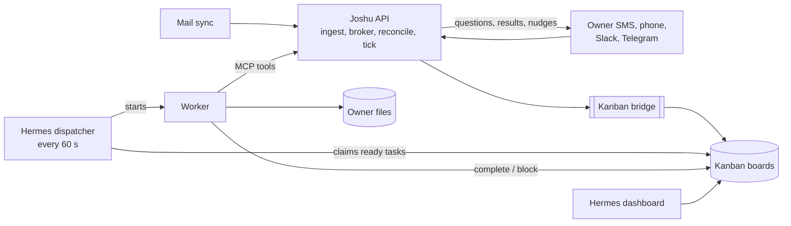

# Kanban boards in Joshu

Last checked against the code: Joshu release 0.1.48, with Hermes pinned at `3c27eb6` (v0.20.0).

This folder describes how Joshu uses Hermes Kanban boards today. It says what the code does, and does not judge the design.

## Terms

These are the terms that the pages in this folder use.

- **Kanban board**: one SQLite file of tasks at `~/.hermes/kanban/boards/<slug>/kanban.db`.
- **Kanban task**: one row on a board. The Hermes dashboard draws it as a card.
- **Task kind**: the `kind:` line at the top of a task body, for example `kind: mail_track`.
- **EA board**: one of the fixed boards `ea-mail-ingress`, `ea-scheduling`, `ea-owner-reply`, `ea-onboarding`, `realtime-goals`.
- **Project board**: `project-<slug>`, the board of the folder `Projects/<slug>/`.
- **Worker**: one Hermes run that works one task.
- **Hermes Kanban dispatcher**: the loop in the Hermes gateway that starts a worker for each `ready` task, every 60 seconds.
- **Kanban bridge**: the Python program that the Joshu API uses to read and change tasks.
- **Owner question**: a blocked task with block kind `needs_input`. Only these tasks get a nudge.
- `<files>`: the owner files root, `.../Desktop/joshu's files`. Paths in task bodies are relative to it.

## The big picture

Hermes owns the boards, and Joshu uses them as the shared to-do list of the companion. Joshu touches them in three ways:

1. **Joshu code puts tasks on boards.** Mail ingest, the scheduling and owner-reply routes, the realtime-goal broker, and the onboarding reconcile call the Kanban bridge, which imports the Hermes Kanban module and writes the SQLite file directly.
2. **Hermes runs workers on the tasks.** Every 60 seconds the dispatcher claims each `ready` task that has an assignee and starts a worker. The worker loads the skills named on the task, reads the files the body points to, and ends with `kanban_complete` or `kanban_block`.
3. **Joshu code reads the boards to talk to the owner.** The realtime-goal broker checks its own board every 5 seconds and texts the owner questions and results. The hourly proactive tick sends at most one nudge a day about an owner question on any other board.

A worker can only change its own task with Hermes tools. To create a task on another board, it calls a Joshu MCP tool (for example `mail_create_track_task`), which goes through the Joshu API and the bridge.

## Two kinds of boards

The Hermes dispatcher only starts workers for `ready` tasks, so the status that Joshu gives a new task decides the role of its board.

**Boards the box works.** On `ea-mail-ingress`, `ea-scheduling`, `ea-owner-reply`, `realtime-goals`, and the Multiplayer team boards `team-<slug>`, new tasks are `ready` and a worker starts within a minute. These are jobs: file this email, negotiate this meeting, answer this request, do what the companion promised a team. A team commitment that needs the owner starts `blocked` with `needs_input` instead.

**Boards that wait.** On project boards and `ea-onboarding`, Joshu creates each task and blocks it at once. These tasks are records of what is open, for the owner to see. They move only when something wakes them: a new email in the thread, an answer from the owner, or the onboarding check.

| Board | One task means | Created by | Starts as | Page |
|---|---|---|---|---|
| `ea-mail-ingress` | One email to file (a task that fails is archived after 48 hours) | Mail ingest | `ready` | [Mail and project boards](mail-and-project-boards.md) |
| `project-<slug>` | One matter that waits on a person (a track) | The ingress worker | `blocked` | [Mail and project boards](mail-and-project-boards.md) |
| `project-<slug>` | A multi-step project from chat, then its steps | Skill `ea-project-kanban` | `triage` | [Mail and project boards](mail-and-project-boards.md) |
| `ea-scheduling` | One meeting negotiation | The ingress worker | `ready` | [Scheduling and owner reply](scheduling-and-owner-reply-boards.md) |
| `ea-owner-reply` | One request the owner emailed to the companion | The ingress worker | `ready` | [Scheduling and owner reply](scheduling-and-owner-reply-boards.md) |
| `realtime-goals` | One request by SMS, phone, Slack, or Telegram | The realtime-goal broker | `ready` | [Realtime goals](realtime-goals-board.md) |
| `ea-onboarding` | One setup step not done yet (required setup step or setup tip) | The onboarding reconcile | `blocked` | [Onboarding](onboarding-board.md) |
| `team-<slug>` | One piece of work that the companion promised a Multiplayer team (task kind `team_commitment`) | The team stand-up | `ready`, or `blocked` with `needs_input` | [Multiplayer teams](../teams.md) |

## An example box

To give a sense of scale, one box that its owner had used for about four months had the five EA boards and 39 project boards. `ea-mail-ingress` had 526 tasks (506 done). `ea-scheduling` had 41, `ea-owner-reply` 10, and `realtime-goals` 51 (29 done, 22 cancelled). The project boards held 295 tasks, and all but one were mail tracks (166 blocked, 128 done). Every task had assignee `default` (the Hermes profile that workers run as).

## Where things live

| What | Path |
|---|---|
| Board database, metadata, worker logs | `/root/.hermes/kanban/boards/<slug>/` (`kanban.db`, `board.json`, `logs/<task_id>.log`) |
| Mail mirrors that tasks point to | `<files>/connectors/mail/<provider>/[<account_key>/]threads/<thread_id>.md` |
| Triage stubs | `<files>/Triage/`, filed ones in `Triage/_done/` |
| Project folders | `<files>/Projects/<slug>/` |
| Realtime goals | `<files>/.joshu/realtime-goals/state.json` |
| Nudge state | `/var/lib/arozos/joshu-state/proactive/state.json` (Joshu state folder, `JOSHU_STATE_DIR`) |

The owner sees boards only in the Kanban tab of the Hermes dashboard at `hermes-admin.<box domain>`, behind basic auth, where a board switcher lists every board.

## Pages and diagrams

- [`hermes-kanban-engine.md`](hermes-kanban-engine.md): storage, statuses, the dispatcher, workers, Joshu patches, the bridge.
- [`task-reference.md`](task-reference.md): every task kind, with real bodies and the fields that point to files.
- [`mail-and-project-boards.md`](mail-and-project-boards.md), [`scheduling-and-owner-reply-boards.md`](scheduling-and-owner-reply-boards.md), [`realtime-goals-board.md`](realtime-goals-board.md), [`onboarding-board.md`](onboarding-board.md): one page per area.
- [`cross-board-readers.md`](cross-board-readers.md): the nudge, owner replies, and the hygiene cron.

Interactive diagrams (archify, source JSON in [`diagrams/src/`](diagrams/src/)): [system overview](diagrams/kanban-system-overview.html), [task lifecycle](diagrams/kanban-task-lifecycle.html), [tasks and files](diagrams/kanban-task-file-pointers.html), [email to track](diagrams/kanban-email-to-track.html), [realtime goal](diagrams/kanban-realtime-goal.html), [nudge and reply](diagrams/kanban-proactive-nudge.html).
