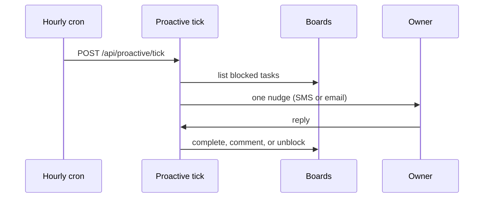

# Code that reads many boards

A few parts of Joshu read every board because they look after the owner, not one kind of work. They find the boards by listing the folders under `~/.hermes/kanban/boards/`.

## The hourly nudge

The Hermes cron job "Joshu proactive tick" runs every hour and calls `POST /api/proactive/tick`. No LLM decides; `runProactiveTick` (`src/proactive/tick.ts`) applies fixed rules and stops at the first one that says no:

1. **Time:** inside the owner's working hours (weekdays 08:00 to 17:00 by default).
2. **Cap:** fewer nudges today than the daily cap (1 by default; the owner can reply MORE or LESS).
3. **Sweep:** read the blocked tasks of every board except `realtime-goals`, and keep the owner questions (block kind `needs_input`). The Multiplayer team boards `team-<slug>` are included; a team question that the companion texted today with `team_tell_owner` counts as nudged today ([Multiplayer teams](../teams.md#owner-replies)). Skip tasks already nudged today, tasks whose dates are all more than 14 days old, and tasks on projects whose `about.md` status is not `active`.
4. **Rank:** due dates first, then project urgency and the age of the task.
5. **Route:** skip with reason `no_delivery_channel` when the box has no owner mobile with the Twilio SMS gateway and no email route to the owner (`ownerTextChannelFor` in `src/ownerTextChannel.ts`).
6. **Meeting check:** wait if the owner is in a meeting.
7. **Send:** Hermes composes a short text that ends with `Ref: pj/<task id>`, and Joshu sends it by SMS, or by email when there is no mobile number or the SMS is undelivered.

The tick only reads boards. It records the nudge in `/var/lib/arozos/joshu-state/proactive/state.json`, in the Joshu state folder. A send that fails records nothing, so the next tick tries again.

### Design decisions

- Check the route before the compose. Before this decision, the tick composed a nudge and then found no route, every hour of the working day. For example, a box with no owner mobile and no work email made nine Hermes calls of about 25,000 input tokens each day and sent nothing. The tick now asks `ownerTextChannelFor` after the sweep, so a dry run still shows the candidate, and before the meeting check, which can call the calendar. `ownerTextChannelFor` and `sendOwnerText` share the same two checks, so they cannot disagree. A backoff after a failed send was rejected, because the compose had already happened by then. Without a route, the tick returns `skipped`, not `error`, because the box has a setup gap and the setup board already asks the owner for a mobile and a Gmail account.
- The compose names the channel. The compose prompt asks for an SMS or an email body. A nudge by email does not ask for MORE, LESS, or USEFUL, and Joshu does not add the cadence hint, because owner replies to a nudge are routed only by SMS and jChat. A nudge whose SMS is undelivered goes by email with the SMS wording, because a second compose would cost a second Hermes call for a rare case.
- One Hermes session for each compose. The session key is `proactive:compose:<kind>:<task id>:<time>`. The old key had only the kind and the date, so each compose of a day got the earlier composes as history, and the model wrote as if the owner had read nudges that were never sent. A session for each task and day was rejected, because a retry after a failed send would still see the unsent nudge.

## Owner replies

A reply within two hours of a nudge, or one that quotes the `Ref:` line, goes to the nudged task:

| Reply | Effect on the task |
|---|---|
| `DONE` or `CLOSE` | Completed, with a comment by `owner`. |
| `KEEP` | Comment only; stays blocked. |
| `MORE`, `LESS`, and similar | Changes nudge settings only. |
| Anything else | A comment `## Owner reply (proactive nudge)`, then a Hermes turn with the board's skill that unblocks, completes, or re-blocks the task. |

If that Hermes turn fails, Joshu unblocks the task so a worker picks up the owner's comment. On a project board it also wakes the linked meeting tasks.

## The hygiene cron

On weekdays one hour after work starts, the Hermes cron job "Joshu proactive hygiene" asks an LLM to review up to 20 blocked tasks across all boards (onboarding excluded). It completes the ones that are clearly stale and lists the ones it cannot judge. A later nudge can ask the owner DONE or KEEP about those.

## Other readers

- `GET /api/instance/health` lists worker runs from the last 24 hours that crashed, timed out, or gave up, for information only.
- The morning email lists blocked meeting tasks.
- The companion's chat sessions (jChat, SMS, voice) have the Kanban tools, so the owner can ask "what is open on scheduling?" or "mark that one done".
