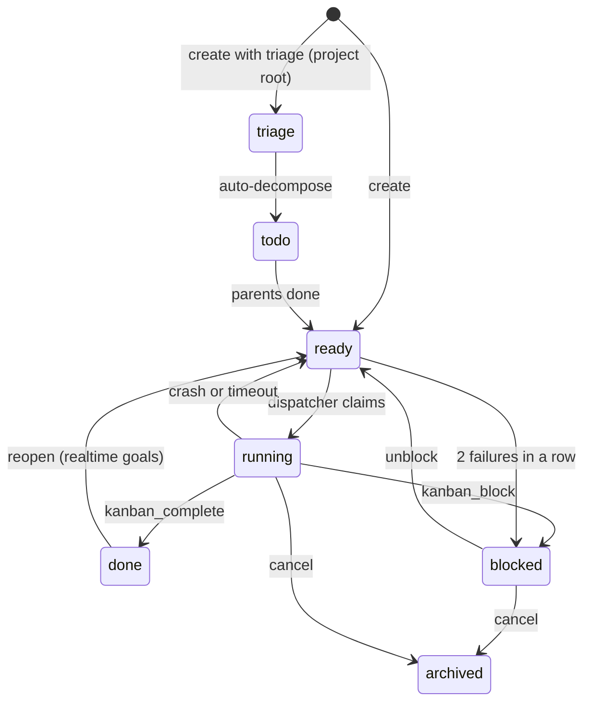

# The Hermes Kanban engine and how Joshu changes it

This page covers the Hermes side of the boards and what Joshu adds on top. Joshu runs Hermes at ref `3c27eb6` (v0.20.0), pinned in `deploy/Dockerfile` (`HERMES_AGENT_REF`).

## Storage

Each board is a folder `/root/.hermes/kanban/boards/<slug>/` in the `joshu-stack` container, with `kanban.db` (SQLite), `board.json` (name, description, default workdir), and `logs/<task_id>.log` (output of every worker run). Joshu always names a board, so its tasks are never on the Hermes `default` board.

Table `tasks` holds one row per task. The columns that matter to Joshu are:

| Column | How Joshu uses it |
|---|---|
| `id` | `t_` plus 8 hex characters, for example `t_5c2e81a0`. |
| `title`, `body` | The body starts with a `kind:` header and instructions. Joshu later appends to it. |
| `assignee` | Always `default` (`JOSHU_HERMES_KANBAN_ASSIGNEE`). |
| `status`, `block_kind` | See below. Joshu reads `block_kind` to find owner questions. |
| `skills` | Loaded on the worker, for example `["ea-playbook"]`. |
| `workspace_path` | The folder the worker starts in: `<files>` or `<files>/Projects/<slug>`. |
| `idempotency_key` | Stops the same email or request from making two tasks. |
| `max_runtime_seconds` | 28800 on EA boards; not set on project boards. |

The other tables are `task_events` (one row per change; the block reason lives in the newest `blocked` event), `task_comments`, `task_runs` (one row per worker run, with outcome and summary), and `task_links` (parent and child links from auto-decompose).

## Statuses

Joshu tasks use seven Hermes statuses:

- `ready`: waiting for the dispatcher.
- `running`: a worker owns the task.
- `blocked`: no worker runs until an unblock. The block reason and block kind say why.
- `done`: finished.
- `todo`: waiting for parent tasks (only auto-decompose children).
- `triage`: waiting for auto-decompose (only project triage roots).
- `archived`: cancelled.



For mail tracks and onboarding tasks, Joshu calls `create` and then `block` at once, so the dispatcher never sees them `ready`. The bridge can also complete a task in any open status, for example when the owner replies DONE to a nudge.

## The dispatcher and workers

The dispatcher is a loop inside the Hermes gateway. Joshu turns it on in `ensureJoshuHermesConfig` (`src/hermesApi.ts`) with `kanban.dispatch_in_gateway: true`, `dispatch_interval_seconds: 60`, and `auto_decompose: true`. On each tick it stops workers that crashed or ran too long, promotes `todo` tasks whose parents are done, and claims each `ready` task (oldest first) and starts a worker:

```
hermes -p default --cli --accept-hooks --skills ea-playbook chat -q "work kanban task t_9d41b7e2"
```

The worker starts in the task's workspace with `HERMES_KANBAN_TASK=<id>` and `HERMES_KANBAN_BOARD=<slug>` set. Its only prompt is `work kanban task <id>`. It learns the rest from the skills on the task, from Hermes' worker guidance in the system prompt, and from `kanban_show`, which returns the body, comments, events, and earlier runs.

A worker can change only its own task, with `kanban_complete`, `kanban_block`, `kanban_comment`, and `kanban_heartbeat`. Joshu also gives the `kanban` tools to chat sessions (jChat, SMS, voice), so the companion can read and close tasks when the owner asks.

Hermes has three limits:

- A run that exceeds `max_runtime_seconds` is stopped.
- After 2 crashes or timeouts in a row, the task is blocked with event `gave_up`.
- After the same block kind twice in a row, stock Hermes moves the task to `triage` (the unblock-loop breaker). A Joshu patch keeps EA, project, and team board tasks `blocked` instead. The patch also writes a `blocked` event, so that the dispatcher (`recompute_ready`) does not move the task back to `ready`. The task stays blocked until the next handoff unblocks it.

**Auto-decompose** sends `triage` tasks to an LLM, which splits them into child tasks. In Joshu only project triage roots start in `triage`, and the patch below turns auto-decompose off for EA boards.

## Joshu patches to Hermes

`deploy/scripts/vps-start.sh` applies these at every container start (three also run at image build):

| Script | Effect |
|---|---|
| `patch-hermes-ea-kanban-no-autodecompose.py` | Auto-decompose skips the EA boards and the Multiplayer team boards `team-<slug>`. A block loop on an EA, project, or team board keeps the task `blocked` and writes a `blocked` event, so the dispatcher does not promote it to `ready`. |
| `patch-hermes-kanban-worker-terminate-on-complete.py` | A worker exits 3 seconds after `kanban_complete` or `kanban_block`. Each tick kills up to 5 workers whose task is no longer running. |
| `patch-hermes-kanban-guidance-gate.py` | The worker guidance goes into the system prompt only for workers, not for chat sessions. |
| `apply-hermes-kanban-ws-base-path-patch.sh` | Fixes the dashboard's live updates when it is served under `/joshu/hermes-admin`. |

The Joshu API also runs `scripts/hermes-kanban-orphan-reaper.py` every 60 seconds, which stops leftover worker processes in the same way.

## The Kanban bridge

The Joshu API does all board work through `callKanbanBridge` (`src/hermesKanbanBridge.ts`), which runs `scripts/hermes-kanban-bridge.py` with one JSON request and reads one JSON response. The bridge imports `hermes_cli.kanban_db`, so it uses the same code and files as Hermes.

On create, the bridge adds two rules. On EA boards, a task must have an assignee and cannot start in `triage`. When a task with the same idempotency key exists, the bridge does not make a second one: it unblocks a blocked match, returns an open match, and for a `done` match creates a new task with key `<key>-wave-<unix time>`. Realtime goals use a strict mode that returns any existing task, archived ones included.

The main actions are `ensure_board`, `create`, `list`, `show`, `block`, `unblock`, `update_block_reason`, `comment`, `append_body`, `complete`, `reopen`, `cancel`, `archive_stale_blocked`, and `find_open_by_text`. `find_open_by_text` searches the task bodies on many boards in one process and returns each task with the given statuses whose body contains the text, with its full body and its board (used for owner Gmail replies, see [Mail and project boards](mail-and-project-boards.md#tracks)). With `include_activity`, `list` and `show` add the block reason, the last comments, and `block_cause`, which says whether the worker blocked with a question (`source: worker`) or the system stopped the task (`source: system`). `cancel` stops the worker, comments, archives the task, and cancels its browser handoffs. `archive_stale_blocked` works on board `ea-mail-ingress` only: it comments on and archives each stale ingress task and returns task ids, never titles (see [Mail and project boards](mail-and-project-boards.md#an-ingress-task-that-cannot-finish)).

## The dashboard

The Kanban tab of the Hermes dashboard runs on `127.0.0.1:9119`. Caddy publishes it at `hermes-admin.<customer domain>` with basic auth (`deploy/scripts/render-caddyfile.sh`). From it the owner can view any board and also create, edit, comment on, move, and archive tasks. Those changes go straight into the same SQLite file.
