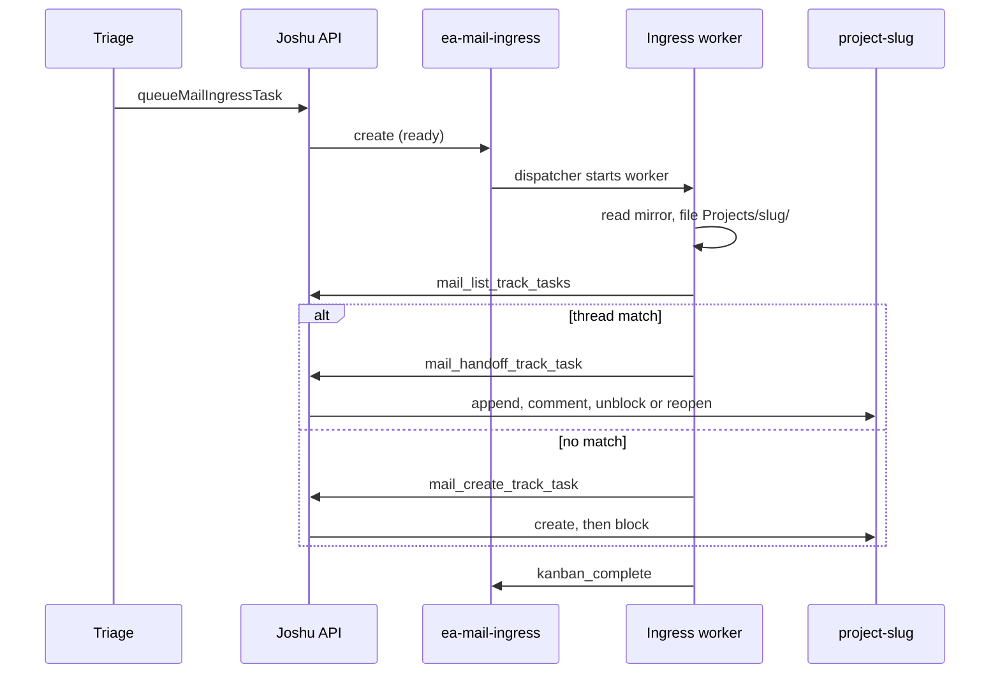

# Mail ingress and project boards

This page follows one email to an ingress task on `ea-mail-ingress`, then to a project folder and a track on a project board. Task bodies are in [`task-reference.md`](task-reference.md).

A project board is always named `project-` plus the folder name, so `Projects/family-school-logistics/` belongs to `project-family-school-logistics` (`projectBoardSlug` in `src/ea/mailTypes.ts`). `ensureProjectBoard` creates the folder and the board together. An unknown slug becomes `other`.

## From email to ingress task

The mail sync runs every 10 minutes for the companion's inbox (Nylas) and the owner's Gmail (Composio). For each changed thread it writes the mail mirror (owner Gmail threads first pass `gmailThreadIngestKind` in `src/ea/gmailJunk.ts`) and calls `createTriageStubAfterMirror` (`src/ea/triageStub.ts`), which:

1. skips mail the companion sent and Gmail junk, and writes no triage stub for stale mail (the newest message is older than 36 hours, or the hours in `JOSHU_EA_SCHEDULING_MAX_AGE_HOURS`), so a catch-up of old mail does not fill `Triage/`;
2. drops duplicates, because the same email often arrives through both inboxes (`connectors/_state/mail-dedup.json`, keyed by RFC Message-ID);
3. classifies the email with an LLM as `noise`, `info`, or `track`, with a guessed project slug;
4. for `track` only, decides whether the companion may act on it, writes a triage stub in `Triage/`, and calls `queueMailIngressTask`.

`queueMailIngressTask` (`src/ea/mailCron.ts`) checks the open meeting and owner-reply tasks of the thread, writes the body (including what the worker may do), and creates the task `ready` with the preloaded skills `ea-mail-ingress` and `ea-mail-track` (see [Skills of the mail workers](#skills-of-the-mail-workers)).

## What the ingress worker does

Within a minute the dispatcher starts a worker, which follows the "Mail ingress" section of `ea-mail-ingress`:

1. Read the mail mirror.
2. **File it.** Match or create `Projects/<slug>/`, and add journal and `todo.md` entries that link to the mirror.
3. **Find the track** with `mail_list_track_tasks(projectSlug, threadId)`. If no open track has this thread, the response can name a done track of the thread (`done_match`). Otherwise the worker gets the compact list of the project's open tracks (title, status, thread ids, and latest handoff summary, without the task bodies) and matches by judgment.
4. **Hand off** to the matching track, or **create** a new one with `mail_create_track_task`. A handoff to a blocked track unblocks it, and a handoff to a done track reopens it. In both cases the worker of the track reads the email.
5. **Project reconcile:** complete the tracks that this email makes unnecessary. The ingress worker skips this step when the handoff woke the worker of a track, because that worker runs Project reconcile.
6. Open or hand off a meeting task or owner-reply task, only when the body allows it.
7. Move the triage stub to `Triage/_done/` and complete the ingress task.

## An ingress task that cannot finish

A worker can fail: the dispatcher crashes, the worker uses up its iteration budget, or the worker exits without a Kanban tool call. The ingress task then stays `blocked` (event `gave_up`, or a block kind `transient` or `capability`). No code retries it, because a worker that runs weeks later would read the old email as new mail.

The ingress sweep (`src/ea/ingressSweep.ts`) archives each stale ingress task: a blocked ingress task with no event for 48 hours and a block kind other than `needs_input`. The Joshu API runs it once at start and then every hour, through bridge action `archive_stale_blocked`. Each archived task has a comment by `joshu-ingress-sweep`. Environment variable `JOSHU_INGRESS_SWEEP_HOURS` changes the age limit, and `0` turns the ingress sweep off. A person who unblocks or comments on a task by hand gives it a new 48 hours.

## Tracks

A track records that one matter is still open because it waits on a person. Joshu creates it and blocks it at once with `awaiting owner or external party`, so no worker runs on it.

When a new email belongs to a track, the ingress worker hands it off (`handoffMailToTrackTask`). Joshu appends a `mail_handoff:` block to the body, adds a comment, and **unblocks** a blocked track or **reopens** a done track. A track worker then reads the new email and either completes the track or blocks it again, with `awaiting owner — <decision>` and kind `needs_input` when the owner must decide, or with `awaiting reply: …` and no kind when someone else must answer.

An owner Gmail reply gets the same handoff without an ingress task. When the newest message of an owner Gmail thread is the owner's reply after an inbound message, the Gmail sync mirrors the thread, does not triage it, and calls `handoffOwnerGmailReply` (`src/ea/ownerGmailReply.ts`). That function finds each open track of the thread on all project boards with one bridge call (action `find_open_by_text`) and hands off the reply. It skips the handoff when the companion is a recipient, because the Nylas sync and mail ingress handle that email.

No Joshu code completes a track by itself. A track closes when a worker or a chat turn completes it: the track worker after a handoff, a later ingress worker during Project reconcile, the owner replying DONE to a nudge, or the daily hygiene cron.

## Skills of the mail workers

Hermes puts the whole `SKILL.md` of each preloaded skill of a task into the system prompt of the worker, so the worker sends it again on each LLM call. Until release 0.1.61, both mail workers preloaded `ea-playbook`, about 13,500 tokens. Most of it was for chat and crons, and the worker of a track used less than a quarter of it. Now each mail worker preloads only the sections that it uses:

| Task | Preloaded skills | Tokens of the preloaded text |
|---|---|---|
| Ingress task | `ea-mail-ingress`, `ea-mail-track` | about 9,400 (was 13,500) |
| Track | `ea-mail-track` | about 2,900 (was 13,500) |

The token counts are from tokenizer `o200k_base`. `ea-mail-track` has the filing rules that both workers use: "Every run — read first", "Project files", "Link discipline", "Mail attachments", "Canonical project matching", "Project reconcile", "Project boards — no scheduling sends", and "MCP / Joshu API failures". `ea-mail-ingress` has the steps of the ingress worker: "Mail ingress", "Scheduling decision gate", "Core loop", and "Classification guide". `ea-playbook` keeps the sections of chat and crons, and a table that names the skill of each moved section. The constants are `MAIL_INGRESS_TASK_SKILLS` and `MAIL_TRACK_TASK_SKILLS` in `src/ea/mailTypes.ts`, and `npm run test:mail-worker-skills` checks that no section is in two skills.

- **Two skills, and the ingress task preloads both.** The alternative was one skill for each worker kind, with the shared sections in both. It was rejected, because each fix of a shared section would then be needed twice, and the copies would drift. A second alternative was one skill for each section, loaded with `skill_view` on demand. It was rejected, because a worker that skips a `skill_view` call skips a rule, and the result of each `skill_view` call stays in the history of the run, so after a few LLM calls it costs as much as a preload.
- **The sections moved word for word.** Only step 1 of the Required order (the skills are preloaded, so the worker does not load them again) and the links between skills changed. The workers do the same steps as before. The body of an ingress task no longer asks for `skill_view('ea-playbook')`. That call loaded the preloaded skill a second time, in about one of four ingress runs on one box.
- **`ea-playbook` names the skill of each moved section.** Chat and crons load a moved section with `skill_view` when they need it, for example Project reconcile after the owner reports an outcome. The same table tells the worker of a task that still preloads `ea-playbook` to load the new skills.
- **A handoff moves an old track to `ea-mail-track`.** A track can stay blocked for weeks, so many tracks were created with `ea-playbook`. A handoff is the only step that gives such a track new work. Before `handoffMailToTrackTask` unblocks or reopens a track whose preloaded skills include `ea-playbook`, it sets them to `ea-mail-track` with bridge action `set_skills`. A failure only logs a line, because the table in `ea-playbook` still leads the worker to the new skill. A one-time migration of all tracks at start was rejected: it must open every project board, and a track that never runs again gains nothing.

## Project folders and boards

The folder and the board are linked by name. A track carries `project_slug:`, and the board's default workdir is `<files>/Projects/<slug>`. The frontmatter of `about.md` also matters to the board: the nudge only fires for projects whose `status` is `active` (or empty), and `urgency` and `deadline` affect which owner question is nudged first. The daily planning skills read project files, not boards.

## Projects from chat

When the owner asks in chat for a multi-step project, skill `ea-project-kanban` creates a project triage root on the project board (`triage`, no assignee). Hermes auto-decompose splits it into child tasks, which become `ready` in order and are worked like any other task. The skill writes `kanban_board` and `kanban_root_task` into `about.md`, and the owner follows the work in the dashboard.
