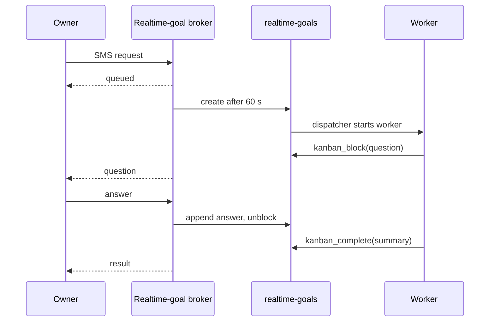

# The realtime-goals board

Board `realtime-goals` holds the owner's requests by SMS, phone, Slack, or Telegram that need more than a quick answer. The realtime-goal broker in the Joshu API owns the board: it creates the tasks, checks them every 5 seconds, relays questions and answers, and sends results. Message routing and the owner outbox are described in [`../realtime-goals.md`](../realtime-goals.md).

## Two records for one request

- **The realtime goal** in `<files>/.joshu/realtime-goals/state.json` holds the intake: the owner's messages, the channel, and the delivery of questions and results. Its field `kanbanTaskId` points to the task.
- **The Kanban task** holds the work. Its body starts with `Goal ID: <goal id>`, and it has the same idempotency key as the goal.

## From message to task

1. An owner message reaches the broker. An LLM router decides whether it is a quick reply, a question back, a new request, or an update to an open request.
2. A new request becomes a goal with status `queued`. More messages in the next 60 seconds are merged into it.
3. After 60 seconds the broker creates the task (`ready`, skill `realtime-goal`) with strict idempotency, so a retry cannot make a second task.

jChat and the app chat never create goals: they are answered in the chat itself.

## Questions, answers, and results

On each tick the broker reads the task with the bridge `show`:

- **Blocked by the worker with a question** (kind `needs_input`): the broker sends the question to the owner. When the owner answers, it appends `## Owner answer` to the body and unblocks the task, so a new run continues from the answer.
- **Stopped by the system** (a crash or two failures): the broker appends `## Joshu recovery` and unblocks it, up to two times, then tells the owner it could not finish.
- **Done:** the broker takes the run summary, rewrites it for the owner, adds a browser handoff link if there is one, and sends it.
- **Archived** without a cancel: the goal is marked failed and the owner is told.

An update while the task runs is appended as `## Owner update` without an unblock. A follow-up within 48 hours of finishing reopens the task.

The hourly proactive nudge skips this board, because the broker already asks its own questions.

## Browser handoffs and cancellation

When a goal ends with a page that the owner must finish (for example a checkout), the worker creates a browser handoff that can carry the task id. The broker puts the handoff link into the result, and cancelling the task cancels its handoffs.

When the owner cancels a goal, the bridge `cancel` stops the worker, adds the comment `Cancelled by owner: <reason>`, and archives the task. On the example box in the [overview](README.md#an-example-box), 22 of 51 tasks on this board ended this way.
