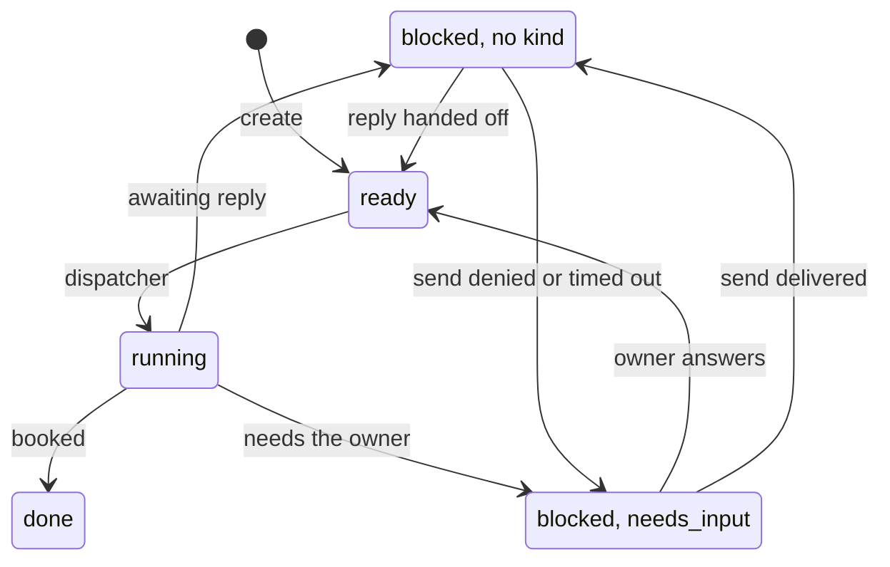

# Scheduling and owner-reply boards

`ea-scheduling` holds one meeting task per meeting negotiation, and `ea-owner-reply` holds one owner-reply task per request that the owner emailed to the companion. Both are worked by the dispatcher, and both are fed by the ingress worker through Joshu MCP tools. Task bodies are in [`task-reference.md`](task-reference.md).

## How a matter gets here

The ingress task body already says what the ingress worker may do after filing:

- `scheduling_eligible: true` (`allowed_actions: file,schedule`): the email is about scheduling and the companion is authorized on it. The worker may find or create a meeting task.
- `owner_reply_eligible: true` (`allowed_actions: file,reply`): the owner wrote to the companion and asked it directly. The worker may find or create an owner-reply task.

The ingress worker cannot create these tasks itself, because Hermes pins it to its own board. It calls `scheduling_create_meeting_task` or `owner_reply_create_task`, which check eligibility again and call the bridge.

**One task per matter.** The same matter often arrives on several threads (the Gmail and Nylas copies of one email have different thread ids). The coordination scope groups those threads under one id (`src/coordination/`). Before Joshu creates a meeting task or an owner-reply task, it checks the scope and returns the open task if one exists. New tasks are recorded in `connectors/_state/coordination-active.json`.

## Meeting tasks

The task id is the identity of the meeting. The `ea-scheduling` worker reads every email on the task, checks the owner's calendar, and then does one of four things:

- **Book:** create the calendar event, send a confirmation, and complete the task.
- **Wait:** block with `awaiting reply: …` and no kind.
- **Reach out:** send availability, then block with `awaiting reply: …`.
- **Ask the owner:** block with `owner review: …` and kind `needs_input`.

Every email the worker sends carries the task id and goes through the action guard, which may ask the owner by SMS to approve it. Afterwards Joshu rewrites the block reason (`src/ea/schedulingSendFollowup.ts`). A delivered email becomes a wait (no kind). A denied or timed-out approval becomes an owner question (`needs_input`).

A blocked meeting task wakes up when:

- a reply arrives (the next ingress worker hands it off, which appends an `ingress_handoff:` block and unblocks);
- the owner answers a nudge about it, or about a linked project task;
- someone unblocks it by MCP or in the dashboard.

It closes when the worker books it, when the owner replies DONE or asks in chat, when the hygiene cron judges it stale, or when it is cancelled.

Older forms of scheduling are still in the code but unused: one Hermes cron per thread (removed by `scripts/migrate-remove-scheduling-crons.mjs`), Markdown case files under `Projects/<slug>/scheduling/`, and the board `ea-sched-ingress`.

## Owner-reply tasks

The `ea-owner-reply` worker does what the owner asked and replies on the same thread with `nylas_send_message`. It then completes the task, or blocks it with `awaiting owner — <question>` and `needs_input` when it needs the owner. That makes it an owner question, so the hourly nudge can pick it up. A later email on the thread is handed off and unblocks the task, in the same way as for meeting tasks.
