# Building verified research reports and topic alerts with Joshu and the You.com API

*This article first appeared on the You.com blog on November 9, 2026: [Building Verified Research Reports and Topic Alerts with Joshu and the You.com API](https://you.com/resources/joshu-verified-research-reports).*

Starting from around the beginning of 2026, we have seen personal AI assistants rise from a curiosity to mainstream adoption. Openclaw, then Hermes Agent, started the trend with open source efforts for more technical minded folks, but that technical barrier didn’t last long: by the fourth quarter nearly every AI lab had released their own agent, with the most prominent being released by Meta with their Muse platform. Has AI finally broken from coders and power users to mainstream adoption?

Possibly, but in order for successful adoption for a variety of scenarios and use cases, AI product teams need to re-think the *harnesses* (software designed to orchestrate one or more AI models to achieve a goal). Developers have had it good: years of tooling, linting, compiling aids while made for humans, actually made for excellent hooks for artificial systems too, and the harnesses take full advantage of that. But ‘tooling’ for everyone else outside of engineering largely needs to be invented.

New user-focused harnesses, such as [Joshu](https://www.joshu.me), help bridge that gap. Joshu (助手, Japanese for assistant) models its harness as an always present executive assistant. Joshu is designed to run on a persistent cloud computer featuring a web desktop, browser, file storage, and long-term memory. Because a Joshu has its own email address, its own phone number, and direct connections to SMS, Slack, Microsoft Teams, Telegram, and WhatsApp, an owner can text their Joshu from a train, call it on the phone, or copy it on an email thread the same way they would reach a human chief of staff.

One of the most practical jobs a business user would have their assistant do is to keep track of the outside world by preparing a deep briefing before a meeting or watching a set of companies, competitors, and industry topics week after week. This blog post details the design of Joshu to help make high quality research reports.

### Do we need a Harness for Research?

Chat models generally have quite old knowledge of the world, so most have added on web search capabilities natively so that they can search for facts to get up to date information. Why then would these chat systems need anything else? Three major issues come to mind:

- Unchecked language model summaries invent facts, fabricate numbers, or hallucinate links when they synthesize search snippets directly. Even when a quote is real, a model can confuse two companies or products sharing a similar name, making an unverified briefing risky to forward to a client.
- Simple recurring search alerts either flood the owner with duplicate links or repeat the same background summary every week. When an agent generates fresh search queries on every scheduled run, small changes in wording return a different slice of the web, making old stories look new and active stories look quiet.
- Interactive agent turns are fragile for long background jobs and scheduled alerts. A deep research run can take several minutes across dozens of searches and page reads, and a scheduled alert must reach the owner reliably by text message or email even when no chat session is open.

### Why a pipeline built on the You.com API and a content router works well

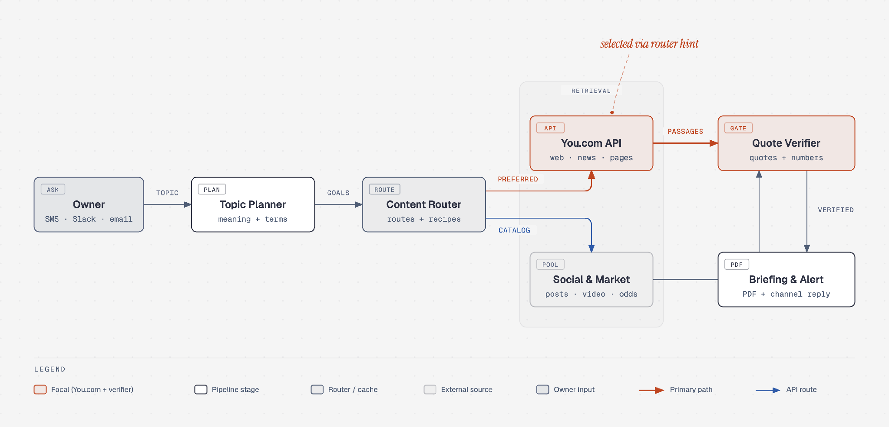

*Architecture diagram showing an owner topic request moving through the research planner and control plane content router to the You.com API, quote verifier, and PDF delivery.*

Joshu solves all three problems by running research as a deterministic pipeline paired with the You.com API and a central content router, rather than leaving research to an open-ended chat turn. The pipeline uses the You.com API to retrieve fresh web results, dated news coverage, and rich page passages, routed through Joshu's control plane content router. Every claim in the final prose must cite a fact containing an exact quote from a retrieved page, and deterministic code strips any drafted sentence whose citation is invalid or whose numbers do not appear in the cited quote. For recurring alerts, the Joshu plans the queries and expanded search terms for each topic once at setup and stores event stories in a structured ledger for 60 days, ensuring every scheduled run searches consistently and alerts the owner only when real news breaks.

## Novel design aspects

The Joshu system has a few novel design features designed specifically for high quality research and reporting.

### Routing research goals to the You.com API through preference hints and learned caches

A Joshu needs to pull from many kinds of sources, including live web search, news articles, academic papers, prediction markets, and social platforms. Hardcoding vendor paths and custom response parsers for every source makes the system brittle and requires a software release whenever a better data provider becomes available.

Instead, Joshu expresses retrieval requests as content goals and sends them through the control plane content router. A content goal pairs a source kind with a query, and the Joshu can attach preference hints from its skills or from the owner's preferences. Because the router supports provider preferences, configuring a hint preferring the You.com API directs web, news, and passage retrieval goals to You.com endpoints in the router catalog without changing the downstream research pipeline.

When a Joshu box resolves a content goal through the router, it relies on two local caches stored in a persistent box skill:

- The route cache maps each goal kind and preferred provider to a specific endpoint in the control plane catalog, along with its query parameter name and fixed inputs. On a cache miss, or when a new preference hint names You.com in place of an earlier provider, the Joshu searches the router catalog, inspects the candidate endpoints with their prices, success rates, and latencies, and uses one model call to select the matching You.com endpoint.
- The shape cache maps each endpoint to a declarative recipe of JSON paths extracting the result list, URL, title, passage text, author, publication date, and engagement metrics from the JSON reply. On a cache miss, the Joshu sends a small sample of the API response to one model call to learn a JSON path recipe, validates the extracted items, and saves the recipe for future runs.

The route cache is a plain cache, so it holds only routes that the box can call, and it has no memory of a failed search. When the route cache has no usable entry for a goal kind, the box searches the router catalog and learns a route at that use, in every report, and it keeps the learned route only when the call returns items. An earlier design wrote a "no route" record when a newly learned route failed, and the box then did not look again for 7 days. We removed the record, because it hid a source from the owner for a week to save one model call and one router call for each report. A box that still has such records removes them when it starts.

The box removes a cached route after three faults in a row, and it does not remove the route after one fault. The faults that count are an error of the provider or of the router, an endpoint that the catalog no longer has, a call that runs out of time, and a reply that the box could not read. An empty usage wallet, a rate limit, an unauthorized answer, and a router with no channel do not count, because they tell nothing about the endpoint. A healthy endpoint gives a provider error or runs out of time now and then, and one call that returns items sets the count back to zero. Removal at the first fault would replace a working route with the second choice of the model after one passing error, and the replacement would stay. For the same reason, faults of one route within one hour count as one fault: the topics of one recurring report call the same endpoint at the same time, so one passing error would otherwise count once for each topic.

When the third fault removes a route, the box learns one new route in the same report and calls it, and the model call does not get the endpoint that just failed as a candidate. The box learns at most one route each time it resolves a goal, so a broken source costs at most one more route model call and one more router call, and one recipe model call when the new endpoint has no shape recipe yet. A recurring report resolves each goal one time for each topic, so the limit there holds for each topic. We did not share one learned route between the topics of a run, because the saving is one model call on the rare run that removes a route.

The route model call sees the first six endpoints of the catalog search, with the endpoints of a provider that a hint names before all others. The box does not order the candidates itself. The catalog search of the content router can list more than 100 endpoints for a goal kind, so the order of that search decides which endpoints the model can pick, and the content router ranks it: the capability that names the job and that callers use with success comes first, and in one capability the endpoint that works comes first. We keep the ranking in one place, the content router, because every caller of the catalog search needs it, and a second order on the box would be a second rule to keep in step with the first.

A learned route is valid only when its query input is a name in the input schema of the chosen endpoint. The box refuses any other answer of the model, and it does not call the endpoint.

Because shape recipes consist only of restricted JSON path expressions and URL templates, the Joshu never executes parser code generated by a model. After the first run learns the route and shape recipe, every subsequent search and alert call to the You.com API runs with zero extra model overhead.

### Facts checked by quote and deterministic number verification

Language models are good at organizing prose, but they are unreliable when asked to summarize raw search results in a single pass without a strict grounding boundary. To keep the model from inventing facts or blending unrelated sources, Joshu splits synthesis into three separate stages: fact extraction, the theme writer, and a deterministic verification pass in code.

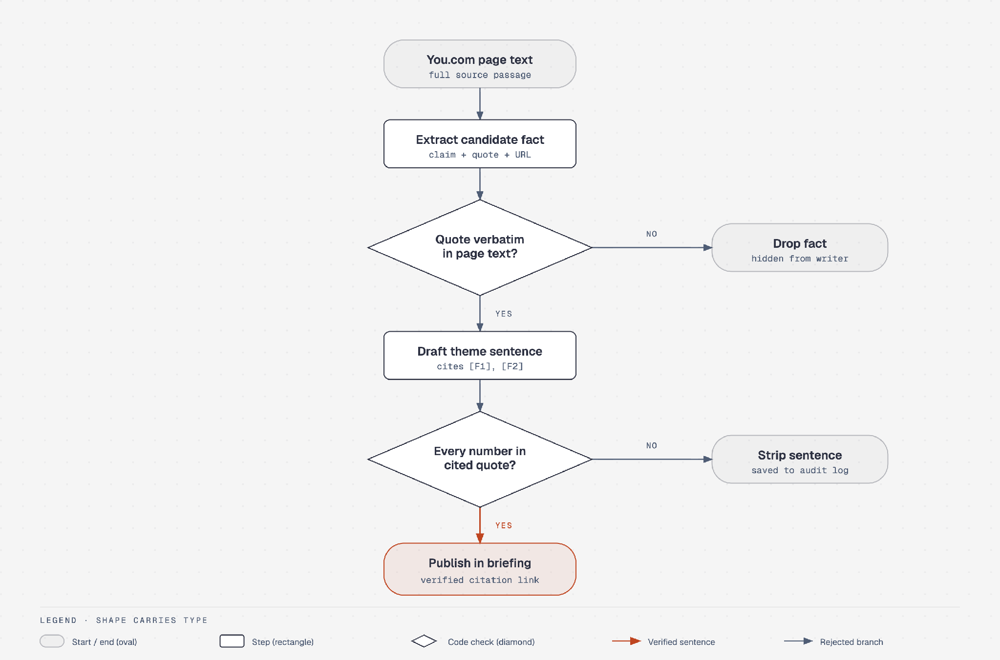

*Flowchart showing how extracted quotes from You.com pages are checked word for word in code before drafting, and how sentences with unverified numbers are stripped before publishing.*

First, between retrieval and writing, a dedicated extraction step reads the full passages returned for each theme and asks the model to extract discrete facts. Every candidate fact must include a verbatim quote from the source page. Deterministic code checks whether the quote appears word for word in the retrieved page text and discards any fact whose quote is missing. Code then removes duplicate quotes and assigns each surviving fact an identifier such as `F1` or `F2`.

Second, the theme writer drafts the narrative prose for each theme. Instead of using one large model call to write the whole report, the theme writer runs one isolated language model call per theme in parallel (up to four at once). Each theme writer call never sees raw web pages, search snippets, or URLs. Instead, it receives only the verified facts for its own theme (each with its `F1` identifier, claim, verbatim quote, site name, and publication date), the titles of the other themes in the report so sections do not repeat each other, and the owner's formatting notes. Each theme writer returns a plain headline and one to three connected paragraphs where every factual sentence ends with a citation tag such as `[F12]`. A separate summary writer call then reads the finished themes to write the top-level overview paragraph, cover title, and chat summary.

Third, once the theme writer and summary writer finish drafting, a verification pass in code checks every sentence before the report is rendered:

- Code drops any sentence citing a missing fact identifier.
- Code extracts every number from each sentence, including integers with two or more digits, decimals, percentages, and currency amounts. Code then checks whether every number appears in the verbatim quote of a fact cited by the sentence, while allowing years matching the publication year of a source page in the theme. Any sentence with an unbacked number is stripped automatically and recorded in an audit log.

Running quote and number checks in code costs nothing at run time and prevents fabricated statistics from ever reaching an owner's inbox.

### Topic disambiguation and one-time keyword expansion

Checking whether a quote exists on a page does not help if the page is actually about a different company or product with the same name. When an owner asks for a report or sets up a recurring alert, the planning step first writes one sentence defining what the topic means and lists up to four similarly named subjects to exclude, guided by any notes from the owner. Every downstream step, including event grouping, fact extraction, and theme writing, receives both the definition and the exclusion list so lookalike entities are filtered out even when a news article confuses them.

At the same time, searching only for a company's exact name misses broader market shifts and competitor moves. During planning, the model extracts up to 6 named search terms directly from the owner's request and generates up to 10 expanded search terms covering direct competitors, product categories, and industry terms. For a recurring alert, the Joshu generates the queries, topic definition, and expanded search terms once when the lane is created and reuses the saved plan on every scheduled run. Keeping the search plan fixed ensures two runs search the You.com API the same way, so changes in the alert reflect real changes on the web rather than query drift.

### Stories as durable memory and themes as fresh synthesis

A useful topic alert has to distinguish between a new event, a story with new developments, and an ongoing story with nothing new to report. Joshu separates what it remembers across runs from how a single briefing is organized:

- A story represents a single event in the world, backed by the web pages, news articles, and social posts covering the event during a run. Recurring alerts store stories from the last 60 days in a local ledger alongside their normalized URLs and timestamps.
- A theme is a narrative section of a single report or alert grouping one or more related stories under a headline. Themes are built fresh for each report and are never carried over as memory.

When a scheduled alert runs, it first matches newly collected stories against the story ledger by exact URL overlap in code, and then uses a single model call to match remaining stories semantically across runs and across lanes. Each story is marked new (never seen in an earlier run), developing (matched to an earlier story, with new articles or posts from the current window), or quiet (matched to an earlier story, with no new items). The theme builder then synthesizes only the new and developing stories across all tracked topics, passing the previous summary of each developing story to the writer so the alert explains what changed since the last update.

### Self-contained editorial PDFs and delivery on every channel

Owners read briefings on planes, on mobile phones between meetings, and inside corporate email clients, and they frequently forward reports to colleagues who do not have an account on the owner's Joshu box. A report therefore cannot rely on external stylesheets, web fonts, or hotlinked images breaking offline or failing behind a firewall.

When a Joshu renders a report, it embeds its editorial fonts directly as base64 @font-face rules and downloads one lead image per theme from the cited source pages, checking image dimensions and file size before embedding the picture as a data URI. A headless Chromium process prints the HTML page to PDF in an isolated environment with network access disabled.

To deliver the report cleanly on whichever channel the owner used, the Joshu pairs native file attachments with stateless signed links. On email, the Joshu sends the theme summaries in the message body and attaches the PDF. On Slack and Telegram, the outbox uploads the PDF directly into the chat thread. On SMS and voice callbacks, the Joshu sends a concise text summary along with a public link signed with an HMAC token of 128 bits, allowing the owner to open the PDF in one tap on a phone browser without signing in.

## Technical walkthrough

### Overview of the 8-step research pipeline

When an owner asks their Joshu for a research report on any channel, the pipeline runs end to end across eight stages within a strict time budget, typically finishing in about two and a half minutes.

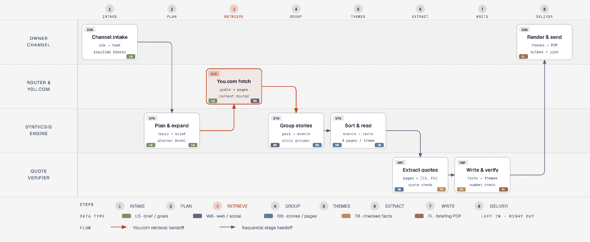

*Process diagram showing all eight steps of a research report across the owner channel, content router, synthesis engine, and quote verifier.*

Each of the eight stages has its own time budget, data contract, and failure boundary. Below is how each step works in detail.

### Step 1. Channel intake and ambiguity check

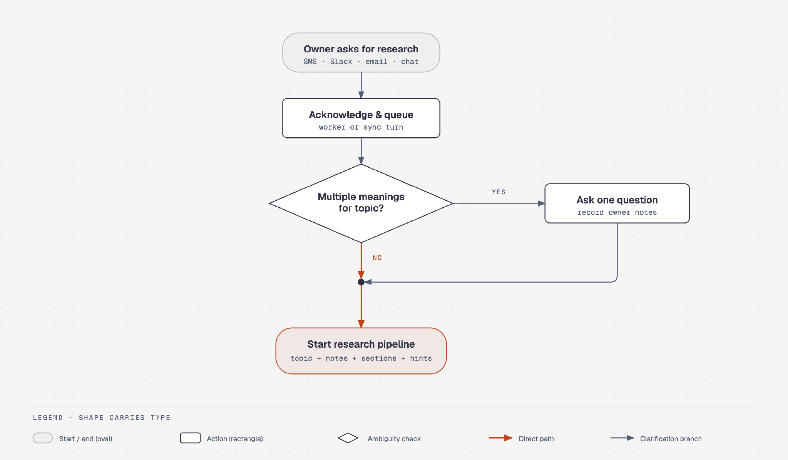

*Flowchart showing an owner request arriving on any channel, queuing a background worker or starting in web chat, asking one clarifying question when ambiguous, and passing the request to the pipeline.*

First, the Joshu receives the request on the owner's channel. On SMS, phone, Slack, or Telegram, the realtime broker acknowledges the request right away and queues a background worker so the conversation never blocks, while in web chat the Joshu posts a short start note. If the topic could refer to more than one subject, the Joshu asks a single clarifying question before starting, and then passes the owner's topic, notes, optional section names, and provider preference hints to the research pipeline.

### Step 2. Topic planning and keyword expansion

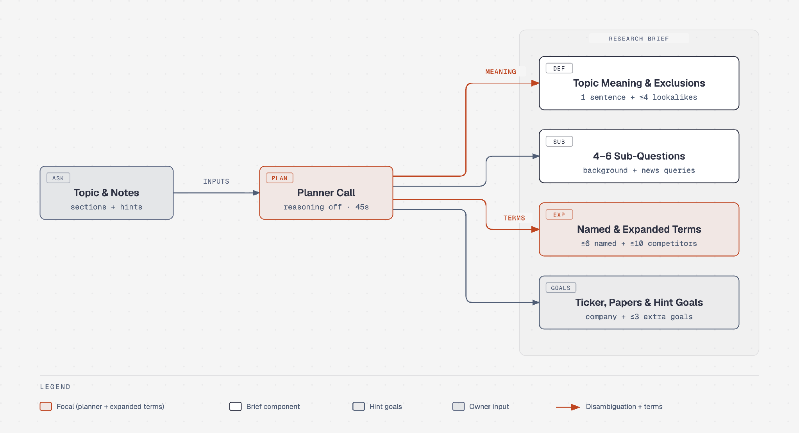

*Architecture diagram showing the topic and owner notes feeding the research planner, which produces the topic meaning and exclusions, sub-questions, named and expanded search terms, and extra content goals.*

Second, the planning step calls the language model with reasoning disabled to produce a structured research brief. The brief defines what the topic is about, lists lookalike subjects to exclude, and creates four to six sub-questions labeled as either background or news (or maps one sub-question to each section requested by the owner). The brief also generates up to 6 named search terms and 10 expanded search terms, a short keyword query for social sources, optional academic paper queries when peer-reviewed studies are relevant, a company ticker when the topic focuses on a public company, and up to three extra content goals triggered by the hints.

### Step 3. Parallel retrieval via the You.com API and the content router

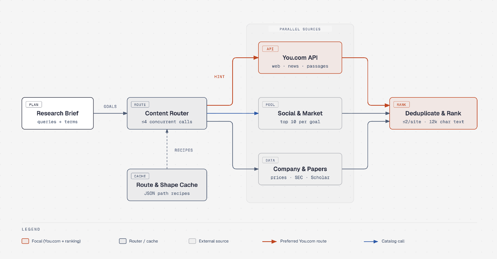

*Architecture diagram showing the research brief consulting the route and shape caches and dispatching parallel requests to the You.com API, social and market goals, and company filings before domain deduplication and ranking.*

Third, the retrieval stage runs web, news, company, and social searches in parallel through the You.com API and the control plane content router. For each sub-question, the pipeline runs both a recent search (covering the last 30 days) and an evergreen background search, along with targeted recent searches for the expanded search terms, keeping at most four search requests in flight at once. When a preference hint specifies You.com, the content router directs web, news, and passage retrieval goals to You.com API endpoints using its cached route and shape recipe. In parallel, the pipeline resolves default social goals (Reddit, YouTube, TikTok, Instagram, and X) and any extra hint goals (such as prediction market odds) over the 30-day window. Code deduplicates URLs and caps results at two pages per domain so a single publisher cannot dominate the report. Code then ranks the retrieved pages and pulls full text passages (up to 12,000 characters per page) and source images for the top articles and papers.

Which service runs the web search depends on the box. A box that can reach You.com calls the You.com Search API, and reads the full text of a page with the You.com Extract API. A managed box holds no You.com key: it sends both calls through a proxy of the control plane. A self-hosted box can use its own You.com key. A box with only an Exa key uses Exa for both. On a box with both, Exa answers a search or a page that You.com could not answer, and Exa returns the passages of a news page or a paper page that answer the brief, because You.com has no call for that. The source list of the report names the provider that the box used. [The web provider of a box](../hermes-integration.md#the-web-provider-of-a-box) gives the decisions.

### Step 4. Event story grouping and noise filtering

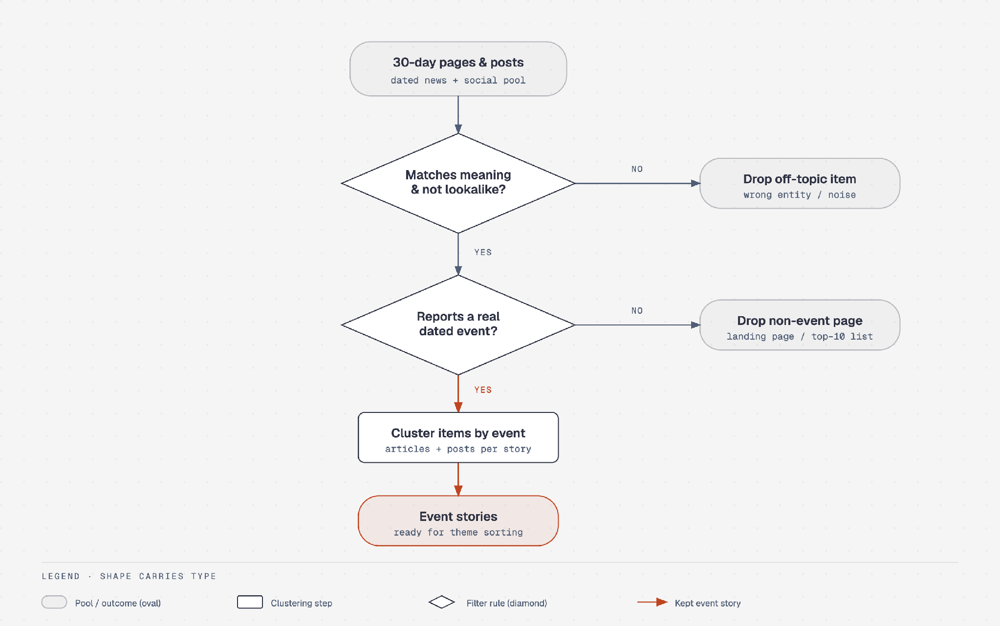

*Flowchart showing dated pages and social posts passing through a lookalike exclusion check and an event check before clustering into event stories.*

Fourth, the grouping step pools all dated news pages from the last 30 days together with the top social posts and groups them into event stories in a single model call. Using the topic definition and exclusion list from the plan, the model drops off-topic items and filters out evergreen vendor landing pages or generic product lists reporting no dated event. If the grouping call ever fails or times out, deterministic fallback logic turns each dated news page into its own story and omits unchecked social posts so the report still completes cleanly.

### Step 5. Theme sorting and full-page reading

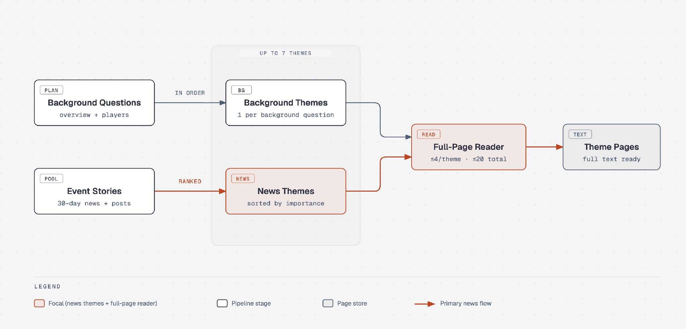

*Architecture diagram showing background sub-questions and event stories forming up to seven theme drafts, followed by full-page reading of up to four pages per theme and twenty pages across the report.*

Fifth, the theme sorting and reading steps organize the report structure. Background sub-questions from the plan become background themes at the start of the report, and one model call sorts the event stories into news themes ordered by importance, up to 7 themes in total (or places each story into the owner's custom sections). The pipeline then reads full page text via the You.com API for the top unread articles in each theme, up to 4 pages per theme and 20 across the report, so the extractor has complete context rather than short snippets.

### Step 6. Quote-checked fact extraction

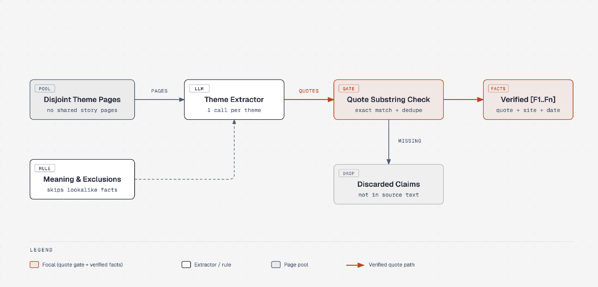

*Architecture diagram showing disjoint theme page pools feeding parallel per-theme fact extraction calls, followed by verbatim substring verification and sequential fact numbering.*

Sixth, the fact extraction step runs one parallel model call per theme over the pages assigned to the theme. Background themes also read the evergreen search pages from their sub-question, excluding any page already assigned to a news story so two themes never compete for the same quote. Code verifies every returned fact contains an exact substring quote from its source page, drops any claim whose quote is missing, removes duplicate quotes, and numbers the verified facts sequentially (F1, F2, and so on).

### Step 7. Parallel theme writing and sentence verification

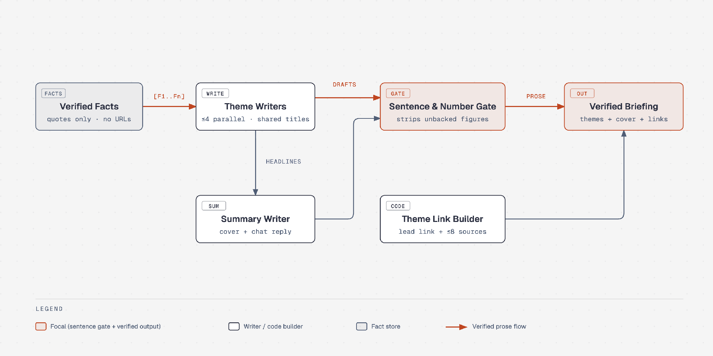

*Architecture diagram showing verified facts feeding parallel theme writers and the cover summary writer, which pass through the citation and number check and merge with deterministic theme links.*

Seventh, the writing and verification step drafts each theme in parallel from its verified facts, sharing the headlines of all themes so sections do not repeat one another, and then runs one summary call to write the cover overview and chat summary. Code runs the deterministic citation and number check over every drafted sentence, strips any sentence with an unverified figure, and builds the link list for each theme directly from the underlying story URLs (choosing the best news article first, then web pages, then social posts).

### Step 8. Offline PDF rendering and multi-channel delivery

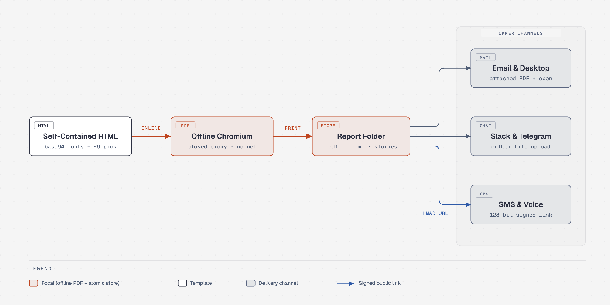

*Architecture diagram showing embedded fonts and data-URI images feeding an isolated Chromium PDF render, atomic report folder save, and delivery via email attachment, Slack or Telegram upload, or signed SMS link.*

Eighth, the rendering and delivery step downloads and embeds up to six source images and renders the self-contained HTML and PDF files via headless Chromium with network access disabled. Code saves the files and the initial story ledger atomically so a future follow-up request can diff against the report, and the Joshu delivers the summary and PDF back to the owner on the originating channel.

### Walkthrough of a recurring topic alert

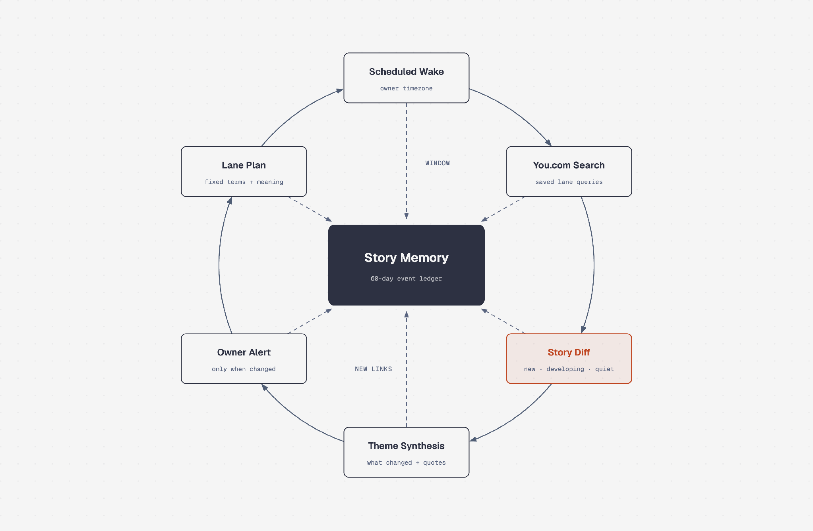

*Six stations flow clockwise from Scheduled Wake through You.com Search, Story Diff, Theme Synthesis, Owner Alert, and Lane Plan, syncing against a central 60-day Story Memory hub.*

Recurring topic alerts use the same verification and theme pipeline, adapted to run unattended on a schedule and highlight only what changed.

First, when an owner asks their Joshu to follow one or more topics on a schedule (for example, every weekday morning at 8:00 AM), the recurring report service plans each topic lane once. It saves the lane's queries, topic definition, lookalike exclusions, and expanded search terms to disk, and registers a scheduled job in the owner's timezone triggering the Joshu API directly without opening an interactive chat turn.

Second, when the schedule fires, the collection step queries the You.com API and the content router across every lane for material published since the timestamp of the last completed run (or over the last 7 days for a new alert). The collector runs each lane's saved queries plus up to 16 named and expanded search terms per run, resolves news redirect URLs so the same article always maps to the same canonical link across runs, and drops any web page lacking a publication date so undated landing pages cannot masquerade as breaking news.

Third, the grouping step combines the collected items from all lanes and groups them into event stories using each lane's saved definition, exclusions, and tracked competitor terms. Grouping all lanes together allows a single event touching two watched topics to merge into one story rather than appearing twice.

Fourth, the comparison step diffs the current run's stories against the 60-day story memory. Any story sharing a canonical link with a stored story merges with the stored story in code at zero cost. One model call then compares the remaining stories against the stored ledger and marks every story as new, developing, or quiet.

Fifth, if every story in the run is quiet, the runner records the completed check, advances the coverage timestamp, and sends nothing to the owner (unless the owner explicitly asked for a "nothing new" confirmation). When one or more stories are new or developing, the runner invokes the shared theme pipeline on the active stories alone. It reads the top pages in full, extracts facts checked by verbatim quote, drafts themes explaining what changed since the earlier story summary, and strips any sentence failing the citation or number check.

Sixth, the delivery step saves the update files, renders the update PDF (including a timeline chart of new items across recent runs), sends the alert on the owner's chosen channel, and updates the 60-day story memory only after delivery succeeds. If a transient network error or restart interrupts a run before delivery, the story memory and coverage window remain untouched so the next run automatically covers the missed period.

### News, research papers, filings, and stock prices through the content router

A Research report and a report update get four more sources in addition to the web search: the news for each sub-question, research papers for a research question, and, for a topic about one public company, the SEC filings and the stock prices of the company. The code calls these four the source search (`src/research/pipeline/sourceSearch.ts`).

News, research papers, and SEC filings are content goals, as the social sources are. The code gives the goal kind ("News articles", "Research papers", "SEC filings") and the query. The box finds a provider endpoint in the router catalog with one model call, learns how to read the reply with a second model call, and keeps both in the route cache and the shape cache. The code names no provider for these three sources.

Stock prices are the one source with a fixed provider endpoint (`tiingo.daily.prices`, and `tiingo.daily.meta` for the name of the company of a ticker).

A failed source has the state "could not be reached" with the reason, and the report goes on with the other sources.

Decisions (2026-11):

- **The four sources moved from Composio to the content router.** Until release 0.1.67 they came from the Composio toolkit `composio_search`. Composio retired the toolkit in November 2026, and every version answers HTTP 410. The code named one provider, so the box could not find another by itself, and the sources were off on every box.
- **The code names what the report needs and no provider.** With a content goal, the box can replace a provider that goes away with no release. The box removes a route from the route cache after three faults in a row, and faults within one hour count as one. So the source has the state "could not be reached" in up to three reports, and the box then searches the router catalog again. The first version of this change named one provider endpoint for each source, which repeats the fault of the outage. In a test with an empty route cache, the box found a working provider endpoint for each of the three goal kinds by itself.
- **The goal kinds are short.** "News articles", "Research papers", and "SEC filings" each led to a working provider endpoint. Longer kinds, such as "Google Scholar papers" or "SEC filings list for a stock ticker", led to an endpoint that did not answer or to no endpoint.
- **One call at a time finds the route of a goal kind.** A report asks for the news of each sub-question at the same time. With no route in the route cache, each call would choose a provider endpoint with its own model call. So one call at a time runs until a call left a route, and the others then run at the same time. When the route cache has a route, no call waits. When a call fails because the usage wallet is empty, or for another reason that holds for the whole goal kind, the other calls fail with that reason and make no call.
- **Stock prices are not a content goal.** A content goal returns items with a title and a link. The price page needs one close for each trading day, and it computes the first, the last, the highest, and the lowest close. So the prices keep a fixed provider endpoint. It is the one place where a provider that goes away needs a release.
- **A stock split does not show as a fall.** The price reply has the price of each day and a split factor for each day. The box divides each close before a split by the split factor. It does not use the adjusted close of the provider, because that value also changes with each dividend and then differs from the close that a reader sees.
- **No price call for an exchange outside the United States.** The price source has stocks of exchanges in the United States. The same ticker on another exchange is another listing with other prices and another currency. So the box makes a price call only for NASDAQ, NYSE, NYSEARCA, NYSEAMERICAN, and BATS, and for another exchange the source has the state "could not be reached" with that reason.
- **One lookup gives the company name for the check of the ticker.** The report drops the company pages when the name of the company of the ticker shares no word with the company of the plan. The box asks one free endpoint for the name, one time for one report. When the lookup fails, the pages still come back and the check has no name to compare.
- **The owner pays for the source search from the usage wallet.** A router call takes the provider price plus the router markup, and the price depends on the provider endpoint that the box found. Before, Joshu paid for these sources, so they worked with an empty usage wallet. Now a source that the content router refuses because the usage wallet is empty has the state "could not be reached", with the link to the usage billing page, and the report has the web search of the box. We did not build a proxy of the control plane that pays for these calls, as the You.com proxy does, because the content router already has the catalog, the billing, and the provider keys.
- **The reader of the content goals reads a relative date.** Search results of news often have a date such as "4 days ago". A goal with dates leaves out an item with no date, so the reader now reads such a date. The change is in the reader of every goal and not in the source search.

Limits:

- The quality of a source depends on the provider endpoint that the box finds. In the test, the research papers came from a search of arXiv, which has fewer fields than Google Scholar.
- The filings goal returns the newest filings of every form, so a report can have fewer than three filings of forms 10-K, 10-Q, and 8-K. When the reply has only other forms, the report has no filing page.
- The period of the news is a filter on the items of the reply. The route of a goal has fixed inputs that the box chose one time, for example a time window of about one month, so a period of one year gets the news of that window.
- A self-hosted box needs a router API key in Connectors for the four sources. Without one, the report has the web search only.
- We did not check whether the content router refuses a call with the price $0 when the usage wallet is empty.

Tests: `npm run test:research-pipeline` (case "source search client").

## Wrap up and where we are taking research next

### Operational trade-offs

Designing research and topic alerts around verifiable quotes and fixed lane plans introduces deliberate trade-offs:

- Strict number verification favors precision over prose variety. If the language model rounds a number from a quote (for example, writing "\$500 million" when the quote says "\$498 million") or computes a sum across two quotes, the deterministic check drops the sentence. The resulting theme is occasionally shorter than drafted, but every surviving figure is provably present in the cited source.
- Requiring publication dates on recurring alerts prevents evergreen vendor pages from triggering false alerts, at the cost of skipping newly published blog posts on sites omitting date metadata. On-demand Research reports keep undated pages for their background themes so foundational material is still covered.
- Bounding concurrency (at most four simultaneous search or router calls per box and two background alert runs at once) keeps memory usage and API rate consumption predictable on a personal assistant box while still completing runs across several lanes in a few minutes.

### Future directions

While sophisticated, there is lots of room for improvement. One key area the team is focused on is further personalization. What if Bob wants a tabloid-style news magazine, but Sally wants hard financial analysis from today’s stock market? Or a PDF full of rich color and design, rather than a traditional two column newsprint? With today’s AI models, not only can they be excellent research partners, but also custom design partners. Indeed, the future is wide open!
