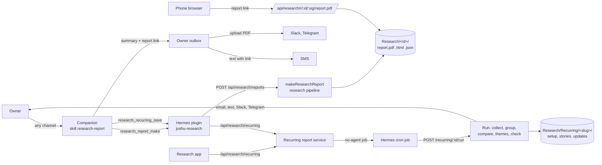

# Research reports

## Purpose

A Research report tells the owner what good web sources say about one topic: news, reports, research papers, company pages and filings, and official sources, with the recent pages first. The box sorts what it found into themes, the way a news page groups its coverage: background themes on what the topic is, then news themes on what happened in the last 30 days. Each theme has a headline, a few paragraphs, a picture from a source when one fits, its lead link, and the links to its other pages and posts, and each fact links to the page that it comes from. The owner asks the companion on any channel, and the companion answers in the same conversation with a short summary and a PDF. The box saves each Research report as a PDF, an HTML page, and a data file in the folder `Research` of the owner files.

A recurring report follows one or more topics (lanes) on a schedule. Each run groups what web, news, papers, company data, and social sources published into stories, compares them with the stories of earlier runs, sorts the new and developing stories of all lanes into themes, and sends a report update with those themes, written the way the owner asked. A repeat request on the topic of an earlier Research report gives a report update against that report instead of a new report. The Research app on the desktop lists every report and has one form for a new one.

## Motivation

Before Research reports, research ran in the last30days desktop app. Its result was a list of grouped posts inside the app, or a chat answer and a Markdown file, and the owner could not forward either one to a client. The async reply of the app tool reached only jChat, because Joshu dropped the text of the follow-up Hermes turn, so a request by text message, Slack, or Telegram got no answer.

These constraints shaped the design:

- Owners read on many channels and forward what they get, so the report must stand alone: fixed fonts, no script, and nothing loaded from the internet.
- A model can invent facts, numbers, and links, so the facts of the report must come from the pages that the box read, and code must check what the model writes.
- A first version that used the last30days engine as the only collector gave mostly social posts and reactions. The owner wants a research report from good sources, with social posts as a small extra.
- The sources will change. The parts that search and read pages must be replaceable without a change to the writer or the renderer.
- A request on a text message, Slack, or Telegram already goes to a background worker with a long time limit, and jChat has no turn time limit, so a synchronous call can serve every channel.
- An MCP tool call times out after 300 seconds, and a Research report can take several minutes.

Recurring reports replaced the Watch feature of the last30days app, which refreshed watched topics but had no comparison between runs, so one box had a custom Hermes cron job that rewrote the whole result every weekday. Owners also follow a topic across many kinds of sources, and checking each source by hand is the work that a companion should do. These constraints shaped recurring reports:

- A Hermes cron job cannot send a text message, and agent cron jobs have hung on a full gateway pipe and were skipped after a model switch. A run must not depend on a Hermes turn.
- Two runs must search the same way, or a story looks new or quiet only because the queries changed.
- The comparison must be in plain files that the next run, the companion, the Research app, and gbrain can read.
- The box should hold no code of another project: the last30days engine needed Python 3.12, a pinned copy, and four patches.

## Architecture

The diagram above shows how a request reaches the box and how the Research report goes back to the owner. The next diagram shows what happens inside `makeResearchReport`: how the information moves from the topic of the owner to the parts of the PDF. The source file of the diagram names the code of each box.

The source of this diagram is [`diagrams/research-reports.json`](diagrams/research-reports.json) (an Archify dataflow diagram).

The next diagram shows one run of a recurring report: the Hermes cron job starts the run, the collect step searches the sources of each lane with its lane plan, the group and compare steps make the stories of all lanes and give each one its story status against `stories.json`, and the theme steps and the check make the themes that Joshu saves and sends.

The source of this diagram is [`diagrams/research-reports-recurring.json`](diagrams/research-reports-recurring.json) (an Archify dataflow diagram).

The parts and what each one owns:

- The research pipeline (`src/research/pipeline/`) makes the research. `llm.ts` is the shared OpenRouter call, `exa.ts` the Exa client, `you.ts` the You.com client, `composioSearch.ts` the Composio Search client, and `plan.ts`, `search.ts`, `company.ts`, `extract.ts`, `write.ts`, and `pictures.ts` are the steps.
- The social sources (`src/research/social/`) ask the content router for one content goal for each social source. For a Research report, `pool.ts` keeps the posts of each goal with the most engagement, and the posts join the pool of the report. The default goals are Reddit posts, YouTube videos, TikTok videos, Instagram reels, and X posts. The content goals client (`src/contentRouter/`) turns each goal into a router call with the route cache and the shape cache of the box skill `joshu-content-cache` (see "Content goals" below). The research code names no provider endpoint and no provider path.
- The recurring report service (`src/research/recurring/service.ts`) makes, changes, pauses, and deletes recurring reports and their Hermes cron jobs, and plans each new lane (`plan.ts`). The store (`store.ts`) owns the folders in `<files>/Research/Recurring/`.
- The themes (`src/research/themes/`) are the shared steps of both kinds of report after the compare step: `sort.ts` sorts the stories into themes, `read.ts` makes a page for each item and reads the best pages in full, `write.ts` writes each theme and the summary, `links.ts` builds the links of each theme, `text.ts` writes the themes as the text of each channel, and `index.ts` (`buildThemes`) runs them in order.
- A run (`run.ts`) collects (`collect.ts`), groups and compares stories (`stories.ts`), makes the themes, saves the report update, and sends it (`delivery.ts`). The runner in `run.ts` starts runs in the background, at most two at once.
- Report updates on request (`repeat.ts`) and the PDF of the full update (`updatePdf.ts`) reuse the steps of a run.
- The Watch migration (`watchMigration.ts`) moves the watched topics of the last30days app to one recurring report at the first boot.
- The Research app (`apps/research/`) and the routes of recurring reports (`src/research/recurring/routes.ts`) use the same service as the plugin tools.
- The charts (`src/research/charts.ts`) count items by day, by source, and by theme, and draw two SVG charts. The first report has no charts; the code stays for the follow-up report.
- The template (`src/research/template.ts`) renders the HTML page with the fonts from `src/research/fonts.ts`.
- The PDF render (`src/research/pdf.ts`) prints the HTML page with a one-shot headless Chromium run.
- The report store (`src/research/store.ts`) owns the folders in `<files>/Research/` and finds earlier Research reports.
- The report links (`src/research/reportLinks.ts`) sign and check the public links, and find report links in outbox texts.
- The routes (`src/research/routes.ts`) serve the plugin on localhost and the public report link.
- The Hermes plugin `joshu-research` and the skill `research-report` connect the companion to the routes.

## Theory of operation

A Research report goes through these steps:

1. The owner asks for research. On a text message, a phone call, Slack, or Telegram, the realtime-goal broker acknowledges the request and queues a worker. On email, the `ea-owner-reply` worker runs. In jChat, the companion writes one line that the report started.
2. The companion asks one question first only when the topic can mean more than one thing.
3. The companion calls `research_report_make` with the topic and the notes of the owner, and with sections only when the owner asks for a fixed structure in so many words. Guidance such as "cover this space" or "start with those points" goes in the notes, and the box picks the themes. The notes say what the topic means, what it is not, and what to look at, in the words of the owner, with no research and no style words of the companion. The sections are at most 6 names, in the owner's order. The Research app sends the same fields from its form. The plugin posts to the Joshu API and waits up to 11 minutes.
4. After the plan step, the social collection starts and runs in parallel with the search. It asks the content router for each content goal for the last 30 days with the short keyword query of the plan (an extra goal of a hint has its own query), and keeps the 10 posts of each goal with the most engagement. When it fails or is late, the report has no posts.
5. The plan step asks the model for a research brief, one sentence on what the topic means (`about`), up to four things with a similar name that the report is not about (`notAbout`), and four to six sub-questions, each with a recent query, an evergreen query, and a kind: `background` for what the topic is, its players, or its market, and `news` for what happened recently. The model follows the notes of the owner. It also returns the search terms of the report, with the same rules and limits as the lane plan of a recurring report, and each sub-question lists the terms that it is about. Code puts each term in the first sub-question that lists it, or in the first sub-question when none does. When the owner gave sections, the plan has exactly one sub-question for each section, in the owner's order, and each sub-question keeps its section. The model also gives a Google Scholar query for at most two sub-questions that ask what research shows, and names the company with its ticker and exchange when the topic is about one public company. When the model fails, a fixed plan of five general sub-questions is used, with no Google Scholar query and no company, or one sub-question for each owner section.
6. The search step runs two Exa searches for each sub-question, and one more Exa search with 5 results for each search term of the sub-question, at most four at once. The recent query and the search terms only find pages from the last 30 days. Both exclude social sites and content farms. When the box has a Composio key, Composio Search runs at the same time: a Google News search of the last month with the recent query of each sub-question, and a Google Scholar search for each Google Scholar query. Code removes duplicate pages, keeps at most two pages for each site, ranks the Exa pages by search rank, highlight score, and how many searches found them, and keeps 24, chosen from the Exa results alone. On top of them it adds at most 6 news articles that are not among the Exa pages and the top paper of each Google Scholar search. Exa then returns the full text (12,000 characters) and the images of the best 12 Exa pages, the best 3 added news articles, and the top papers, because the snippet of a paper is too short for facts. A news or paper hit has no highlight score, so it gets a fixed score of 0.3, which only orders the pages. When every Exa search fails, the report fails at step "search". A Composio search that fails only gives fewer pages. When the request names You.com as the web search provider, the same searches go to You.com instead of Exa (see the design decision of 2026-11-06), and Exa still reads the full text.
7. When the plan names a company, the company step gets the daily stock prices of the last month from Google Finance and the newest three SEC filings (10-K, 10-Q, or 8-K), at the same time as the searches. Code writes one price page with computed lines (first and last close, change, highest and lowest close) and one line for each trading day. Exa reads each filing for the passages that match the research brief. The price page and the filing pages come first in the list of pages and every sub-question reads them, outside the limit of 24. When the company name from SEC or Google Finance shares no word with the company of the plan, code drops both.
8. The group step (60 seconds) makes stories of the pool: the dated pages of the last 30 days that a news question found (of every question when the plan has no news question or the owner named sections), and the social posts. One model call groups the items, with `about` and `notAbout`, and leaves out the items that are not about the topic and the pages that report no event. Every story is new. The answer may use about 120 tokens for each item, at most 12,000, because a story takes 60 to 80 tokens and a pool can have almost one story for each item. When the call fails, the box logs it and makes each dated news page its own story, without the social posts, so the report still has news themes.
9. The theme step (30 seconds) makes one background theme for each background question, in the order of the plan, and one model call sorts the stories into news themes, the most important first, at most 7 themes in all. With owner sections, the call puts each story in a section instead, and the report has only the sections. Each section keeps the words of the owner as the label above it, cut at a whole word after 100 characters, and gets a headline from the writer like any theme. When the call fails, each story is its own theme.
10. The read step (30 seconds) makes a page for each item of each story, found by its theme, and Exa reads the best web, news, and paper pages of each theme in full, at most 4 for each theme and 20 for the report.
11. The extract step (75 seconds) asks the model, once for each theme and in parallel, for facts with an exact quote from a page of the theme. A background theme or a section also reads the search pages of its question, without the pages of a story of another theme. The call gets `about` and `notAbout`, and skips each fact about a thing with a similar name, also when the page itself mixes the two up. For a page whose full text is shorter than 1,000 characters (often a paywall), the model reads the passages from the search first. Code keeps a fact only when its quote is in the text of its page, removes repeated quotes, and numbers the facts `F1`, `F2`, and so on.
12. The write step (105 seconds) writes each theme in its own model call, at most four at once, from the facts of the theme, with the headlines of the other themes, the stories of the theme, and the notes of the owner, with each fact cited as `[F12]`. A theme without a fact, or whose text does not pass the check, is left out. Then one call (30 seconds) writes the summary paragraph, the chat summary, and the cover from the finished themes. Code drops each sentence that cites an unknown fact, and each sentence with a number that is not in the quote of a fact it cites. Code builds the links of each theme: the lead link from the most important story (a news article before a web page before a post, and a direct link before a Google News redirect), then at most 8 more pages and posts. With fewer than 8 facts or fewer than three themes, the summary says that the box found little.
13. The pictures step takes, for each theme, the first cited page with a suitable picture, downloads it, checks its type, width, and size, and embeds it as a data URI with the site name and a link to the page.
14. The HTML page and the PDF are made in a temporary folder inside `Research/`. The folder is renamed to `<YYYY-MM-DD>-<topic slug>` (with `-2`, `-3` for a repeat on the same day) only when every step worked. A failure leaves no folder.
15. The tool returns the summary, the email body (the summary, and the headline, first paragraph, and lead link of each theme), the report link, the PDF path relative to the Desktop (for mail attachments), the PDF path relative to the owner files (for `desktop_open`), and the source states. On a failure it returns `ok: false` with the step that failed.
16. The companion answers on the channel of the request. In email, it replies on the thread with the email body and the PDF attached. In jChat, it gives the summary and the link, and opens the PDF on the desktop. On the other channels, the worker completes its task with the summary and the report link on the last line, and the owner outbox sends it. The Slack and Telegram senders find the report link in the text and upload the PDF with it. A phone result follows the rules of the owner outbox: a callback speaks the summary and texts the link, or a text message carries both when the box does not call.

A run of a recurring report goes through these steps:

1. The Hermes cron job of the recurring report (`no_agent: true`) runs its script at the scheduled time in the owner timezone. The script posts to `/joshu/api/research/recurring/<id>/run` on localhost, and Joshu answers 202 and runs in the background. A recurring report that is still running is skipped, and a third run waits for one of two to end.
2. Collect (2 minutes, no model): for each lane, the queries of its lane plan on its sources, for the period since the last run that worked (a run that sent a report update or found nothing new), or the last 7 days for a starting update and a new lane. Web pages come from Exa (index and category pages are left out) and Google News (each redirect link resolved to the article link, so that the same article has the same link on every run), papers from Google Scholar, a stock price move of at least 5% and new SEC filings from Composio Search, and posts from the content goals of its social sources and of the extra goals of its lane plan (the 10 with the most engagement of each goal). Each lane also searches the search terms of its lane plan by name, with one Exa search of 5 results and one Google News search for each term, and skips a term that repeats a query of the lane plan. A run searches every named term of every lane, and then the expanded terms of the lanes in turn, one term of each lane at a time, until the run has 16 search terms. An item that two lanes found stays in the first lane. A web or news page without a publication date is left out, because the box cannot tell whether it is new, and an item of the content router without a date gets the day of the run. When every Exa search fails, the run fails.
3. Group (90 seconds): one model call groups the items of all lanes into stories and leaves out the items that are not about a lane and the pages that report no event, for example product pages, vendor guides, and lists of top products. Above 120 items, each lane has its own call. The call gets what the topic of each lane means and what it is not, from the lane plans, and the notes of the owner, so it also leaves out items about a thing with a similar name. The call also gets the search terms of each lane in a line "Follows:", and keeps the items about a competitor or about the space as part of the lane. A story belongs to the lane of its first item. A lane plan that has no `about` (a lane plan from before 2026-10-30, or the fixed plan of a failed plan call), or no search terms (a lane plan from before 2026-11-02), first gets the missing fields from one model call with a limit of 30 seconds, before the collect step, and `setup.json` keeps them. The call changes nothing else in the lane plan, and when it fails, the run goes on and the next run tries again.
4. Compare (60 seconds): a story with a link of a stored story joins that story with no model call. One model call matches the other stories with the stored stories of the last 60 days, and with each other across lanes. A story is `new` (no stored story), `developing` (a stored story, and new items), or `quiet` (a stored story, and no new item). A story of a starting lane is always new.
5. Themes (about 5 minutes at the limits): the theme, read, extract, write, and summary steps of a Research report run on the new and developing stories, with no background theme. A theme with a developing story says what changed, from the earlier summary of the story. A number of items in the notes ("keep it to 5") is the most themes, and 7 otherwise. The pictures of the themes are picked for the PDF.
6. Save and send (about 4 minutes at the limits): `updates/<YYYY-MM-DD-HHMM>/update.json`, `update.md`, and `pictures.json`, then the delivery on the channel of the recurring report, then `stories.json`. An email has the summary and every theme with its paragraphs and links in its body, and the PDF of the full update attached. A text message, Slack, and Telegram get the summary and one line for each theme with its headline and its lead link. A run with nothing new saves `update.json` only and sends nothing, unless the owner asked for a "nothing new" line.

A failed step sends a short failure note and no report update, and changes neither `stories.json` nor the period of the next run. When Joshu starts and finds a run that was left running, it marks the run failed and sends the failure note. A live run of 9 lanes with every source took about 2 minutes.

### Content goals

A content goal is a short text with the kind of source and the query, for example "YouTube videos: humanoid robots". Every social source of a Research report and of a run is a content goal, and only the base sources (the Exa web search and Composio Search) are not. `resolveGoal` in `src/contentRouter/goals.ts` handles one goal in these steps:

1. It looks up the goal kind ("youtube videos") in the route cache, `references/routes.json` of the box skill `joshu-content-cache` in `$HERMES_HOME/skills/`. An entry has the provider endpoint, the input name of the query, the fixed inputs, the last success, and the failures in a row.
2. On a miss, it searches the router catalog with the goal kind, reads the inputs of the best six provider endpoints, and makes one model call that picks a provider endpoint and names its query input. The model call sees the price, the success rate, and the latency of each candidate. When a hint names a provider, for example "Polymarket", the endpoints of that provider come first, and a cached route of another provider counts as a miss.
3. It calls the provider endpoint through the router call route, with at most four router calls at once on the box. The client authenticates with the agent token on a fleet box and with the router API key on a self-hosted box.
4. It looks up the shape recipe of the provider endpoint in the shape cache, `references/shapes.json`. A recipe is a JSON path to the list of results and a JSON path (or a template with paths in braces, or a list of paths) for the link, the title, the text, the author, the date with its format, and each metric. The link and the title are required. The other fields are optional, and a field with no path, for example `"author": []` for a web search whose results have no author, is left out of the recipe.
5. It applies the recipe and checks the items: each item has a link and a title, the links are not one link repeated, and no date is after tomorrow. On a miss, or when the check fails on a reply that has a list, it makes one model call with a sample of the reply, applies the new recipe, and keeps it when the check passes. When the new recipe also fails, the goal gets the state "could not be reached" with engine status `could not be read`, and the Joshu API logs the reason (the goal kind, the provider endpoint, and the failed check or model call) with `console.warn`, so `docker logs` shows it.
6. It keeps the route when the call returned items, and returns the items in the shape of the other collected items. When the provider endpoint has dates, items before the period are left out. Items of a provider endpoint with no dates, for example markets, all count.

A failed call gives the goal the state "could not be reached" with the reason, and the other goals continue. A route with three failures in a row leaves the route cache, so the next report learns it again. An empty usage wallet, a rate limit, or a missing router API key does not count as a failure of the route.

The box makes the box skill `joshu-content-cache` at the first gateway sync with the content router on, or at the first use. The first `routes.json` has the five default social goals and the 15 provider endpoints of skill `joshu-social-posts`, and the first `shapes.json` has the recipes of the four ScrapeCreators search endpoints, so the first report makes no learning call for them. The default social goals come from the table "Default social goals" of the factory skill `joshu-content-router`: the box copy first, then the copy in the release, then a list in code.

Hints are lines in skills, for example "Polymarket for prediction market odds on political topics". The companion reads the default hints of skill `joshu-content-router` and the hints of the owner in skill `joshu-content-cache`, and passes the hints that fit in argument `hints` of `research_report_make` and `research_recurring_save`. The plan model call of a Research report, or the lane plan call of a recurring report, reads the hints and returns up to three extra goals, each with a goal kind, a query, and the provider that the hint names. The items of the extra goals join the pool like the posts of the default goals. A metric with a name that is not engagement, for example `odds`, is shown as it is next to the link and does not count for engagement.

The source ids of recurring reports are strings: a base source (`web`, `papers`, `company`), the id of a default goal (`reddit`, `x`, `youtube`, `tiktok`, `instagram`), or `goal:` and a goal kind. The ids of the default goals are the old source ids, so a recurring report saved before the content router keeps working: each social id maps to its goal when the run reads it.

Every model call uses the model of `JOSHU_RESEARCH_WRITER_MODEL` (default `JOSHU_OPENROUTER_DEFAULT_MODEL`), no-training routing, reasoning turned off, and one retry. The time limits of a Research report are 45 seconds for the plan, 90 seconds for the search and the page text, 60 seconds for the group step, 30 seconds each for the theme step and the read step, 60 seconds for the fact extraction, 90 seconds for the themes, 30 seconds for the summary, and 45 seconds for the pictures, the HTML page, and the PDF. The social collection has 2.5 minutes in parallel with the search. A Research report is done or failed within 8 minutes, which leaves time for the wait of the realtime-goal broker (about 60 seconds for a text message request) and the start of the worker, inside the 10 minutes that the owner is promised. A real run took about 2.5 minutes.

## Design decisions

### 2026-10-19: A research pipeline on Exa makes the report

The pipeline follows the steps that published research systems share (Anthropic's multi-agent research system, Stanford STORM, GPT-Researcher, and LangChain open_deep_research): plan sub-questions, search in parallel, read the best pages, extract facts, outline, write, and check. The research runs in parallel, and the text is written in one call. Writing each section in parallel was rejected, because LangChain found that sections written in parallel do not fit together. The Exa Agent API (one asynchronous run with a schema) was rejected for now, because it gives less control over the sources and the pictures and has no time guarantee. Keeping the last30days engine as the web collector was rejected, because it asks Exa for five results for each query, cuts the text to 500 characters, and drops each page without a date. Exa allows 10 searches each second for all boxes of one Exa team, so one box runs at most four at once and waits for `Retry-After` on HTTP 429.

### 2026-11-06: A Research report can use You.com for the web search

A one-time Research report can use You.com in place of Exa for its web search, so the two providers can be compared on the same topic. Argument `web_provider` of `research_report_make` is `exa` (the default) or `you.com`, and the Joshu API takes the same field as `web_provider` in `POST /joshu/api/research/reports`. A hint such as "You.com for web search" was not enough, because a hint only adds content goals to the stories and the social posts, and the cited web pages come from the Exa search alone.

The You.com client in `src/research/pipeline/you.ts` has the interface of the Exa client, so the search step, the ranking, and the limit of four searches at once stay the same. Each search is one call of router endpoint `you.web.search.highlights` through the content router, with the agent token of the box, and costs $0.0055. The request maps the query to `query`, the number of results to `count`, the start of the last 30 days to `freshness` as a date range such as `2026-10-07to2026-11-06`, and the excluded sites to `exclude_domains`. In a test on a fleet box on 2026-11-06, You.com answered HTTP 400 when `exclude_domains` was a comma-separated string, as the router catalog describes it, and accepted a list, so the client sends a list. The router only accepts `extraction: {"extraction_mode": "highlights"}`. The reply maps `results.web[]` to the pages: `page_age` is the publication date, the passages in `contents.highlights` (or `snippets`) are the highlights, and the description is the highlight when a result has none. You.com gives no highlight score, so a You.com page scores only by its rank and by how many searches found it.

The router has no You.com endpoint for the full text of a page, so Exa still reads the full text and the images of the best pages, the filings, and the pages of each theme. A box without an Exa key gets only the You.com highlights. The source list names the provider of the web search, "Web (You.com)" or "Web (Exa)". When You.com is chosen and the box cannot call the content router, the report fails at step "search" with the reason. Recurring reports and report updates keep Exa, and the Hermes web search backend (`web.backend: exa`) does not change.

### 2026-10-21: Composio Search adds news, papers, and company data

Exa's recent searches return many market-research press releases and miss dated news that Google News has, and a topic about a public company got no market data or filings. Each box already has a Composio key, and the Composio toolkit `composio_search` needs no sign-in, so the box can call Google News, Google Scholar, Google Finance, and SEC EDGAR through it. In a test on 2026-10-21, the news search returned dated articles from publishers that the Exa runs did not have, and the other web searches of Composio Search (Tavily, DuckDuckGo, and an Exa answer) returned weaker pages than Exa, so the box does not use them. A separate news API or SerpAPI was rejected, because each box would need a new key or a new relay. A Composio Tool Router session was rejected, because the pipeline knows which tool it needs and a session adds calls.

The client posts to the Composio tools API with `fetch`, the pinned toolkit version `20260903_00`, and the Composio user of the box, so that each call has a real time limit and the tests can pass a fake `fetch`. The toolkit version is pinned because Composio toolkits change their argument schemas without notice. A call has 40 seconds and no retry: most calls take about one second, but a news search for a query that Composio had not seen before took more than 20 seconds in 7 of 15 calls of one test run. One box runs at most four Composio calls at once, and a report makes at most 10. Composio counts these calls as ordinary tool calls of the Composio project and limits them to 1,000 an hour for each Composio organization on the free plan.

News and papers add pages to the Exa pages, and the Exa pages are chosen from the Exa results alone. A first build ranked news and papers together with the Exa pages, and for a topic on a company and its market the news pushed every report, regulator, and consulting source that an Exa-only run had cited out of the pages; the report read worse. So the news adds at most 6 articles (3 read in full), Google Scholar adds only its top paper, and the planner asks Google Scholar only when peer-reviewed studies are the main evidence, because papers on business topics gave filler. News and papers do not get a section of their own, because the writer groups facts by theme. In the saved runs Exa returned no highlight scores, so an Exa page scores only by its rank. The stock prices become a page that code writes, so a sentence about the price passes the number check only when its number is on that page. The first 12,000 characters of a filing are the cover page, so Exa returns the passages that match the research brief instead of the full text.

### 2026-10-30: The plan says what the topic means, and the owner can name the sections

A report on CLARA Analytics, a claims AI company, said that Hippo Insurance's AI work includes CLARA Analytics. Hippo's own claims voice agent is named Clara, and a news article had mixed the two up. The fact passed the quote check, because the quote is on the page word for word. The check only proves that a page says something, so a source that confuses two things with the same name gets through.

The fix tells each model call what the topic is. First, the plan step writes one sentence on what the topic means and lists up to four things with a similar name. Second, the fact step, the outline, and the writer get that sentence and the list, and the fact step skips facts about the other things, also when the page mixes them up. A recurring report saves the same sentence and list in each lane plan, and the group step gets them. A lane plan that was made before the change gets only the sentence and the list at its next run, from one model call, because planning the lane again would change its queries and make the next run look different only because the search changed (see "Each lane is planned once"). The owner corrects a wrong meaning with notes, which reach the plan step of a Research report and the lane plans and the group step of a recurring report. A rule in code that drops facts with a second company name was rejected, because many true facts name two companies, and the model can tell from the passage which Clara a page means. A check of each fact against a second source was rejected, because it doubles the searches and many true facts have only one source.

Before this change, the owner could not choose the sections of a Research report: the model chose four to six sub-questions and three to six themes. Now the owner can name up to 6 sections. Each section becomes one sub-question, so the searches look for it, and the outline keeps the sections in the owner's order with the owner's words. The page design does not change. A section with no fact is left out, because a section without a cited fact would break the rule that every claim has a source. A recurring report has no sections of its own: each topic is one part of every report update, so the topics are its sections.

### 2026-10-19: The writer cites facts, and code checks each sentence

The writer gets only the facts, each with its identifier, quote, site, and date, so links, dates, and site names come from the pages and never from the model. Code drops a sentence that cites an unknown fact, and a sentence with a number (two or more digits, a decimal, a percent, or an amount of money) that is not in the quote of a cited fact. This is the idea of Anthropic's citation step and of the FACT score of DeepResearch Bench, done in code: it is free and catches invented numbers, the most harmful error in a report that the owner forwards. A claim without a number can still overstate. The calls turn reasoning off, because the default model is a reasoning model: with reasoning on, even at low effort, it spent about 7,500 tokens and more than two minutes before the answer, and with reasoning off it answered in 28 seconds. Letting the companion write the report in its own turn was rejected, because the result would depend on the main model of the box and on the conversation, and no test could check it.

### 2026-10-19: Pictures come from the cited pages

The closing card of a Research report and of a report update shows the portrait of the companion, the same picture as in its email signature. The box downloads it once and embeds it, because the page loads nothing from the internet; without it, the card shows the first letter of the name. For each theme section, the box takes the share image of the first cited page that has one, or else an image of the page with alt text. It keeps a JPEG, PNG, or WebP of at least 300 pixels in width (read from the file header) and at most 1 MB, skips URLs and alt texts that name a logo, an icon, or an avatar, and puts at most six pictures in one report. A picture shows the site name and links to the page. Generated pictures were rejected, because a picture in a research report should show something from a source. Linking to the picture on the web was rejected, because the page must load nothing from the internet.

### 2026-10-29: Joshu calls the social relays itself

The first version ran the last30days engine for the social box. Recurring reports need social posts on every run of every lane, and the engine made most of its relay calls for comments and transcripts, needed Python 3.12, a pinned copy of another project, and four patches, and had its own scoring. So Joshu calls the ScrapeCreators and Xquik relays with the same request as the patches of the engine: the top Reddit posts of the period, and the YouTube, TikTok, Instagram, and X searches with the date filter of each vendor, with no comments and no transcripts. Code filters the posts by date. Relevance comes from one model call, because the posts with the most engagement are often off topic. A failed source only gets the state "could not be reached". The box shows at most two posts of one source, because the views of a video are far larger numbers than upvotes: a test without that cap filled the box with five TikTok videos. Keeping the engine for social posts only was rejected, because the box should hold no code of that project. On 2026-11-01, content goals through the content router replaced the two relays, and the date filter, the relevance call, and the cap of two posts stayed. On 2026-11-02, the posts joined the themes, so the relevance call and the cap went away: the group step leaves out the posts that are off topic.

### 2026-11-01: The social sources ask the content router for goals

The box asks for goals instead of naming sources in code, and learns which provider endpoint serves each goal and what its reply looks like. A new source is a hint in a skill and a catalog entry on the control plane, with no release of the box. The research code keeps the parallel calls, the item model, the ranking, and the report layout, and the fixed ScrapeCreators paths, the readers of each site, and the Xquik reader are gone. The client runs in the Joshu API and never in Hermes, so the agent token stays out of the Hermes environment. The learning calls use the box model with reasoning off, like the other research model calls.

Alternatives: keep one fixed path and one reader for each site. Rejected, because each new source, for example Polymarket for political research, then needs a code change and a release.

### 2026-11-02: One pipeline sorts everything into themes

A report update of a recurring report with two lanes read as two reports: one section for each lane, one sentence for each story, and 18 of 20 stories with one page each, because the group step made one story for each event and the writer got only a title and a short snippet of each item. A Research report explained well, but its themes followed the questions that the box planned before it searched, and its social posts were in a separate box. Now both kinds of report go through one pipeline: the pages and posts of all lanes become stories, the stories are sorted into themes, the best pages of each theme are read in full, and each theme is written from quoted facts. The steps after the compare step are `buildThemes` in `src/research/themes/`. Making a Research report a run with one lane was rejected, because a Research report needs the sub-questions, the evergreen searches, and the company step for its background themes.

### 2026-11-02: Stories are the memory, and themes are made again for each report

The box keeps stories in `stories.json` as before, and the story status still comes from the stories. Themes are made for one report and saved only in its data file, so a theme of next week can hold other stories. Storing themes and comparing themes between runs was rejected, because the subject of a theme changes from week to week, and a match of stories by link is exact and free.

### 2026-11-02: Lanes decide what the box searches for, and one call groups all lanes

A lane keeps its queries and its sources, so that two runs search the same way, but a report update no longer has a section for each lane. One group call gets the items of all lanes, so related stories of two lanes can share a theme. A run with more than 120 items groups each lane on its own, so that one prompt stays small. Keeping one call for each lane and merging in the compare step was rejected, because the compare step only joins stories about the same event.

### 2026-11-02: Undated pages and pages that report no event stay out

Half of the pages of the report update of 2026-11-02 were vendor pages: a resource hub, a list of the best AI agents, and an industry page. Code now drops each web or news page without a date from a report update, because the box cannot tell whether it is new. The group prompt leaves out pages that report no event. Rules on URL patterns, for example `/resource-hub`, were rejected, because such rules break on the next site and the model can tell from the text whether a page reports an event. Items of the content router without a date, for example the odds of a market, get the day of the fetch. A Research report keeps its undated pages for its background themes.

### 2026-11-02: One call sorts the stories into themes

One model call gets the new and developing stories, with their sources and their number of new items, and the notes of the owner, and returns themes, the most important first, at most 7 or the number of the notes. With the sections of the owner, the call puts each story in a section. When the call fails, each story is its own theme, so the report still goes out. Clustering with embeddings was rejected, because the research pipeline has no embedding step, and a model joins stories by subject, for example two funding rounds of different companies, which a distance between texts does not do well.

### 2026-11-02: Each theme reads its own pages, and background themes come from the plan

Each theme reads its own pages in full, at most 4, and 20 for a report, and the fact step runs once for each theme with only its pages. A background theme or a section also reads the search pages of its question, but not the pages of a story of another theme, because the fact step keeps each quote once and a news theme would lose its facts. The plan marks each sub-question as background or news: background questions make the background themes, which come first, and the dated pages of the news questions join the stories of the last 30 days. Writing from snippets with a longer prompt was rejected, because the snippet of a news item is one or two sentences and the writer then repeats the headline. Finding background in the pool was rejected, because the pages of the last 30 days rarely say what a company does.

### 2026-11-02: One writer call for each theme, then the summary

Each theme is written in its own call, at most four at once, with the headlines of the other themes so that the themes do not repeat each other. One more call writes the summary from the finished themes, and code checks the themes and the summary as before. One call for the whole report was rejected, because the model spreads its effort over every theme. The decision of 2026-10-19 to write the text in one call was about sections of one research report that must fit together; themes of a news report stand on their own, and the summary call ties them together. This replaces the digest writer of 2026-10-29.

### 2026-11-02: Code builds the links, and each channel gets its own text

The lead link of a theme is an item of its most important story, with a news article before a web page before a post, and a direct link before a Google News redirect, and at most 8 more pages and posts follow it, each with its site and, for a post, its engagement. The model never writes a link. The email of a report update has the whole update in its body as light markdown for the signed email, with no pictures, so that Gmail does not cut it at 102 KB, and the PDF attached with the pictures. The email of a Research report has the summary and the first paragraph and lead link of each theme, with the PDF attached. A text message, Slack, and Telegram get the summary and one line for each theme. A limit of items in the notes now counts themes.

### 2026-11-02: The data files keep the themes

The themes of `report.json` keep the shape of the theme sections and add their kind, their stories, and their links; the summary paragraph is the overview, and the key findings and the social posts are empty. `update.json` has version 2 with the summary, the themes, and the facts and pages that the themes cite, and keeps in `digest` the text that the box sent, so that older readers still work. `update.md` replaces `digest.md`, and `pictures.json` holds the pictures of the PDF. The Research app shows the themes of a new report update and the digest of an older one. A run takes about 5 minutes and at most 12.5 minutes at the limits, and a Research report at most 8 minutes.

### 2026-11-01: The route cache and the shape cache are files in a box skill

The two caches are JSON files in the box skill `joshu-content-cache`, so the companion can read them and add hints of the owner to the same skill. The skills seed does not merge a box skill, so a release keeps the data, and the merge of a factory skill by a model cannot drop it. Each write goes to a temporary file and a rename, so two reports at once leave valid JSON, and the last write wins.

Alternatives: a file in the Joshu state folder. Rejected, because the companion should read and extend the cache as a skill. A factory skill was rejected, because the merge of the skills seed can drop text that the box added.

### 2026-11-01: A shape recipe is paths, not code

A recipe holds JSON paths, and the box applies it with a small path reader. The model never writes code that the box runs. The same format can serve a shared catalog of recipes later.

Alternatives: let the model write a JavaScript mapper. Rejected, because the box would run code from a model, and a bad mapper could do more than return wrong items.

### 2026-11-01: Goals in the plan and in recurring lanes

The plan model call gets the hints and returns the social query and up to three extra goals. The default social goals come from a table in the factory skill `joshu-content-router` that the Joshu API reads when it runs, so a new default goal is a skill change. The source ids of recurring reports widen to strings, and the old ids map to goals when a run reads them, so saved recurring reports need no migration.

Alternatives: a closed list of source ids with a new id for each new source. Rejected, because each new source would need a code change again.

### 2026-11-01: Every provider endpoint is ranked the same way

The box ranks the items of every goal with the same engagement rule, whatever the provider endpoint. A metric with a name that is not engagement, for example `odds`, is shown as it is and does not count, and an item of an extra goal needs no engagement number, because a market with odds has none to compete with the views of a video. The source list has one row for each goal. Until 2026-11-02, the items went to a box of five social posts after one relevance call; since then they join the pool of the report (see the decisions of 2026-11-02).

### 2026-11-01: Goals have limits on cost and on model text

A goal runs on every report and every run, so one bad choice of the box costs money again and again. So a goal uses only a provider endpoint of a data capability with a known fixed price, and never a `treg.` route endpoint. The box sets no price cap: the price of a report is a later product decision. The box keeps only the input names that the JSON Schema of the endpoint has, and leaves out a fixed input that asks for more than 50 results. A new route whose first call fails or gives no items stays in the route cache as a failed entry, and the box does not learn that goal kind again for 7 days. A report or a recurring report has at most 5 `goal:` sources. The model writes recipes and routes that the box keeps in a skill folder, so each recipe path must match `^[A-Za-z0-9_.\[\]]{1,100}$`, only the link can be a template of the form `https://<host>` with paths in braces, and the box checks a cached route and a cached recipe again before it uses them.

Alternatives: trust the router catalog and the model. Rejected, because of the repeated cost, and because the companion can edit the files of the skill folder.

### 2026-11-01: Hints are skill text that the companion passes on

The default hints are in the factory skill `joshu-content-router`, and the hints of the owner are in the box skill `joshu-content-cache`. The companion reads both and passes the hints that fit a request in argument `hints` of the research tools, or as the provider endpoint of a media request. The Joshu API reads no hint from the skills itself, only the table of default social goals.

Alternatives: let the Joshu API read the hints from the skills for each report. Rejected, because the companion knows the request and can leave out a hint that does not fit, and an extra goal costs money on each report.

### 2026-10-29: A recurring report is a folder and a Hermes cron job with a script

Each recurring report is a folder `Research/Recurring/<slug>/` with `setup.json`, `stories.json`, a `README.md` that gbrain indexes, `updates/`, and `migration/`, and one Hermes cron job with `no_agent: true` whose script calls the run route, in the way of owner reminders. The Schedules app shows the job, and Hermes runs it in the owner timezone. A Hermes agent cron job that writes the digest was rejected, because such a job cannot send a text message and depends on the gateway, where cron runs have hung and were skipped after a model switch. A scheduler inside Joshu was rejected, because owner reminders already use Hermes cron jobs. A delete removes the job and its script and keeps the folder, so the report updates stay in the owner files.

### 2026-10-29: Each lane is planned once, and Auto picks the sources once

When a lane is made or its topic changes, one model call plans all new lanes: two web queries, a news query, a social keyword query, a Google Scholar query, the company, and the search terms (see the next decision), and with Auto two to four sources besides Web and news, with one sentence of reason, only from the sources that the box can use. Two runs then search the same way, so their stories can be compared. Planning each run again was rejected, because new queries make a story look new or quiet only because the search changed.

### 2026-11-02: The plan expands the request of the owner into search terms

The queries of a lane plan are close variations of the topic, so a lane on one company found the news of the company and almost nothing about its competitors or its market, even when the owner asked for both. The lane plan now has search terms, which each run searches by name. The named terms (at most 6) are the companies, products, people, and concepts that the owner named in the topic, the hints of the lane, or the notes, as the owner wrote them. The expanded terms (at most 10) are the terms that the plan model adds for what the owner most likely wants, e.g., competitors, product names, and the words of the space. Code drops an expanded term that repeats a named term. The search terms are made once with the rest of the lane plan, so two runs search the same terms. A keyword tool, e.g., the related queries of Google Trends, was rejected because related queries come from search volume and do not name the competitors of a small company. Letting the companion write the terms into the notes was rejected, because the writer follows the notes as rules of the owner, and the notes must hold only the words of the owner.

Each search term gets one Exa search with 5 results, fewer than the 8 of a lane query because a term is narrower, and one Google News search. The named terms are always searched, and the expanded terms fill the rest of a limit of 16 search terms for each run, one term of each lane at a time, so that one lane with many terms does not take the whole limit. With 16 terms, a run stays inside the 2 minutes of the collect step at four Exa searches and four Composio calls at once, and inside the 1,000 Composio calls an hour that all boxes share. Joining the terms with OR in one Google News query was rejected, because one Google News call returns one page of results, so each term would get only a few articles.

The group step gets the search terms in a line "Follows:" and keeps the items about them as part of the lane. Writing the competitors and the space into `about` was rejected, because `about` says what the topic means so that the group step can drop things with a similar name, and a long `about` makes that rule weaker. A lane plan that was saved before the search terms gets them once, at its next run, from the model call that fills in a missing `about`, and its queries and sources stay the same. The first report update after that can have more new stories than usual, because the terms find pages that the earlier runs did not search for. Planning the old lanes again was rejected, because a new plan also changes the queries and the Auto sources.

A one-time Research report gets the same search terms in its plan, and each term belongs to one sub-question, so the pages of a term compete in the ranking of that sub-question and the report does not get longer. A sub-question on the main players alone was not enough, because its query, for example "CLARA Analytics competitors", finds lists and comparisons, not the news of each competitor. The terms of a Research report get one Exa search each and no Google News search: at most 16 more Exa searches take about 15 seconds at four at once, inside the 90 seconds of the search step, while a Composio news search for a query that Composio has not seen can take more than 20 seconds. A report update on the topic of a Research report searches the search terms of its plan. Leaving the terms out of a Research report, because it runs once and has nothing to compare, was rejected, because the terms are there to find what the owner asked about.

### 2026-10-29: Stories and story status are plain files

`stories.json` keeps each story with its lane, its items, and the time of the last run that found it, and a story that no run found for 60 days is dropped. `update.json` keeps each story of the run with its story status and new items, so the writer, the Research app, and a later turn of the companion read the comparison instead of making it again. A Research report saves its theme sections as stories, so a repeat request can compare with it. Links match first because they are exact and free; the model only matches what links cannot. A wrong match shows a new story as developing, which still shows it to the owner.

### 2026-10-29: Joshu writes the digest with the notes of the owner

One model call writes the digest from the notes, the channel format, and the stories, and code checks links and numbers as for a Research report. The companion turns what the owner says about the format into notes, so chat still shapes each digest. The writer gets a ranked subset of the stories, because a starting update can have more than 150 stories, and a live writer ignored a limit of 8 items when it got all of them. Code reads a number of items from the notes ("at most 8 items") and gives the writer only that many; the rest of the notes stay free text for the writer. Letting the companion write each digest in a Hermes turn was rejected for the reasons of the cron job decision. On 2026-11-02, the themes replaced the digest, and the number of the notes now limits the themes.

### 2026-10-29: Joshu sends report updates without a Hermes turn

Email goes from the companion mailbox to the owner addresses of the box profile (the setup can choose which), as HTML with the signature of the companion, because Nylas reads the body as HTML and plain text loses its line breaks. In the email, the headline of each theme is a heading (the topic of each lane before 2026-11-02), and each link shows the name of its site. An email report update also has the update PDF attached. The run renders the PDF with a limit of 90 seconds, and sends the digest without it when the render fails, so a Chromium problem never stops a report update. A text message goes on the owner text channel with its email fallback, and Slack and Telegram go with the send functions of the owner outbox to the latest Slack or Telegram conversation of the owner. When that conversation is gone, the box sends on the owner text channel. The box never takes a recipient from a model answer. An owner outbox item for each report update was rejected, because outbox items belong to realtime goals and carry phone call handling that report updates do not use.

### 2026-10-29: A repeat request is a report update, and the full update is a PDF

The skill tells the companion to find an earlier Research report first. With one match, a report update runs the steps of a run with one lane from the topic, the queries, the sources, and the `about` and `notAbout` of that report, since its date. The PDF of the full update uses the design of a Research report (the CSS of `template.ts`, the fonts, and the Chromium render): a cover with the contents, the summary, each theme with its picture, paragraphs, citations, and links, a chart of the new items of each lane over the earlier report updates, and the cited pages at the end. A report update from before 2026-11-02 keeps the old layout: the digest as the summary and a section for each lane with a card for each story. The report link covers both folder shapes of a report update with a pattern for each, and the route checks that the path stays in `Research/`.

### 2026-10-29: The Watch migration runs once before the cleanup

At the first boot, before the last30days cleanup, Joshu reads the enabled watched topics from the engine database with `node:sqlite` (read only), finds the Watch jobs and each custom job that reads the Watch results, and makes one recurring report "Watched topics" with one lane for each topic. The schedule and the channel come from the earliest custom job, and one model call turns its prompt into notes on content and format, without recipients or tools. Recipients come only from the addresses of the prompt that are in the box profile. The jobs are copied to `migration/`, the custom jobs are removed, and a marker file stops a second run.

### 2026-10-29: The Research app uses the same service as the plugin tools

The app (Vite and React, like the Schedules app) and the plugin tools call the same routes, so the app and the companion always show the same recurring reports. The routes check the ArozOS session of the owner or allow direct localhost. The form offers Slack and Telegram only when the owner has a conversation there. A one-time report from the form runs in the background, and Joshu sends it on the chosen channel, with the PDF attached in email.

### 2026-10-19: Charts are SVG drawn in TypeScript, and belong to the follow-up report

The chart of items by day and the grid of themes by source describe coverage over time, which is what a follow-up report about the same topic shows. The first report has no charts. A chart library that runs in the browser was rejected, because the PDF render would have to wait for a script, and a mail client that blocks scripts would show no chart in the HTML page.

### 2026-10-19: Fonts are embedded in each page

Newsreader (variable), Work Sans, and Silkscreen (SIL Open Font License) come from the Fontsource npm packages, are copied to `dist/research/fonts/`, and are embedded as base64 `@font-face`. The layout follows the approved editorial mockup, with two later cuts: a theme has no side column of counts and no list of its own sources, because the list of pages read at the end has the sources. The layout has a cover with a side column, a summary with a drop cap, one page for each theme with a picture, numbered citations, and its links, a closing card of the companion, and the list of pages and posts. The finding cards and the social box of the mockup went away on 2026-11-02, when the themes took their place. Google Fonts was rejected, because the render would need the network, a failed request silently gives a fallback font, and each opening of a forwarded page would ask Google. Installing the fonts in the image was rejected, because a forwarded HTML page would not have them.

### 2026-10-19: The PDF comes from a one-shot headless Chromium run

The image already has Chromium. The run uses a new temporary profile and a proxy that points at a closed local port, so it cannot reach the network. The printed page has normal margins and a white background, so it prints well on paper; the paper color is only for the HTML page on a screen. Pictures are scaled to fit, never cropped, because a cropped chart loses its numbers. Printing in the shared browser was rejected, because the owner sees that browser in jWeb and its traffic goes through the residential proxy. A Python PDF library was rejected as a new dependency with weaker CSS support.

### 2026-10-19: Each Research report is one folder

The folder name is the report identifier, and earlier reports are found by a scan of the folders. A database table was rejected, because the owner can delete a folder in the file manager and a table would then point at a missing folder. The data file (`report.json`, `schemaVersion: 2`) holds the plan, the pages with their dates, the facts with their quotes, the social posts, the text, the dropped sentences, and the credits of the pictures, so a follow-up report can compare two runs of one topic.

### 2026-10-19: Synchronous tools in a Hermes plugin

An async tool with a reply into the Hermes session was rejected, because that reply reaches only jChat. A tool on the connectors MCP was rejected, because MCP tool calls time out after 300 seconds. The plugin is enabled in the global toolsets (which workers use) and in `platform_toolsets.api_server` (jChat). The retired plugin `joshu-last30days` is dropped from both at each gateway sync.

### 2026-10-19: The owner outbox uploads the PDF

The report link in the text is the handle of the file, so the kanban task, the realtime-goal broker, and the outbox item format did not change. A new attachment field on the outbox item was rejected, because the summary of a worker is free text, and three parts would need the new field for one feature. The `MEDIA:` tags of the Hermes gateway were rejected, because the outbox, not the gateway, sends realtime-goal results, and the gateway refuses files under `/var/lib`, where the owner files are. When Slack or Telegram refuses the file, the sender sends the text alone, which still has the link.

### 2026-10-19: The report link is a signed public route

`/joshu/api/research/r/<report identifier>/<signature>/report.pdf` serves the PDF inline without a sign-in. The signature is HMAC-SHA256 over the identifier with a per-box secret, cut to 128 bits in base64url, so the link has only ASCII characters and no `;` and survives the SMS text handling. The link has no expiry, so a forwarded link keeps working; deleting the folder stops it, and rotating the secret stops all links. An ArozOS share with the permission "anyone" was rejected, because ArozOS creates a share only with the session of a signed-in owner. An expiring token was rejected, because a forwarded link would stop working.

### 2026-10-19: Boxes remove the last30days app at boot

Deleting the app from the image does not delete its copies on a box. At boot, Joshu removes the two watch Hermes cron jobs by name, their scripts, the copied skills and their registry entries, the ArozOS subservice folder, and the desktop shortcuts. It keeps the old results in `research/last30days/` and the engine state.

## Limits and failure modes

- A box without an Exa key cannot make a Research report with Exa or run a recurring report: both fail at step "search". A Research report with You.com as the web search provider needs the content router, and without it fails at step "search". A box without the content router makes a report without social posts, and its runs name the social sources as "could not be reached" (with "need a router API key" on a self-hosted box). The social sources cost the owner the provider price plus the router markup, and the base sources cost the owner nothing. A box without a Composio key makes a report from Exa only, and its list of sources names no extra source.
- The model can still overstate in a sentence without a number. The check covers citations and numbers, not the meaning of the prose.
- The number check is strict. A sentence that rounds a number or adds a date that is not in the cited quote is dropped, so a theme can be shorter than the model wrote it. A year passes when it is the publication year of a page of the theme or is in a quote of a fact of the theme, because the first live run dropped correct sentences such as "Hippo reported $498 million in Q3 2026". The period of an abbreviation, for example "U.S." or "Oct.", does not end a sentence, so a dropped sentence leaves no broken half behind. The dropped sentences are in the data file.
- Exa costs about $0.10 to $0.40 for each report (about 12 searches, up to 16 more for the search terms, 12 page texts, and one more call for the filings of a company).
- The Google News search has no country of the owner, so it can return news of another country. The fact extraction skips pages that do not answer the sub-question.
- The company name check accepts one shared word, so it catches a clearly wrong ticker, not a company with a similar name. A company that is listed only outside the United States has a price page and no filings.
- Google Scholar links often go to journal pages behind a paywall, so the box reads only the abstract.
- Some sites block the download of their pictures. The theme then has no picture.
- The first live Research reports of 0.1.62 and 0.1.63 had no news themes when the group call answered with more stories than its output limit of 40 tokens for each item, because the cut answer failed and the report went on without stories. The limit is now about 120 tokens for each item, and a failed group call falls back to one story for each news page.
- A theme can join stories that are only loosely related. The theme prompt asks for one subject in each theme and allows a theme of one story.
- A new web page without a date never shows in a report update.
- A theme whose pages give no fact that passes the quote check is left out, also when its story is new.
- Anybody who has a report link can open the PDF. The route sends `X-Robots-Tag: noindex`.
- The owner files have both `Research/` (new reports) and `research/last30days/` (old results).
- When a step fails, the companion tells the owner, and the owner can ask again. The box does not retry by itself.
- Two Research reports at once run two Chromium runs, which a box with 8 GB of memory handles.
- A run of 9 lanes makes about 27 Exa searches and 9 Google News searches for the queries of the lane plans, at most 16 more Exa searches and 16 more Google News searches for the search terms (more only when the owner named more than 16 terms), about 36 router calls, one Exa read of at most 20 pages, and about 12 model calls (group, compare, themes, one fact call and one writer call for each theme, and the summary). The first report or run of a new goal makes up to two more model calls to learn the route and the recipe. No limit on the number of recurring reports or lanes is set yet.
- The plan model can name a wrong competitor, or an expanded term that finds noise. The group step leaves out items that are not about the lane, and the owner can change the topic of the lane to plan it again with new search terms. A change of the notes alone does not make the search terms again.
- A story can look developing because of one minor new post. The notes limit the number of themes, and the theme step ranks the stories by new items and sources.
- A report update by text message has one line for each theme, and Twilio splits a long one into several messages.
- Instagram reel search has no exact date filter, so code drops the old reels after the search.
- A learned route can pick a weak or expensive provider endpoint. The route model call sees the price and the health of each candidate, and a route with three failures in a row is dropped. A learned recipe can map a wrong field. The recipe check catches a missing link or title, one link repeated, and a date in the future, but not every wrong field.

## Code map

| Part | Path |
|---|---|
| Research pipeline | `src/research/pipeline/` (`llm.ts`, `exa.ts`, `you.ts`, `composioSearch.ts`, `plan.ts`, `search.ts`, `company.ts`, `extract.ts`, `write.ts`, `pictures.ts`) |
| Composio Search pin | `src/connectors/composio/composioSearchConfig.ts` |
| Social sources and the social posts of a Research report | `src/research/social/` (`sources.ts`, `pool.ts`, `health.ts`) |
| Themes | `src/research/themes/` (`index.ts`, `sort.ts`, `read.ts`, `write.ts`, `links.ts`, `text.ts`) |
| Content goals client | `src/contentRouter/` (`client.ts`, `goals.ts`, `learn.ts`, `recipe.ts`, `store.ts`) |
| Skills of the content router | `integrations/hermes/skills/research/joshu-content-router/SKILL.md`; the box skill `joshu-content-cache` is made by `src/contentRouter/store.ts` |
| Recurring reports | `src/research/recurring/` (`types.ts`, `store.ts`, `schedule.ts`, `plan.ts`, `service.ts`, `collect.ts`, `stories.ts`, `delivery.ts`, `run.ts`, `runtime.ts`, `repeat.ts`, `updatePdf.ts`, `watchMigration.ts`, `routes.ts`) |
| Research app | `apps/research/`, `arozos/subservice/research/` |
| Charts, template, fonts | `src/research/charts.ts`, `src/research/template.ts`, `src/research/fonts.ts` |
| PDF render | `src/research/pdf.ts` |
| Whole run, store | `src/research/make.ts`, `src/research/store.ts` |
| Report links, routes | `src/research/reportLinks.ts`, `src/research/routes.ts` |
| Boot cleanup and Watch migration | `src/research/retireLast30days.ts`, `src/research/recurring/watchMigration.ts` |
| Outbox upload | `src/realtimeGoals/delivery.ts`, `src/realtimeGoals/ownerOutboxSenders.ts` |
| Hermes plugin and config | `.hermes/plugins/joshu-research/`, `syncResearchPlugin` in `src/hermesApi.ts` |
| Skill | `integrations/hermes/skills/research/research-report/SKILL.md` |
| Tests | `npm run test:content-router`, `test:research-social`, `test:research-recurring`, `test:research-recurring-run`, `test:research-watch-migration`, `test:research-pipeline`, `test:research-report`, `test:research-pdf`, `test:research-hermes`, `test:research-outbox`, `test:research-retire`; fixtures in `test/fixtures/research/` (Composio Search answers and saved ranking runs in `composio/`, a You.com search reply in `you/`, provider replies of the social goals in `social/`, a Polymarket reply in `test/fixtures/content-router/`, Hermes cron jobs of a Watch box in `watch/`) and `scripts/lib/research-test-fakes.mjs` and `scripts/lib/content-router-fakes.mjs`; the Composio Search pin in `npm run test:composio-toolkit-pins` |
