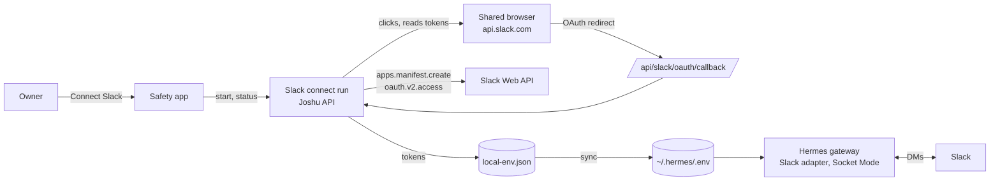

# Slack chat

## Purpose

Slack chat lets the owner talk to the companion in Slack, in a direct message that reads like a direct message with a coworker. Each box has its own Slack app in the workspace of the owner. The Hermes gateway runs the Hermes Slack adapter in Socket Mode with the tokens of that app, and Joshu sets up the app, saves the tokens, and tells Hermes how to behave in Slack.

## Motivation

The first version of the setup asked the owner to make a Slack app on api.slack.com, copy a manifest, copy two tokens and a Slack member ID into the Safety app, and confirm a restart. Few owners finished it, and the companion stayed silent until the owner wrote first. Slack also stopped accepting the older `assistant_view` messaging experience for new apps, so the old manifest no longer worked for new apps.

These constraints shaped the design:

- Socket Mode needs two tokens: a bot token (`xoxb-`) and an app-level token (`xapp-`). Slack has an API to make an app from a manifest, but no API to make an app-level token or the configuration token that the manifest API needs. Both appear only on pages of api.slack.com.
- Slack blocks many datacenter IP addresses, so a box reaches api.slack.com through the shared browser, which uses a residential proxy on local Chromium or the proxy of Browser Use Cloud.
- Tokens must not reach a model, a trace, or a log. A model that drives the pages would see the tokens, so the steps on api.slack.com are fixed code.
- Most target owners run their own small Slack workspace and can add apps there. A central Slack app for all boxes would need a router for Socket Mode events and would keep the tokens of all owners in one place, so each box keeps its own app.

## Architecture

The parts and what each one owns:

- The Safety app (`apps/safety-settings/src/SlackChatCard.tsx`) shows the Slack card. It starts a Slack connect run, polls its status, opens jWeb, and has the manual path and the pairing code field.
- The Slack connect run (`src/slackConnect/run.ts`) is a state machine in the memory of the Joshu API. It holds the configuration token, the app token, the bot token, and the client secret of one run, and it drops them when the run ends. Its status has a phase and a hint, never a token.
- The browser steps (`src/slackConnect/browserSteps.ts`) click by role and visible name on api.slack.com and find tokens by their prefix pattern.
- The Slack Web API calls (`src/slackConnect/slackApi.ts`) take the token as an argument and put only the method name and the Slack error code into an error.
- The finish step (`src/slackConnect/finish.ts`) checks and saves the tokens, finds the Slack user of the owner, and sends the first direct message.
- The box manifest (`buildBoxSlackManifest` in `src/hermesSlackSetup.ts`) comes from `hermes slack manifest --agent-view`, with Joshu changes.
- `syncJoshuSlackSuggestedPrompts` writes the Slack settings of Hermes into `platforms.slack.extra` of `~/.hermes/config.yaml`.
- `.joshu/safety-settings/local-env.json` holds the saved Slack values (`SLACK_BOT_TOKEN`, `SLACK_APP_TOKEN`, `SLACK_ALLOWED_USERS`, `SLACK_HOME_CHANNEL`, `SLACK_APP_ID`). Joshu copies them into `~/.hermes/.env`, and the Hermes gateway reads that file when it starts.

## Theory of operation

A Slack connect run goes through these phases:

1. `sign_in`: the run opens `https://api.slack.com/apps` in the shared browser, and the Safety app opens jWeb. The owner signs in. On each poll, the run reads every tab: the address, the title, the visible headings, the open dialog, and the state of **Generate Token**. Text that looks like a token is masked in the page. The run names each page (sign-in page, workspace list, 2-factor page, "Launching <workspace>", Your Apps signed out, Your Apps ready, or other), takes the tab that is furthest in the sign-in, and decides. On a page that Slack shows after a sign-in ("Launching <workspace>", `docs.slack.dev`, the web client), the run keeps one tab and opens the apps page. On a page that only the owner can finish, the hint says what Slack shows and what to do. The run goes on when the only tab is the apps page with **Generate Token**. **I'm signed in** in the Safety app (route `POST /api/safety-settings/slack-connect/signed-in`) makes the run keep one tab and open the apps page at once; the run does not wait for it.
2. `configuration_token`: the run clicks **Generate Token**, selects the workspace when the list has one workspace, and clicks **Generate**. Slack shows a configuration token only behind a **Copy access token** button, so the run puts a copy catcher into the page, clicks the button, and reads what Slack copied. The catcher writes nothing to the clipboard. Slack allows one configuration token for each workspace. When the page already shows one token and **Generate Token** is disabled, the run uses that token.
3. `create_app`: the run calls `apps.manifest.create` with the box manifest.
4. `app_token`: the run opens the settings page of the new app, clicks **Generate Token and Scopes**, adds scope `connections:write`, and clicks **Generate**. Slack shows the app token in a read-only input.
5. `install`: the run opens the OAuth authorize URL with a random `state`. The owner clicks **Allow**. Slack sends the browser to `/joshu/api/slack/oauth/callback`, and the run exchanges the code with `oauth.v2.access` for the bot token and the ID of the user who clicked **Allow**.
6. `finishing`: the run saves the tokens and the Slack user of the owner, opens the direct message channel, and saves it as the Slack home channel when none is set. Then Joshu restarts the Hermes gateway and waits until a new gateway process answers. After that the companion sends the first direct message.

Each click step checks its result before the next click (the dialog opened, the list opened) and runs up to 3 times. When **Generate Token** opens no dialog, the run loads the apps page again before the next try. Each failed try writes a log line with the name of the step that stopped it, and no token. When the workspace list has more than one workspace, the run picks the workspace of the page "Launching <workspace>" of the sign-in. When the tries fail, the run sets a hint that names the button, and the owner clicks it in jWeb. The run keeps polling, so a token that appears after the click of the owner still counts. Only a token that was not on the page before the click counts, so an old token is never used by mistake.

The manual path saves tokens that the owner copies. Joshu checks each new token with Slack (`auth.test`, `apps.connections.open`) before it saves anything. When the Slack user of the owner is unknown, Joshu looks up the owner email with `users.lookupByEmail`. When that fails too, the companion answers the first direct message with a pairing code, and the owner enters the code in the Safety app.

## Design decisions

- **2026-10-09: fixed code drives api.slack.com, not the companion.** The alternatives were the companion clicking through the pages, and one central Slack app for all boxes. The companion would see the tokens, and they would reach traces. A central app needs a Socket Mode router and holds the tokens of all owners. Fixed code keeps the tokens in one process and needs only a sign-in and one click from the owner.
- **2026-10-09: find tokens by pattern, click by visible name.** Slack changes its pages. A moved button costs the owner one click when the hint names it, and the token search does not depend on the layout.
- **2026-10-10: the copy catcher reads the configuration token.** The page has no other place where the token appears. The alternative, reading the clipboard of the browser, needs a permission and writes the token to the clipboard of the shared browser.
- **2026-10-09: the box manifest uses `agent_view` and two slash commands.** Slack lets new apps use only `agent_view`. The full Hermes command list has about 50 operator commands, for example `/yolo` and `/model`, which an owner does not need in a direct message. The manifest keeps `/new` and `/stop`.
- **2026-10-10: the first direct message waits for the gateway restart.** When the message went out before the restart, an owner who answered at once got no answer, because the old gateway had no Slack connection. The restart keeps its wait while the gateway runs a cron job, a turn, or a live call, and the run status tells the owner that the companion is finishing a task.
- **2026-10-11: the boot script does not export the Slack and Telegram values of `~/.hermes/.env`.** The boot script loads `~/.hermes/.env` into the environment of the Joshu API, and an old copy of a token there won over a newer save of the Safety app until the next restart. The boot script now unsets the messaging keys after it loads the file, and a key in `instance.env` still wins.
- **2026-10-11: one flat direct message conversation.** Hermes answers each new direct message in a new thread with its own session by default. Joshu sets `reply_in_thread: false` and `dm_top_level_threads_as_sessions: false`, so the direct message reads like a direct message with a coworker. The idle reset of 30 minutes still starts a fresh session after a quiet gap. A mention in a channel also gets a reply in the channel.
- **2026-10-11: no restart notice in Slack.** Joshu restarts the Hermes gateway at boot and after config changes, and Hermes posted "Gateway shutting down" into the direct message each time. Joshu sets `gateway_restart_notification: false` for Slack. Hermes still resumes the session when the owner writes again.

- **2026-10-14: the run reads the browser, decides in code, acts, and checks.** The first build watched only the first tab, took the text of the apps page as proof of a sign-in, and clicked **Generate Token** one time without a check. When a sign-in ended in a new tab and the page did not answer the click, the owner saw "sign in to Slack" while Slack showed "Launching <workspace>". The run now reads every tab on each poll, names the page, says what it sees, acts, and goes on only when the next page shows the expected result. Plain code decides, because the pages differ by address and heading and each action is a fixed browser step; a model on each poll would add seconds and cost. A page that the code cannot name goes to the owner with its title, and **I'm signed in** tells the run to go on. The boot data of the apps page is not used as a sign-in signal: after a sign-in that worked, it still said that the visitor was not signed in.
- **2026-10-14: a click step that fails loads the page again and tries again.** On a live box, the apps page once did not answer **Generate Token** for the run or for the owner. A new load of the page is the standard fix, and a log line names the step that stopped each try.

## Limits and failure modes

- The owner must be able to add apps to the workspace. In a workspace where an admin approves apps, Slack shows "Request to install", and the run fails after 30 minutes. The owner starts again after the approval.
- The run lives in memory. A restart of the Joshu API loses it, and the owner starts again.
- The names of the sign-in pages come from their address and heading. When Slack changes them, the run names the page "other", and the owner finishes the page and clicks **I'm signed in**.
- If Slack changes the copy button of the configuration token, the run cannot read the token. The hint asks the owner to click, and the owner can use the manual path.
- On Browser Use Cloud, a page that Slack opens in a new tab (for example the 2-factor page) is visible only when jWeb shows the browser chrome of Browser Use (see [the shared browser notes](../hitl-camofox-notes.md)).
- Each new connection makes a new Slack app. The run deletes the earlier app only when the box saved its app ID and the configuration token belongs to the same workspace.
- In a channel, the companion answers only a message that mentions it.

## Code map

| Part | Files |
|---|---|
| Run and routes | `src/slackConnect/run.ts`, `src/slackConnect/routes.ts` |
| Pages of api.slack.com | `src/slackConnect/browserSteps.ts` |
| Slack Web API | `src/slackConnect/slackApi.ts` |
| Save, owner lookup, first message | `src/slackConnect/finish.ts` |
| Pairing code | `src/slackConnect/pairing.ts`, `scripts/patch-hermes-pairing-reply.py` |
| Manifest, setup status, Hermes settings | `src/hermesSlackSetup.ts` |
| Save route and access gate | `src/safetySettings/routes.ts` |
| Restart that waits for the new gateway | `applyConfigAndAwaitGatewayRestart` in `src/hermesApi.ts` |
| Boot environment | `unset_safety_messaging_env` in `deploy/scripts/vps-start.sh` |
| Safety app card | `apps/safety-settings/src/SlackChatCard.tsx` |
| Tests | `npm run test:slack-connect`, `npm run test:gateway-restart-guard` |
