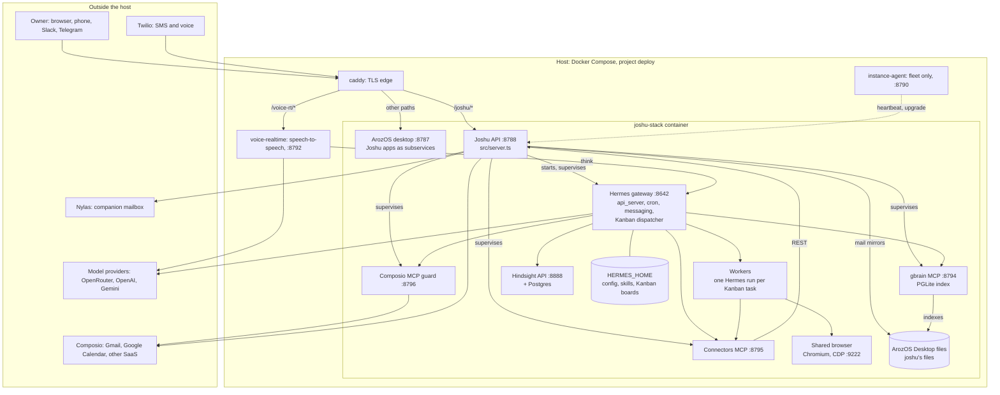

# System overview

This document tells how one Joshu box is built from end to end, and why the main boundaries between its parts exist. Read it before the document of a single subsystem. Each section links to the document that has the details.

## Purpose

A box is one Joshu instance on its own host. It gives one owner a companion: an AI assistant with its own name, email address, and phone number. The companion works in a web desktop (ArozOS), reads and files the owner's mail and calendar, answers on SMS, phone, Slack, Telegram, and web chat, and runs long jobs in the background as Kanban tasks. One Docker Compose stack on one host runs everything that the box needs, except the model providers and the SaaS connectors.

## Motivation

The design follows from a small set of facts and constraints:

- **One owner for each box.** Each owner gets a separate host and a separate data volume. There is no multi-tenant database, so a bug or a bad prompt cannot show the data of one owner to a different owner. The cost is one host for each owner, which is acceptable for a personal companion.
- **An agent runtime that changes quickly.** Joshu uses [Hermes](https://github.com/NousResearch/hermes-agent) as its agent runtime. Hermes gets new features every week (Kanban, memory providers, messaging platforms, skill learning). Joshu wants those features without a merge each week, so Joshu keeps Hermes as an upstream dependency (see "Design decisions").
- **Mail is large, slow, and rate-limited.** Live mail APIs are slow for an agent that searches often, and they limit the request rate. The companion also needs to search mail together with the files of the owner. So Joshu copies mail and calendar into Markdown files on the box, and indexes them with the same search index as the other files.
- **The companion acts for a person.** A message that the companion sends to a third party cannot be taken back. Joshu, not the model, decides which writes are blocked, which writes need the approval of the owner, and which writes are allowed.
- **The owner is often on a phone.** The owner talks to the box by SMS and by phone call more than on the desktop. A long job must not keep the owner on the line, and the result must come back on a channel that reaches the owner.
- **Open source.** The box stack is published under AGPL-3.0. A person can run a box on their own host without the managed control plane. Fleet-only parts (provisioning, billing, the managed control plane) are outside this repository.

## Architecture

The boxes in the diagram are the components. The next table gives the boundary and the data of each component.

| Component | What it is | Data that it owns | Details |
|---|---|---|---|
| Caddy | The TLS edge of the host. It sends `/joshu/*` to the Joshu API, `/voice-rt/*` to the voice service, and each other path to ArozOS. A separate host name, with basic auth, goes to the Hermes dashboard. | TLS certificates. | [`box-api-edge-security.md`](../vps-sandbox/box-api-edge-security.md) |
| ArozOS desktop | An upstream web desktop ([ArozOS](https://github.com/tobychui/arozos)), built from `vendor/arozos` with the patches in `patches/arozos/`. It gives the owner a login, a file manager, and windows. Joshu apps (jMail, jChat, jWhiteboard, Connectors, Safety, Telephone, Schedules, and others) are ArozOS subservices. | The Desktop file tree of the owner, which is the system of record for files. | [`arozos-desktop-shortcuts.md`](../arozos-desktop-shortcuts.md) |
| Joshu apps | Vite and React apps in `apps/`, packaged as subservices in `arozos/subservice/`. Each app has a manifest `joshu.app.json` that declares the data it uses, the GUI actions that the companion may do, and the headless actions. | Nothing: an app reads and writes through the Joshu API. | [`platform-architecture.md`](../platform-architecture.md), [`app-sdk.md`](../app-sdk.md) |
| Joshu API | The Node.js server of Joshu (`src/server.ts`, an Express server built to `dist/server.js`). It serves `/joshu/api/…`, starts and supervises the Hermes gateway, supervises the MCP servers, writes the Hermes configuration, receives the Twilio webhooks, syncs mail, and enforces the safety tiers. | Joshu state under `.joshu/` (registry, policy, goals, outbox), the mail mirrors, and the Hermes configuration that it generates. | This document, and each subsystem document. |
| Hermes gateway | The long-running process `hermes gateway run`. It runs chat turns for jChat and the API (the `api_server` platform on port 8642), Hermes cron jobs, the Telegram and Slack platforms, and the Hermes Kanban dispatcher. | `HERMES_HOME`: sessions (`state.db`), cron jobs, Kanban boards, box skills. | [`hermes-integration.md`](../hermes-integration.md) |
| Workers | One Hermes run for each Kanban task. The dispatcher of the gateway starts a worker every 60 seconds for each task that is ready. A worker loads the skills named on the task and ends with `kanban_complete` or `kanban_block`. | Its own task only. | [`realtime-goals-theory-of-operation.md`](realtime-goals-theory-of-operation.md) |
| Skills and Hermes plugins | Factory skills in `integrations/hermes/skills/` (procedures in `SKILL.md` files) and Hermes plugins in `.hermes/plugins/` (Python hooks and tools). The skills seed copies the factory skills into box skills that Hermes can change. | Box skills under `HERMES_HOME/skills/joshu/`. | [`hermes-integration.md`](../hermes-integration.md) |
| MCP servers | Three local HTTP MCP servers. The start script starts them, and the MCP supervisor of the Joshu API (`src/mcpSupervisor.ts`) restarts each one that fails its health check: the connectors MCP (`:8795`, tools for mail, calendar, Kanban; each tool calls the Joshu API), the gbrain MCP (`:8794`, file search), and the Composio MCP guard (`:8796`, a proxy to Composio that applies the safety tiers). | Nothing: they are adapters. | [`connectors.md`](../connectors.md), [`agent-safety.md`](../agent-safety.md) |
| Connectors | Composio holds the OAuth tokens of the owner's Gmail and Google Calendar. Nylas holds the mailbox of the companion. The Joshu API syncs both into mail mirrors and calendar files every 10 minutes. | Mail mirrors and calendar files under `joshu's files/connectors/`, and sync cursors. OAuth tokens stay in Composio. | [`connectors.md`](../connectors.md) |
| gbrain | An upstream file index ([gbrain](https://github.com/garrytan/gbrain)) with hybrid search (keywords and embeddings) in PGLite. It indexes the whole Desktop of the owner, which includes the mail mirrors. | The index under `/root/.gbrain`. The files stay the source of truth. | [`file-brain.md`](../file-brain.md) |
| Hindsight | The upstream long-term memory service, installed in the Hermes environment and run as an API on `:8888` with its own Postgres. Hermes uses it as its memory provider: it recalls memories into each turn and retains facts from each conversation. | The memory bank of the companion. | [`hermes-integration.md`](../hermes-integration.md#hindsight-memory) |
| Shared browser | One Chromium for the companion, the workers, and the owner, in the stack container (or a Browser Use Cloud session). The owner sees it live in jWeb and on the browser handoff page. | Browser profile and cookies. | [`hitl-camofox-notes.md`](../hitl-camofox-notes.md) |
| Voice service | `packages/voice-realtime/`, in its own container. It runs the call gate and a speech-to-speech model (OpenAI Realtime or Gemini Live) for phone calls and browser voice. | Nothing durable. | [`twilio-self-host.md`](../vps-sandbox/twilio-self-host.md) |
| Instance agent | An optional sidecar for the managed fleet (`--profile fleet`). It sends heartbeats to the control plane and runs signed upgrade commands. A self-hosted box does not run it. | Nothing. | [`instance-agent-protocol.md`](../vps-sandbox/instance-agent-protocol.md) |

Most processes run in one container, `joshu-stack`, which the start script `deploy/scripts/vps-start.sh` brings up in order: the shared browser, Postgres and Hindsight, ArozOS, gbrain and its MCP server, the Joshu API, the connectors MCP, and the Composio MCP guard. The Joshu API starts the Hermes gateway as a child process. The voice service and the instance agent are separate containers in the same compose project (compose profiles `voice-rt` and `fleet`). All services use the network of the host, and each internal port listens on `127.0.0.1` only. Persistent data is on named volumes: ArozOS data, `HERMES_HOME`, Hindsight, Postgres, and gbrain. The Joshu API keeps its own state (team rooms, proactive state, browser handoffs, SMS sessions) in the Joshu state folder `/var/lib/arozos/joshu-state`, in the ArozOS volume. The code is in the release image only; [`runtime-topology.md`](../vps-sandbox/runtime-topology.md) lists the paths, the environment variables, and the boot order.

## Theory of operation

Four paths cover most of what a box does. Each path shows the same model: **the Joshu API decides, Hermes thinks, Kanban holds long work, and files hold the data.**

### A chat turn

1. The owner types in jChat. The app posts to the Joshu API, which sends the turn to the `api_server` platform of the Hermes gateway and streams the answer back as server-sent events.
2. Before the turn, Hermes recalls memories from Hindsight into the context. During the turn, the model calls tools: the gbrain MCP to search files and mail mirrors, the connectors MCP for mail, calendar, and Kanban actions, and the Composio MCP guard for other SaaS tools.
3. If the companion must change the screen, it calls the Hermes tool `app_gui_action`. The Joshu API queues the action, checks it against the manifest of the app, and the app in the browser runs it.
4. After the turn, Hindsight retains new facts from the conversation.

jChat and the chat panels in apps are synchronous: the owner is at the desktop and waits for the stream, so these turns never go to the background.

### A message on SMS, Slack, Telegram, or the phone

1. A message arrives: Twilio posts an SMS to the Joshu API, the Slack or Telegram platform of the Hermes gateway receives a message, or the voice service calls the Joshu API from a phone call. On a phone call the call gate checks the passphrase, the PIN, or the trusted caller ID before the voice agent hears the caller.
2. The realtime-goal broker in the Joshu API decides whether the message is a short turn or long work. A follow-up to an open job goes to that job without a model call. Otherwise a small router model chooses: answer now (`pass`), queue new long work (`queue`), or answer a cancel, a status question, or an acknowledgment directly.
3. On `pass`, Hermes answers in one turn, and the answer goes back on the same channel (an SMS, a Slack reply, or speech).
4. On `queue`, the box acknowledges at once, waits a short commit window for changes, and then puts one Kanban task on the `realtime-goals` board. A worker runs the task. A question from the worker (`kanban_block`) and the final result (`kanban_complete`) go back to the owner through the owner outbox, on the channel where the owner is.

[`realtime-goals-theory-of-operation.md`](realtime-goals-theory-of-operation.md) explains this path in full.

### Mail

1. Every 10 minutes the Joshu API syncs the owner's Gmail (through Composio) and the companion's mailbox (through Nylas) into mail mirrors: one Markdown file for each thread.
2. gbrain indexes the new files, so the companion finds mail with the same search as the other files.
3. For each new email that needs filing, Joshu code writes a triage stub in `Triage/` and puts an ingress task on the `ea-mail-ingress` board. A worker files the email into a project, and can make a track task, a scheduling task, or a reply task for the owner on other boards. When the newest message of a thread is older than 36 hours (`JOSHU_EA_SCHEDULING_MAX_AGE_HOURS`), the thread gets the mail mirror only, with no LLM classifier call, no triage stub, and no ingress task.
4. When the companion sends mail, it uses the connectors MCP tool `nylas_send_message`. The Joshu API applies the safety tiers before the send.

### A write that affects a third party

1. The companion calls a tool that writes: it sends mail, makes a calendar event, posts to a SaaS tool, or clicks a submit button in the shared browser.
2. Tier 1 (hard block) runs first, in the MCP proxies and in the Joshu API. Some tools are never available to the companion, for example Gmail send through Composio and each delete.
3. Tier 2 (action guard), when the owner turned it on: the Joshu API texts the owner a Yes or No question and waits. On approval the write runs. On a denial or a timeout the tool returns a stub that looks like success, so the model does not try again in a loop, and no write happens.
4. Tier 3 (optional classifier) decides only the unclear cases.

[`agent-safety.md`](../agent-safety.md) has the tiers, the gated paths, and the configuration.

### Background work that nobody asked for

Hermes cron jobs run morning and shutdown reviews, the hourly proactive tick, and other scheduled work in the Hermes gateway. The proactive tick reads the Kanban boards and sends the owner at most one nudge a day about a task that waits for an answer from the owner. Joshu code puts tasks on boards through the Kanban bridge (`src/hermesKanbanBridge.ts`); a worker can create a task on a different board only through a connectors MCP tool, so the Joshu API sees each new task.

## Design decisions

**2026-05: Hermes is an upstream dependency, not a fork.**
Decision: the image installs Hermes from upstream at a pinned commit (`hermesRef` in `deploy/RELEASE.json`). Joshu changes Hermes behavior only through supported points: skills, Hermes plugins, environment variables, and the configuration that the Joshu API writes. When no supported point exists, a small idempotent patch script (`scripts/apply-hermes-*.sh`, `scripts/patch-hermes-*`) edits the installed copy at image build and again at each start.
Alternatives: a fork of Hermes; or a separate agent runtime written for Joshu.
Reason: Hermes changes fast, and Joshu gets each new feature with a pin change. A fork would need a merge for each upstream release. Each patch script is small and fails loudly when upstream changes the code that it edits, and the goal is to upstream a generic hook and then delete the patch.

**2026-05: ArozOS and gbrain are upstream projects too.**
Decision: ArozOS is built from `vendor/arozos` with a small set of patches, and gbrain is installed from a pinned commit (`gbrainRef`). Joshu adds apps, scripts, and configuration, not forks.
Alternatives: a desktop and a search index written for Joshu.
Reason: the same reason as for Hermes. One consequence: gbrain changes each page slug to lowercase, so the folder of the companion is `joshu's files` in lowercase.

**2026-06: Markdown mirrors of mail, not live mail search.**
Decision: the Joshu API copies mail and calendar into Markdown files on a 10-minute schedule, and the companion searches the files with gbrain. Live Composio calls are the second step, only when the mirror does not have the email (for example mail older than the connection).
Alternatives: let the companion call the Gmail and Nylas APIs for each search.
Reason: a local search is fast, has no rate limit, works the same for each provider, and searches mail together with the projects and notes of the owner. The files are also readable by people and by deterministic code, for example the mail classifier. The connectors MCP is kept small: actions, not search.

**2026-06: Joshu enforces safety, in three tiers.**
Decision: hard blocks, owner approval by SMS, and an optional classifier, applied in the MCP proxies and in the Joshu API. The Composio MCP of the companion goes through the local guard proxy, not straight to Composio. The owner's own actions in the desktop apps are not gated.
Alternatives: trust the model and the skills to ask; or use only the modifiers of the Composio SDK.
Reason: a prompt is not a guarantee. The model can reach the same write through many paths (an MCP tool, `execute_code`, `curl`, the browser), so the rule must be in code that each path goes through. A denial returns a success-shaped stub, because a model that sees an error tries a different path.

**2026-06: The app layer talks to a platform, not to Hermes.**
Decision: apps declare the data that they use and the GUI actions that the companion may do in `joshu.app.json`, and use `@joshu/platform-data` for data. The companion has one GUI tool, `app_gui_action`, for all apps.
Alternatives: each app talks to the MCP servers and to Hermes directly.
Reason: app code stays the same when ports, paths, or the agent runtime change, and the Joshu API checks each GUI action against the manifest.

**2026-09: Long work from a realtime channel goes to Kanban.**
Decision: SMS, phone, Slack, and Telegram go through the realtime-goal broker. Long work becomes one Kanban task, and the result comes back through the owner outbox. jChat stays synchronous.
Alternatives: run each message as one long Hermes turn; or let the model decide in the turn to start background work.
Reason: a long turn blocks the channel, times out on the phone, and is lost when the process stops. A Kanban task is durable, can ask the owner a question and wait, and has one place for its status.

**2026-10: The release image holds all code.**
Decision: a box runs code and factory skills from the release image only. The host has a small host bundle (the compose file, Caddy scripts, and the installer), and a hotfix overlay that each upgrade empties.
Alternatives: a git checkout on each host, mounted over the image.
Reason: with a checkout, each box could run different code than its release, and nobody could tell which. With the image, the release number tells what runs.

**2026-10: The Joshu API keeps its state in a volume, and the upgrade carries the old state over.**
Decision: the sandbox image sets `JOSHU_STATE_DIR=/var/lib/arozos/joshu-state`, and the Joshu API reads and writes its state there (`src/joshuStateDir.ts`). Before the instance agent recreates the stack container, it runs `deploy/scripts/carry-over-joshu-state.sh` in the old container, and the script copies the state of earlier releases from `/opt/joshu/.joshu` into the volume. The Joshu API runs the same copy at boot for a restart without a recreate. Neither copy overwrites state that is already in the volume.
Alternatives: a new named volume mounted at `/opt/joshu/.joshu`; or the `.joshu` folder of the ArozOS user, where the Nylas grants and the last30days state are.
Reason: the old state is in the writable layer of the old container, so only a process that runs before the recreate can read it. The old container already mounts `joshu_arozos` at `/var/lib/arozos`, so a plain `cp` in the old container writes to a place that the new container sees, with no change to the compose file. A new volume is empty in the old container, so the agent would need to copy the files out to the host and back into the volume. The folder of the ArozOS user depends on the name of the user, which the copy script in the old container cannot compute.

**2026-10: An upgrade removes old release images.**
Decision: after an upgrade or a rollback, when the stack is healthy, the box runs `deploy/scripts/prune-release-images.sh` from the host bundle. For each repository of the current release images, the script keeps the current release, the newest other image (the previous release, for a rollback), and each image that a container uses. The script removes the other images of those repositories and the dangling images. The instance agent and `scripts/lib/upgrade-box-remote.sh` both run the same script, and a failure of the script never fails the upgrade. `JOSHU_PRUNE_RELEASE_IMAGES=0` in `instance.env` turns the cleanup off.
Alternatives: the cleanup in TypeScript in the instance agent; a cron job on the host; `docker image prune -a`.
Reason: Docker keeps each pulled image, and the sandbox image is about 8 GB, so a box that gets many releases fills its disk. One script in the host bundle gives both upgrade paths the same rule. A cleanup at upgrade time, after the health check, keeps the previous release for a rollback, which `docker image prune -a` would remove.

**2026-10: A helper container replaces the instance agent in a release update.**
Decision: in the prepare step of a release update or a rollback, the instance agent does not recreate its own container. It starts the agent replace helper, a container named `joshu-agent-replace` from the agent image of the target release, and the helper runs `docker compose up -d --no-deps --force-recreate instance-agent` with the Docker socket and read-only mounts of `/opt/joshu` and `/etc/joshu`. The helper gets no secret of the agent. The old agent waits, and when the helper exits or hangs for 5 minutes while the old agent still runs, the old agent removes the pending update file and fails the command with the helper log. Code: `packages/instance-agent/src/agentReplace.ts`.
Alternatives: a systemd unit on the host that the agent starts; a detached child process in the agent container; the same compose command without `--force-recreate`; a helper with `--rm`.
Reason: compose creates the new container first and then stops the old one, so a compose process in the old agent container died with that stop, and the new container stayed in state `Created`. The helper is outside the compose project, so the stop does not reach it. The agent image already has the Docker CLI and the compose plugin, so the fix needs no new file on the host. A systemd unit would need a new mount and a unit file on each host, a child process dies with its container, and compose recreates on an image change even without `--force-recreate`. The helper has no `--rm`, so the old agent can read its log after a failure, and the next agent removes it. The old agent waits instead of exiting, because Docker restarts an agent that exits by itself, and the restarted old agent would resume the pending update next to the new one.

**2026-10: The new instance agent does not register while it resumes a release update.**
Decision: when the pending update file exists at start, the instance agent skips `register`, resumes and acks the update, and then starts the heartbeat loop. Other starts call `register` as before.
Alternatives: call `register` after the resumed update; change the control plane so that `register` keeps the status `updating`.
Reason: the control plane sets the status `bootstrapping` on each `register`, and the apply step runs for minutes with no heartbeat, so the deploy workflow read the status on the old release as a rollback. The old agent registered the box already, so the second call adds nothing, and the fix needs no control plane release.

**2026-10: One shared browser, local Chromium or Browser Use Cloud.**
Decision: the companion, the workers, and the owner use one browser, and the owner sees it live. Camofox was removed in release 0.1.51.
Alternatives: a separate headless browser for the companion.
Reason: the owner can take over for a sign-in or a payment, and the companion continues in the same session with the same cookies.

**2026-10: Old mail gets a mail mirror, not a triage stub.**
Decision: when the newest message of a mirrored thread is older than the age limit of mail ingest (36 hours by default), `createTriageStubAfterMirror` writes no triage stub. The check is one early exit in the function that both mail syncs call, and it reuses the age limit that already stopped the LLM classifier for old mail.
Alternatives: write the triage stub and move it to `Triage/_done/` at once, as for mail that the classifier calls `info`; skip the triage stub only in the Gmail sync; use a second, longer age limit for the triage stub.
Reason: a catch-up of a long Gmail history once wrote 583 triage stubs for mail that was 3 to 11 months old, and the morning and evening cron jobs then listed them. A triage stub for old mail had no ingress task, so no worker filed it. An archived stub for each old thread would add thousands of files that nobody reads, and the mail mirror already records the thread. One check in the shared function covers the Gmail sync and the Nylas sync, and one age limit keeps the classifier and the triage stub in agreement.

## Limits and failure modes

- **One owner, one host.** A box does not serve more than one owner. Teams of companions (Multiplayer) connect separate boxes over HTTPS; see [`teams.md`](../teams.md).
- **The Joshu API is a single point of failure.** It starts the Hermes gateway and supervises the MCP servers. The compose health check calls `/joshu/api/instance/health`, and Docker restarts the stack container when the container exits (`restart: unless-stopped`); a health check that fails does not restart the container by itself. The MCP supervisor restarts an MCP server that fails its health check, and tells the gateway when the connectors MCP is back.
- **Mail mirrors can be late.** A mirror can be up to 10 minutes old, and the first connection does not copy old mail (Day 0 copies the last 30 days once). The companion falls back to a live search when the mirror misses.
- **Mail that reaches the box late is not triaged.** After an outage of more than 36 hours, the mail sync mirrors the mail of the outage but writes no triage stub and no ingress task for it. Raise `JOSHU_EA_SCHEDULING_MAX_AGE_HOURS` for the catch-up when that mail needs filing.
- **Localhost is not a trust boundary.** Caddy sends public requests to `127.0.0.1`, so the Joshu API cannot trust the source address. Routes that only the box may call use `isDirectLocalhostRequest`, and browser routes check same-origin headers and cookies. [`box-api-edge-security.md`](../vps-sandbox/box-api-edge-security.md) lists the gates and the remaining risk.
- **The action guard needs an owner mobile.** Without a configured owner mobile, tier 2 cannot ask the owner, and only tier 1 protects writes.
- **Hermes upgrades can break a patch.** Each patch script checks the code that it edits. After a pin change, run the checks in [`hermes-integration.md`](../hermes-integration.md) before a release.
- **A stdout write can stop the gateway.** The Joshu API reads the output of the gateway. A Hermes plugin that writes much text to stdout can fill the pipe and stop each turn, so plugins log with Python `logging`; see [`.hermes/plugins/README.md`](../../.hermes/plugins/README.md).
- **Models and SaaS are outside the box.** The box needs the model providers, Composio, Nylas, and Twilio. When one of them fails, the matching feature fails; the rest of the box keeps working.

## Code map

| Area | Path |
|---|---|
| Compose stack and Caddy | `deploy/docker-compose.yml`, `deploy/scripts/render-caddyfile.sh` |
| Start order of the stack container | `deploy/scripts/vps-start.sh` |
| Image build and pins | `deploy/Dockerfile`, `deploy/RELEASE.json` |
| Joshu API entry point | `src/server.ts` |
| Hermes gateway start and configuration | `src/hermesApi.ts`, `src/hermesSkillsConfig.ts` |
| MCP supervisor | `src/mcpSupervisor.ts` |
| Connectors MCP | `scripts/joshu-connectors-mcp-http-server.mjs` |
| Composio MCP guard | `scripts/composio-mcp-guard-proxy.mjs` |
| Mail and calendar sync | `src/connectors/`, `src/nylas/` |
| Executive assistant mail flow | `src/ea/` |
| Kanban bridge | `src/hermesKanbanBridge.ts`, `scripts/hermes-kanban-bridge.py` |
| Realtime-goal broker and owner outbox | `src/realtimeGoals/` |
| Safety tiers | `src/mcpToolPolicy.ts`, `src/actionGuard/`, `src/ownerChannel/` |
| SMS and phone webhooks | `src/twilioSmsGateway.ts`, `src/twilioPhoneGateway.ts`, `src/voiceGate.ts` |
| Voice service | `packages/voice-realtime/` |
| App registry, invoke API, GUI actions | `src/appRegistry.ts`, `src/appInvokeApi.ts`, `src/appGuiActionApi.ts`, `src/agUiApi.ts` |
| App packages | `packages/platform-data/`, `packages/app-agent/`, `packages/app-sdk/` |
| Apps | `apps/`, `arozos/subservice/` |
| ArozOS source and patches | `vendor/arozos/`, `patches/arozos/` |
| Hermes patches | `scripts/apply-hermes-*.sh`, `scripts/patch-hermes-*` |
| Factory skills and allowlist | `integrations/hermes/skills/`, `integrations/hermes/skills-enabled.yaml` |
| Hermes plugins | `.hermes/plugins/` |
| Hindsight recall for apps | `src/hindsightRecallApi.ts` |
| Tests | `npm run test:platform-architecture` and the `test:*` scripts in `package.json` |
