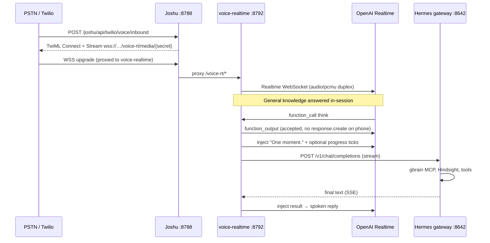

# Speech-to-Speech Voice (OpenAI Realtime)

Low-latency **speech-to-speech** voice using OpenAI Realtime (`gpt-realtime-2`):

- **PSTN** — Twilio Media Streams (`audio/pcmu`)
- **Browser** — jChat / jMail WebSocket (`audio/pcm`, 24 kHz) — see [web-voice.md](web-voice.md)

**Core model:** [voice-think-speak.md](voice-think-speak.md) — when to **think** (Hermes) vs what to **say** (Realtime speech).

Implementation: [`packages/voice-realtime/`](../../packages/voice-realtime/).

**Self-host Twilio (buy number + Console + `instance.env`):** [`twilio-self-host.md`](twilio-self-host.md).

## Architecture



| Layer | Path | Role |
| --- | --- | --- |
| **Inbound TwiML** | Joshu [`twilioPhoneGateway.ts`](../../src/twilioPhoneGateway.ts) | Signature check, `<Redirect>` to the call gate (`/voice-rt/gate`), which returns `<Connect><Stream>` |
| **Voice UX** | `packages/voice-realtime` (`:8792`) | OpenAI Realtime session, Twilio μ-law or browser PCM24k, barge-in, tool dispatch |
| **Browser apps** | Same service, `BrowserRealtimeSession` | WSS `browser_start` / `browser_audio` — [web-voice.md](web-voice.md) |
| **Personal / user work** | Hermes `POST :8642/v1/chat/completions` | Files (gbrain MCP), Hindsight, writes, browser, shell |

Joshu proxies `/voice-rt/*` → `127.0.0.1:8792` ([`src/server.ts`](../../src/server.ts)).

Phone vs browser share `OpenAiRealtimeClient` but use separate session classes — see [voice-think-speak.md](voice-think-speak.md).

### Audio path

Follows [Twilio's OpenAI Realtime sample](https://github.com/twilio-samples/speech-assistant-openai-realtime-api-python):

- **Native `audio/pcmu`** end-to-end for PSTN (no ffmpeg resampling in the hot path)
- **PCM24k** for browser
- Direct delta forwarding ↔ OpenAI
- Mark queue + `conversation.item.truncate` on barge-in (phone)

Key files: `twilioRealtimeSession.ts`, `browserRealtimeSession.ts`, `openaiRealtimeClient.ts`.

### OpenAI stack (no separate TTS)

Joshu does **not** call `POST /v1/audio/speech` for phone or browser voice. All audible output is **OpenAI Realtime** over a WebSocket ([`openaiRealtimeClient.ts`](../../packages/voice-realtime/src/openaiRealtimeClient.ts)):

| Setting | Default | Role |
| --- | --- | --- |
| `OPENAI_REALTIME_MODEL` | `gpt-realtime-2` | S2S model |
| `OPENAI_REALTIME_VOICE` | `alloy` (or `JOSHU_VOICE_ID` from identity) | Spoken voice timbre |
| Input transcription (fixed in code) | `gpt-4o-mini-transcribe` | User speech → text on phone/browser |

Hermes (`think`) is a **separate** Chat Completions stream — it may appear in Langfuse; Realtime audio usually does not appear in [API Logs](https://platform.openai.com/logs). See [OpenAI Platform observability](voice-think-speak.md#openai-platform-observability).

### Why voice does not call `/api/brain/*`

Joshu exposes read-only brain HTTP routes for other fast clients ([`file-brain.md`](../file-brain.md)). **Voice does not use them.** Hermes already holds the PGLite lock via `gbrain serve`; a parallel `gbrain search` CLI from the brain API causes lock timeouts (502 / 15s+ hangs). All personal reads go through Hermes → gbrain MCP in one lane.

## Enable on VPS

**First-time Twilio wiring** (account, number, Console webhook, all required secrets): follow [`twilio-self-host.md`](twilio-self-host.md). Summary of voice-related env once Twilio is bought:

```bash
JOSHU_VOICE_MODE=realtime_s2s
OPENAI_API_KEY=...              # or GEMINI_API_KEY when JOSHU_VOICE_PROVIDER=gemini_live
HERMES_API_KEY=...              # same value as API_SERVER_KEY in instance.env
HERMES_API_BASE_URL=http://127.0.0.1:8642
TWILIO_AUTH_TOKEN=...
TWILIO_MEDIA_STREAM_SECRET=...  # openssl rand -hex 32
TWILIO_VOICE_WEBHOOK_URL=https://<host>/joshu/api/twilio/voice/inbound
TWILIO_MEDIA_STREAM_WSS_URL=wss://<host>/voice-rt/media/<secret>
TWILIO_THINK_PASSWORD=your-passphrase   # REQUIRED — without it PSTN routes stay disabled
# Optional:
# OPENAI_REALTIME_MODEL=gpt-realtime-2
# OPENAI_REALTIME_REASONING_EFFORT=low
# VOICE_PHONE_VAD_MODE=server_vad
# VOICE_PHONE_VAD_SILENCE_MS=500
# VOICE_PHONE_VAD_MODE=semantic_vad
# VOICE_PHONE_VAD_EAGERNESS=high
# VOICE_PHONE_VAD_THRESHOLD=0.62
# OPENAI_REALTIME_VOICE=alloy
# TWILIO_OWNER_CALLER=+15551234567   # optional env fallback; Telephone / Welcome preferred
# TWILIO_PHONE_SESSION_WARN_MS=60000
# TWILIO_PHONE_SESSION_HANGUP_MS=90000
# JOSHU_HERMES_MODEL=~anthropic/claude-sonnet-latest
# TWILIO_PHONE_SYSTEM_PROMPT=...
```

Set `TWILIO_THINK_PASSWORD` to two clear English words, e.g. `harbor lantern`, and set the other Twilio values as [`twilio-self-host.md`](twilio-self-host.md) describes. The owner can change the passphrase later in the Telephone app.

Compose profile **`voice-rt`** starts the service on port **8792**. Caddy proxies `/voice-rt/*` → `127.0.0.1:8792`.

The `voice-realtime` image is published to GHCR alongside the sandbox image (**`ghcr.io/<org>/joshu-oss-voice-realtime:<version>`** for self-host). `npm run vps:build-image` builds and pushes both when `JOSHU_IMAGE_PUSH=1`.

Compose uses **`JOSHU_VOICE_IMAGE_REF`** from `/etc/joshu/instance.env`, which the bootstrap script sets from the release pins. Local fallback: `docker compose build voice-realtime` when no GHCR ref is set.

**Release updates:** When `JOSHU_VOICE_MODE=realtime_s2s`, pull the voice image with the same tag as the sandbox image, recreate `joshu-stack`, wait for it to be healthy, and then force-recreate `voice-realtime` (profile `voice-rt`). The commands are below. A box that runs the instance agent (compose profile `fleet`) does the same steps on a release update. A production box pulls images and does not build with `npm install` on the host.

After changing `packages/voice-realtime/` locally, rebuild the voice image (`npm run vps:build-image` or `docker compose build voice-realtime`) before recreate.

**Provider:** `JOSHU_VOICE_PROVIDER=gemini_live` + `GEMINI_API_KEY` selects Gemini Live for browser and PSTN; default `openai` uses OpenAI Realtime. OpenAI phone uses manual turns (`create_response=false`); Gemini phone auto-responds like browser (see [Gemini PSTN](#gemini-pstn-twilio)).

```bash
# Production (GHCR)
docker compose -f deploy/docker-compose.yml --env-file /etc/joshu/instance.env --profile voice-rt \
  pull voice-realtime
docker compose -f deploy/docker-compose.yml --env-file /etc/joshu/instance.env --profile voice-rt \
  up -d --force-recreate voice-realtime

# Local dev (no GHCR ref)
docker compose -f deploy/docker-compose.yml --env-file /etc/joshu/instance.env build voice-realtime
docker compose -f deploy/docker-compose.yml --env-file /etc/joshu/instance.env --profile voice-rt up -d voice-realtime
```

When `JOSHU_VOICE_MODE=realtime_s2s`, set `TWILIO_MEDIA_STREAM_WSS_URL` to your public WSS media endpoint.

## Gemini PSTN (Twilio)

When `JOSHU_VOICE_PROVIDER=gemini_live`, phone and browser share the same Gemini Live upstream. PSTN differs from OpenAI phone:

| OpenAI PSTN | Gemini PSTN |
| --- | --- |
| `create_response=false` — Joshu calls `requestOrganicResponse()` after transcript | Gemini auto-responds on end-of-speech (like jChat) |
| Cancels unexpected organic via `response.cancel` | **Mutes** pre-user echo/noise (no `clientContent` interrupt — that garbled turn 2+) |
| Manual turn gate via `joshuInitiatedResponse` | Personal work still via `think` tool + Hermes inject |

Implementation: [`twilioRealtimeSession.ts`](../../packages/voice-realtime/src/twilioRealtimeSession.ts), [`geminiLiveClient.ts`](../../packages/voice-realtime/src/geminiLiveClient.ts) (`onInterrupted` vs user barge-in).

**Stale generations (Gemini has no `response.cancel`).** A "cancelled" or superseded generation keeps streaming until Gemini sends `interrupted` / `turnComplete`. `geminiLiveClient.ts` opens a short stale window (≤2.5 s): the old generation's audio and transcript are dropped, its `interrupted` counts as ours (not a barge-in), and when an inject/progress turn replaced it, the new turn keeps its reason (otherwise the filler/answer was relabeled "organic" and cancelled). Outside that window, a server `interrupted` means the caller talked over Joshu.

**Barge-in on Gemini PSTN.** Gemini deltas carry no item id, so no Twilio marks; the session estimates queued playback from bytes sent (`modelAudioPlaysUntil`, 8 bytes/ms μ-law). Talking over a reply still in Twilio's buffer clears it. While a `think` job is running, Joshu does not nudge an organic reply — the job owns the answer.

Symptom before this fix: the voice "talks on top of itself" — `bargeInCount: 0` despite caller interrupts, dozens of `cancel unexpected organic speech` lines per turn, and filler + answer + old reply fragments queued back to back.

### Gemini 3.8 Live (native async tools)

Set `GEMINI_LIVE_MODEL=gemini-3.8-live-extended-thinking` (or `gemini-3.8-live`) to switch phone **and** browser to the native async path — see [voice-think-speak.md — Native async path](voice-think-speak.md#native-async-path-gemini-38-live). Call start logs `tool mode=native_async`.

| | Gemini 3.1 (legacy) | Gemini 3.8 (native) |
| --- | --- | --- |
| Tools | Blocking; silent ack + handler "One moment." + injected result | `NON_BLOCKING`; result returned as a function response the model speaks |
| Declared PSTN tools | `think` + dictation | `think` + `start_task` + dictation |
| Long work | Broker classifier inside `think` | Model calls `start_task` → broker `defer` (classifier still backs up `think`) |
| Organic speech during a job | Dropped / cancelled | Allowed (short ack); logged as `owner-fact-before-result candidate` for eval |
| Session limits | Not handled | `sessionResumption` + `contextWindowCompression`; reconnect on `goAway` |

| Env | Default | Notes |
| --- | --- | --- |
| `GEMINI_LIVE_MODEL` | `gemini-3.1-flash-live-preview` | `gemini-3.8-live*` enables the native path |
| `GEMINI_LIVE_PHONE_THINKING_LEVEL` | `low` (or `GEMINI_LIVE_THINKING_LEVEL`) | Extended Thinking only; `low` / `medium` / `high` |
| `GEMINI_LIVE_THINKING_LEVEL` | model default | Browser (and phone fallback) |
| `GEMINI_LIVE_RESULT_SCHEDULING` | unset | `WHEN_IDLE` / `INTERRUPT` / `SILENT` on function responses — Extended Thinking rejects scheduling, so leave unset there |
| `JOSHU_OWNER_LANGUAGE` | `English` | Reply language pinned in every voice prompt. Native-audio models ignore `languageCode` and mirror what they hear — a noisy line heard as Spanish got a Spanish reply |

Passphrase lock, wrap-up, barge-in, and dictation behave the same on both paths. The broker context snapshot reaches the model only after unlock.

**Checks before and after switching a box:**

```bash
# Real setupComplete with the phone setup (model id, NON_BLOCKING tools, thinking, resumption)
node packages/voice-realtime/dist/geminiLivePreflightCli.js gemini-3.8-live-extended-thinking --thinking=low
# Scripted text conversation against the real model: general → no tool, owner info → think
# (no facts before the canned result), long work → start_task. Unset the passphrase so the
# lock rules do not silence the model.
TWILIO_THINK_PASSWORD= node packages/voice-realtime/dist/geminiLiveNativeSmokeCli.js gemini-3.8-live-extended-thinking
# Gated-call opener, N fresh sessions: one greeting, no tools, result not read out, English reply to Spanish
node packages/voice-realtime/dist/geminiLiveNativeSmokeCli.js --opener 20 gemini-3.8-live-extended-thinking
# Slow think: "working" result → no guess, not called an error; late answer relayed once
node packages/voice-realtime/dist/geminiLiveNativeSmokeCli.js --late 10 gemini-3.8-live-extended-thinking
```

After the switch, test the box with a scripted phone call: unlock → general question → calendar/file lookup (`think`) → long task (`start_task`, callback promised) → "how's that going?" (broker status) → barge in → stay on 15+ minutes (session resumption). Compare `firstAudioMs` and `owner-fact-before-result` against plain `gemini-3.8-live`, and keep the new model only when the call is clean.

**First results (text smoke, canned tool results):** both 3.8 models passed all three rules. Extended Thinking (`low`) acks naturally before results ("Let me check your calendar for tomorrow."); plain 3.8 Live stayed silent until the result and finished the script faster (~24 s vs ~39 s).

## Phone security and call UX (PSTN only)

Browser voice is **not** passphrase-gated. Phone-only behavior lives in [`twilioRealtimeSession.ts`](../../packages/voice-realtime/src/twilioRealtimeSession.ts) and [`phonePassphrase.ts`](../../packages/voice-realtime/src/phonePassphrase.ts).

### Call gate (passphrase / PIN)

Every PSTN call — inbound or a Joshu callback — is authenticated **before any model hears it**. (The old in-stream lock had the conversation model transcribe the passphrase. In one test, unlock waited on the model's turn for 3.7 to 8.7 s, the model misheard 4 of 13 unlocks, and the model's leftover reaction to the passphrase became double greetings, silence, or a reply in Spanish.)

```
Twilio → Joshu /api/twilio/voice/inbound ─<Redirect>→ POST /voice-rt/gate/start?mode=inbound&trusted=0|1
Joshu owner callback TwiML              ─<Redirect>→ POST /voice-rt/gate/start?mode=callback&batch=…&bt=…
/start → <Gather input="speech[ dtmf]"><Play greeting/></Gather> → POST /voice-rt/gate/check
/check → retry | last try | locked_out+Hangup | voicemail notice | <Connect><Stream> + unlock token
stream start → "Unlocked." clip ∥ fresh Gemini session (owner context in the system instruction)
             → exactly one opening turn written by Joshu (greeting, unheard results offered by title, or the callback update)
```

| Piece | Where | Notes |
| --- | --- | --- |
| Routes | [`gate/routes.ts`](../../packages/voice-realtime/src/gate/routes.ts) | Every request must carry a valid `X-Twilio-Signature` over its full public URL (and the box's `AccountSid`), so the query state — attempt count, `trusted` — is as trustworthy as the body. No per-call state. |
| Passphrase | `matchesGatePassphrase` | Same STT tolerance as the lock, without the substring shortcut: one word of a two-word passphrase no longer opens the call. Speech hints prime Twilio's recognizer with the passphrase words. |
| Keypad PIN | [`gate/pin.ts`](../../packages/voice-realtime/src/gate/pin.ts) | Optional, set in the Telephone app (scrypt hash only). 10 wrong PINs box-wide in an hour turn the keypad off for the hour; the spoken passphrase still works. |
| Verified caller ID | Joshu inbound webhook | Opt-in (Telephone app). Skips the passphrase only when `From` is the owner mobile **and** Twilio reports `StirVerstat=TN-Validation-Passed-A`. Callbacks always ask. |
| Unlock token | [`gate/unlockToken.ts`](../../packages/voice-realtime/src/gate/unlockToken.ts) | HMAC over CallSid, mode, method, batch, expiry (2 min), key derived from `TWILIO_AUTH_TOKEN`; single use. A media stream **without** a valid token is closed (1008) — the media secret alone never reaches a conversation. |
| Attempts | 3 wrong entries → `locked_out` + hang-up | Silence, fillers, and unclear speech ask again without spending an attempt (max 6 rounds per call). |
| Callbacks | voicemail greeting heard at the gate, or AMD `DetectMessageEnd` | Leaves *"Hi, it's <name>. I have an update for you, and I've sent the details by text."* and reports `voicemail`; the owner outbox texts the full results. AMD never touches a call that already got through. |
| Clips | `GET /voice-rt/gate/clips/<key>.wav?v=<version>` | The pre-rendered lock clips as 8 kHz WAV for `<Play>`; a missing clip falls back to `<Say>` with the same words. |
| Opener | [`opener.ts`](../../packages/voice-realtime/src/opener.ts) + Joshu `POST /api/realtime-goals/voice/opener` | Records the owner as on a call, returns the owner context and unheard results (marked offered). If the owner starts talking first, the greeting is skipped. |
| Language | [`languageGuard.ts`](../../packages/voice-realtime/src/languageGuard.ts) | A reply in another language logs `ANTIPATTERN language-mismatch` and adds one correction per call. |
| Owner mobile offer | [`ownerMobileOffer.ts`](../../packages/voice-realtime/src/ownerMobileOffer.ts) + Joshu `POST /api/telephone/owner-mobile/from-call` | See [Owner mobile offer](#owner-mobile-offer). |

Settings (same env file for Joshu and voice-realtime):

| Env | Default | Meaning |
| --- | --- | --- |
| `JOSHU_VOICE_GATE_URL` | derived from `TWILIO_MEDIA_STREAM_WSS_URL` | Public gate base, e.g. `https://<host>/voice-rt/gate` |
| `JOSHU_VOICE_GATE_HINTS` | on | `0` stops sending the passphrase words as speech hints (they are visible in Twilio's request logs) |
| `JOSHU_VOICE_GATE_SPEECH_MODEL` | Twilio default | e.g. `experimental_utterances`; with a model set, `speechTimeout` must be whole seconds |
| `JOSHU_VOICE_GATE_SPEECH_TIMEOUT` | `1` (only with a model) | Seconds of silence that end the spoken passphrase |
| `JOSHU_VOICE_GATE_LANGUAGE` | `en-US` | Gather recognition language |

voice-realtime needs `TWILIO_AUTH_TOKEN` (and should have `TWILIO_ACCOUNT_SID`) to check signatures. Joshu and voice-realtime read both from the same `instance.env`.

Logs: `gate greeting`, `gate wrong entry`, `gate unlocked via=… msSinceGateStart=…`, `gate stream start`, `opener call opened … msSinceStreamStart=…`. Tests: `npm test -w @joshu/voice-realtime` (`gate`, `opener`, `gatedSession`), `npm run test:voice-gate`.

### Owner mobile offer

A box without an owner mobile cannot text the owner or call the owner back. When the owner unlocks an inbound call with the passphrase or the PIN on such a box, the voice agent offers one time to save the number of the call as the owner mobile.

The voice service makes the offer only when all these conditions are true (`ownerMobileOfferFor`):

- The call is inbound. Callbacks dial the owner mobile, so they never get the offer.
- The call gate unlocked the call with the passphrase or the PIN. A call unlocked by trusted caller ID already comes from the owner mobile.
- The stream parameter `ownerCaller` is empty: no Telephone setting `ownerCaller` and no `TWILIO_OWNER_CALLER` in the voice container.
- The caller ID has at least 10 digits and is not a Twilio number for a blocked, hidden, or unknown caller ID (`+266696687`, `+7378742833`, `+86282452253`, `+2562533`). The voice agent never asks the owner to say a number.

On such a call, the voice service declares the tool `save_owner_mobile` and adds the paragraph `[Owner mobile]` to the system instruction. The paragraph names the last 4 digits of the number. The voice agent makes the offer after it replies to the first request of the owner, or before the goodbye. Example: *"By the way, want me to save this number, ending in 0199, as your mobile, so I can text and call you back?"*

When the model calls `save_owner_mobile`:

1. The voice service runs the tool one time per call. A second call of the tool saves nothing.
2. The voice service saves only on a clear yes (`offerReplyAllowsSave`): the reply that the model quotes, or else the last user transcript, must be a yes, and the last user transcript must not be a no. A "no" word wins over a "yes" word ("no, wait, yes" saves nothing).
3. The voice service posts `{ callSid, caller }` to Joshu `POST /api/telephone/owner-mobile/from-call`. The number is always the caller ID of the call, never a number from the model.
4. Joshu saves only `ownerCaller`, and only when the box has no owner mobile (Telephone setting, `instance.env`, or environment). Joshu refuses the box number and a number that is not a plausible mobile. After a save, Joshu runs the onboarding reconcile, so the owner-mobile setup card closes. Joshu sends no SMS, and `trustVerifiedCallerId` stays as the owner set it.
5. The tool result tells the voice agent what to say: saved, nothing saved, or the box already has a mobile.

Logs: voice `owner-mobile offer eligible number=…0199` or `owner-mobile no offer (<reason>)` at stream start, and `owner-mobile save <outcome> number=…0199`. Joshu: `[telephone] owner mobile from call call=<CallSid> number=…0199 status=<status>`. No log line has the full number. Tests: `npm test -w @joshu/voice-realtime` (`ownerMobileOffer`, `gatedSession`), `npm run test:voice-gate`.

### Think passphrase (`TWILIO_THINK_PASSWORD`)

**Required for PSTN.** If unset/empty, Joshu does **not** register Twilio inbound routes (`[twilio-phone] disabled … TWILIO_THINK_PASSWORD`). Browser voice is not gated.

The owner can view/change the passphrase (and set a keypad PIN) in the **Telephone** desktop app ([`telephone-arozos-app.md`](../telephone-arozos-app.md)). The override in `.joshu/telephone/settings.json` is preferred over `TWILIO_THINK_PASSWORD` in env (`thinkPassword.ts` / `telephoneSettings/resolve.ts`) and applies on the next call without recreate. Env value: wrapping quotes are stripped (`"Falken's Maze"` → `Falken's Maze`).

Declared PSTN tools: `think` (+ `start_task`, `end_call` natively) and dictation (`PHONE_TOOL_NAMES` in [`realtimeTools.ts`](../../packages/voice-realtime/src/realtimeTools.ts)), plus `save_owner_mobile` on a call with an [owner mobile offer](#owner-mobile-offer). `start_dictation` is STT-gated (explicit dump cue).

### Realtime Goal Broker (same policy as chat)

Every voice `think` hits `POST /joshu/api/realtime-goals/route` **before** Hermes
([`brainThink.ts`](../../packages/voice-realtime/src/brainThink.ts)). Admission
uses the **same classifier** as jChat/SMS — no PSTN-specific intent whitelists.
The broker must receive the full structured think user message (`Intent` /
`Conversation summary` / `User said`), not a thin Realtime paraphrase; otherwise
bookings and other long work can `pass` while SMS queues the same request. See
[realtime-goals — channel-neutral admission](../realtime-goals.md#channel-neutral-admission-coding-preference).

Clearly long work is acknowledged on the call without holding the line open; the
caller can immediately ask for something else. When PSTN-originated work finishes
after the original call, Joshu places an outbound callback during the owner's
configured proactive working window.

A callback is answered at the call gate like any other call; the batch of
results is fetched only after the caller gets through, and spoken as the first
turn. Twilio status callbacks are signature validated. Voicemail leaves a short
notice and the owner outbox texts the full results; missed calls back off; one
call carries every ready result. The owner's reply to a blocked question is
routed (status/cancel/unrelated turns are not written to the card). Details:
[realtime-goals — Owner outbox](../realtime-goals.md#owner-outbox-2026-09-27).

### Gate clips

The gate's words are part of the security behavior, so they are never left to a model (one once voiced a rejection as *"Unlocked. What…"*). Each line is rendered ahead of time in the box's own Joshu voice and served to Twilio as an 8 kHz WAV (`GET /voice-rt/gate/clips/<key>.wav?v=<version>`):

| Piece | Role |
| --- | --- |
| [`lockPrompts.ts`](../../packages/voice-realtime/src/lockPrompts.ts) | `LOCK_PROMPTS` registry (key → exact text) and the clip loader/cache |
| [`generateLockPromptClips.ts`](../../packages/voice-realtime/src/generateLockPromptClips.ts) | `ensureLockPromptClips()` — renders the registry via Gemini or OpenAI TTS in the box voice |
| [`generateLockPromptClipsCli.ts`](../../packages/voice-realtime/src/generateLockPromptClipsCli.ts) | `node dist/generateLockPromptClipsCli.js [--force]` for out-of-band renders |

voice-realtime renders missing or stale clips when it starts listening (not awaited). Clips are `/var/lib/joshu-voice/lock/<key>.pcm.b64` (PCM16 mono @ 24 kHz base64) plus a `clips.json` manifest of the voice and text each came from, so a re-render only touches what changed — a dedicated writable volume (`joshu_voice_clips`). Override with `VOICE_LOCK_PROMPT_DIR`; local dev falls back to `packages/voice-realtime/.cache/lock-prompts`. A missing clip is spoken with Twilio `<Say>` instead — same words, Twilio's voice. The `unlocked` clip ("Unlocked.") is played down the media stream while the model session starts.

Gemini's TTS model is handed `Read this aloud …: <line>` — several lines are instructions, and passed bare the model tries to *answer* them. The style prefix is direction, not script, so it is not spoken.

### Control vs Hermes speech injects

| API | Use on phone |
| --- | --- |
| Pre-rendered clip | Gate lines and "Unlocked." — see [Gate clips](#gate-clips) |
| `injectAssistantMessage(…, "control_turn")` | The call's opening turn, written by Joshu ([`opener.ts`](../../packages/voice-realtime/src/opener.ts)) |
| `injectControlMessage()` | Legacy-path wrap-up lines |
| `injectProgressMessage()` | *"One moment."* and long-job ticks |
| `injectAssistantMessage()` | Hermes result summary after `think` completes |

All three end in `response.create`, but control/progress use short, explicit instruct text; Hermes inject uses [`speechPresentation.ts`](../../packages/voice-realtime/src/speechPresentation.ts) (`voice_only`).

### Core Joshu context in prompts

[`templates/joshu-info/highlevel-info.md`](../../templates/joshu-info/highlevel-info.md) is loaded at startup (whitespace collapsed, max ~2000 chars) and appended to phone/web Realtime prompts as `Core Joshu context: …`. Edit that file to change baseline product knowledge without redeploying prompt strings in code.

## Local dev

### Prerequisites

Same Twilio wiring as [`twilio-self-host.md` — Local development](twilio-self-host.md#local-development) (`TWILIO_AUTH_TOKEN`, hex `TWILIO_MEDIA_STREAM_SECRET`, path-style WSS URL, think passphrase).

Repo root `.env`:

```dotenv
JOSHU_VOICE_MODE=realtime_s2s
OPENAI_API_KEY=...
HERMES_API_KEY=...              # must match Joshu/Hermes gateway
HERMES_API_BASE_URL=http://127.0.0.1:8642
TWILIO_AUTH_TOKEN=...
TWILIO_MEDIA_STREAM_SECRET=...  # openssl rand -hex 32
TWILIO_VOICE_WEBHOOK_URL=https://<tunnel>/joshu/api/twilio/voice/inbound
TWILIO_MEDIA_STREAM_WSS_URL=wss://<tunnel>/voice-rt/media/<secret>
TWILIO_THINK_PASSWORD=harbor lantern
```

Hermes gateway must be running (`npm run dev:arozos` starts the stack). gbrain should be up for file/journal queries ([`file-brain.md`](../file-brain.md)).

### Option A — simple (one ngrok on Joshu)

| Terminal | Command |
| --- | --- |
| 1 | `npm run dev:arozos` |
| 2 | `npm run voice-realtime:dev` (if not autostarted) |
| 3 | `ngrok http 8788` |

Then update Twilio Console → number → **Voice webhook** (not Messaging) if the ngrok host changed:

```bash
npm run twilio-local:urls
npm run twilio-local:env    # merge .env.twilio.local, restart Joshu
npm run twilio-local:check
```

Media stream URL (path token, ngrok-safe):

```text
wss://<tunnel>/voice-rt/media/<TWILIO_MEDIA_STREAM_SECRET>
```

### Option B — twilio-local helper (proxy + ngrok)

`npm run twilio-local:proxy` listens on `:8790` and forwards `/joshu` and `/voice-rt` so one ngrok tunnel covers both. Then `npm run twilio-local:ngrok`, `twilio-local:urls`, and `twilio-local:env` as above. Full checklist: [`twilio-self-host.md` — Local development](twilio-self-host.md#local-development).

## Realtime tool: `think`

Single tool registered with OpenAI Realtime ([`realtimeTools.ts`](../../packages/voice-realtime/src/realtimeTools.ts)):

| User intent | Handler |
| --- | --- |
| General world knowledge | Realtime answers directly (no tool) |
| User files, journals, notes, desktop, memory | `think` → Hermes |
| Writes, browser, multi-step tasks | `think` → Hermes |

Legacy tool names `ask_joshu` and `delegate_to_joshu` are still accepted as aliases.

Full phone vs browser behavior: [voice-think-speak.md](voice-think-speak.md).

### Async UX (while Hermes works)

**Phone (Twilio)** — [`twilioRealtimeSession.ts`](../../packages/voice-realtime/src/twilioRealtimeSession.ts):

1. Realtime calls `think` → `function_output` with **`triggerResponse: false`** (model must not speak from tool JSON)
2. Joshu injects **"One moment."** via `injectProgressMessage` (single wait line)
3. **Progress lines** (optional, for long jobs) — response-aware scheduling after that line finishes
4. When Hermes SSE completes → result injected → Realtime relays it (answer first; times, prices, and names kept exact — no loose summary)
5. At the 3rd progress tick (~35 s) the caller hears one offer: *“I'll text you the answer as soon as it's ready, so feel free to hang up.”*
6. **Hang-up does not cancel the brain job.** It keeps running (max 10 min) and a Hermes answer is texted to the owner; broker intake lines are not.
7. URLs in an answer are never spoken — Joshu texts them and the spoken reply says so ([`realtime-goals.md`](../realtime-goals.md#pstn-callbacks)).

**Wrap-ups** ([`phoneWrapUp.ts`](../../packages/voice-realtime/src/phoneWrapUp.ts)) are handled locally and never reach `think`: “No, that's it” / “No thanks” after an *anything else?* prompt gets “Sounds good. Talk soon.” and the call hangs up after it plays; “I'm waiting” during a live job gets “Still on it.”; a decline while a job runs gets the text promise above. A bare “no” that answers a specific question is not a wrap-up. Before this, “No, thank you” was appended to a background goal and every reply ended in another *anything else?*. Punctuated short answers (“No.”) are no longer treated as noise.

PSTN also uses **`create_response: false`** on server VAD plus [`userInputGate`](../../packages/voice-realtime/src/userInputGate.ts) so only **clear** transcripts trigger `requestOrganicResponse()`. See [voice-think-speak.md — Phone turn control](voice-think-speak.md#phone--who-triggers-the-next-realtime-response).

**Browser** — [`browserRealtimeSession.ts`](../../packages/voice-realtime/src/browserRealtimeSession.ts):

1. Chat UI always gets Hermes (one job per turn — see [web-voice.md](web-voice.md))
2. `think` records function output **without** `response.create` (avoids ack + inject double speech)
3. When Hermes completes and `voiceInject=true` → single co-present summary for audio

Desktop/file questions on phone: Realtime cannot see the desktop; **`think` is the access path**. If the user hears “I don’t have access” then a lookup, grep **`ANTIPATTERN spoke-before-think`** — [voice-think-speak.md — Realtime vs brain](voice-think-speak.md#realtime-vs-brain-desktop--files).

Progress tuning (phone + browser long jobs):

```bash
VOICE_HERMES_PROGRESS_FIRST_DELAY_MS=10000
VOICE_HERMES_PROGRESS_INTERVAL_MS=10000
VOICE_HERMES_PROGRESS_POST_SPEECH_MS=2000
VOICE_HERMES_PROGRESS_MAX_TICKS=12
```

## Logging

Structured logs use the prefix `[voice-realtime]` (grep-friendly):

```bash
grep voice-realtime
```

Happy-path sequence (phone):

```text
[voice-realtime] ws upgrade ok path=/voice-rt/media/…
[voice-realtime] callSid=CA… twilio stream start
[voice-realtime] callSid=CA… openai session ready ms=…
[voice-realtime] callSid=CA… turn #1 USER → "What files are on my desktop?"
[voice-realtime] callSid=CA… turn #1 resp #1 SPEECH START source=organic …
[voice-realtime] callSid=CA… tool invoke think { intent: 'browse_desktop', … }
[voice-realtime] callSid=CA… turn #1 THINK START job=… intent="browse_desktop"
[voice-realtime] callSid=CA… speech-instruct … reason=progress ("One moment.")
[voice-realtime] callSid=CA… think done job=… ms=… { preview: '…' }
[voice-realtime] callSid=CA… speech-instruct … reason=hermes_inject
```

Enable verbose OpenAI event logging: `VOICE_REALTIME_DEBUG=true`.

Useful log lines:

| Tag / message | Meaning |
| --- | --- |
| `turn #N USER →` | Validated PSTN transcript; organic response requested |
| `turn #N THINK START` | Hermes job accepted for this call |
| `SPEECH OUT source=organic\|progress\|hermes_inject\|…` | What Realtime actually said (transcript) |
| `speech-instruct response.create` | Joshu asked Realtime to speak (inject / progress / reprompt) |
| `ANTIPATTERN spoke-before-think` | Legacy path: model spoke (often a denial) in the **same** response as `think` |
| `tool mode=native_async\|legacy` | Which tool path this call uses (Gemini 3.8 = native) |
| `THINK START … tool=think\|start_task native` / `THINK DONE … → function result` | Native tool call started / result returned to the model |
| `eval owner-fact-before-result candidate` | Native: what the model said while its tool was still running (ack OK, owner facts = hallucination) |
| `session resumed` / `resuming session` | Gemini reconnected with a resumption handle (`goAway` or drop) |
| `gate greeting` / `gate wrong entry` / `gate unlocked via=…` | Call gate: greeting played, wrong passphrase or PIN (attempt N of 3, `heardPreview`), caller let in |
| `rejecting Twilio media stream … unlock token` | A stream opened without the gate's token — refused |
| `opener call opened` | The call's one opening turn went out (`msSinceStreamStart`) |
| `THINK WORKING` / `THINK DONE (late)` | Phone think past its 10 s budget / its answer spoken when it landed |
| `ANTIPATTERN language-mismatch` / `ANTIPATTERN delivery-claim-before-result` | Reply in the wrong language / "I texted it" before anything was sent |
| `ANTIPATTERN work-claim-without-tool` | Native: the model said it was checking or working on something, and the interaction ended with no tool call and nothing running; the session added a note (and, after a finished reply, asked for a turn) |
| `tool unsupported tool on phone: <name>` | Model hallucinated a tool not declared on PSTN (`PHONE_TOOL_NAMES`) |
| `UNEXPECTED organic response — cancelling` | OpenAI only: VAD noise while `create_response=false` | On Gemini PSTN, should not appear — if paired with `clientContent interrupt`, rebuild voice-realtime |
| `skip duplicate brain` (browser) | Same utterance; see [web-voice.md](web-voice.md) |

Cancelled `response.done` lines often have **no** `SPEECH OUT` — audio the user heard may still have started; use `VOICE_REALTIME_DEBUG` for raw OpenAI events.

## OpenAI Platform dashboard

Realtime WebSocket traffic **does not** usually appear in [API Logs](https://platform.openai.com/logs) the way Chat Completions do. Confirm billing and volume on [Organization usage](https://platform.openai.com/settings/organization/usage): **All projects**, correct date (UTC), model **`gpt-realtime-2`** (or your `OPENAI_REALTIME_MODEL`).

Hermes **`think`** jobs may show in **Langfuse**; that is separate from Realtime audio. For voice debugging, prefer **`[voice-realtime]`** logs above.

**Which API key bills the call?** [`packages/voice-realtime/src/config.ts`](../../packages/voice-realtime/src/config.ts): `OPENAI_API_KEY` → `VOICE_TOOLS_OPENAI_KEY` → `HINDSIGHT_API_LLM_API_KEY`. Loaded from repo `.env`, then `.env.twilio.local`, then `~/.hermes/.env` ([`loadEnv.ts`](../../packages/voice-realtime/src/loadEnv.ts)) — **last file wins**. Match that key to the org/project in the dashboard.

Full write-up: [voice-think-speak.md — OpenAI Platform observability](voice-think-speak.md#openai-platform-observability).

## Troubleshooting

| Symptom | Cause | Fix |
| --- | --- | --- |
| Two “checking / thinking” lines on `think` | Duplicate ack paths or spoke-before-think | [voice-think-speak.md — Avoiding duplicate acknowledgments](voice-think-speak.md#avoiding-duplicate-spoken-acknowledgments); grep `ANTIPATTERN` |
| “I don’t have access to your desktop” then it looks up anyway | Realtime spoke in same turn as `think` | [Realtime vs brain](voice-think-speak.md#realtime-vs-brain-desktop--files); tighten or remove custom `TWILIO_PHONE_SYSTEM_PROMPT` |
| First desktop question ignored; works on repeat | `think` not called on first turn | Grep `tool invoke think` vs `THINK START`; barge-in / cancelled responses |
| No Realtime usage in OpenAI Logs | Logs are Chat/Responses-oriented | Use Usage dashboard + local `[voice-realtime]` logs; [observability](voice-think-speak.md#openai-platform-observability) |
| Usage in dashboard but wrong org | Key from `~/.hermes/.env` or Hindsight fallback | Align `OPENAI_API_KEY` with the org you monitor |
| Two Langfuse Hermes traces per voice turn (browser) | Duplicate brain trigger | Grep `skip duplicate brain`; see [web-voice.md](web-voice.md) |
| Two spoken summaries after one Hermes answer (browser) | Duplicate `response.create` | Browser uses `function_output only`; grep `speech-instruct` |
| Random barge-in (browser) | Echo into server VAD | See [web-voice.md — Barge-in](web-voice.md#barge-in-browser) |
| Instant hangup after inbound 200 | Wrong ngrok URL or WSS token | `npm run twilio-local:urls`; secret in **path** not `?token=` |
| `ws rejected bad token` | Secret mismatch | Hex secret; path-style URL |
| Passphrase never unlocks, `heardPreview` is nothing like it | Phrase is hard for phone STT, because short words blur into their neighbours and the transcript becomes a different phrase | Pick two clear multi-syllable words in the Telephone app, or set a keypad PIN; grep `gate wrong entry` for what was heard |
| Call hangs up after three tries | Gate lockout | Expected if none matched; check `gate wrong entry` |
| Gate line spoken in a different (Twilio) voice | Its clip is missing | `node dist/generateLockPromptClipsCli.js` in the voice container |
| Call drops right after "Unlocked." | Stream refused (`rejecting Twilio media stream`) or `TWILIO_MEDIA_STREAM_SECRET` mismatch | Joshu and voice-realtime must share the secret and `instance.env` |
| Choppy PSTN audio | Wrong codec | Should be native `audio/pcmu` |
| Empty journal / file results | Missing embeddings | [`file-brain.md`](../file-brain.md) |
| `HERMES_API_KEY missing` at startup | Env not loaded | Set in repo `.env` |
| voice-realtime not running (browser) | Service down | `npm run voice-realtime:dev` or restart `dev:arozos` |
| “I've opened the Welcome app” on phone | Model called `open_desktop` (browser-only tool) | PSTN declares `PHONE_TOOL_NAMES` (no `open_desktop`); handler denies unsupported tools; grep `unsupported tool on phone` |

## Source layout

| File | Role |
| --- | --- |
| [`index.ts`](../../packages/voice-realtime/src/index.ts) | HTTP health, WSS upgrade, Twilio + browser protocol |
| [`twilioRealtimeSession.ts`](../../packages/voice-realtime/src/twilioRealtimeSession.ts) | Phone ↔ S2S bridge after the call gate: opener, `think` dispatch, late answers |
| [`browserRealtimeSession.ts`](../../packages/voice-realtime/src/browserRealtimeSession.ts) | Browser ↔ OpenAI PCM24k, chat sync, turn dedupe |
| [`openaiRealtimeClient.ts`](../../packages/voice-realtime/src/openaiRealtimeClient.ts) | Realtime WS client, tool output, inject/progress speech |
| [`geminiLiveClient.ts`](../../packages/voice-realtime/src/geminiLiveClient.ts) | Gemini Live WS client (PSTN + browser when selected) |
| [`brainThink.ts`](../../packages/voice-realtime/src/brainThink.ts) | Hermes SSE delegate |
| [`speechPresentation.ts`](../../packages/voice-realtime/src/speechPresentation.ts) | Inject wording (screen vs voice_only) |
| [`realtimeTools.ts`](../../packages/voice-realtime/src/realtimeTools.ts) | Tool defs; `PHONE_TOOL_NAMES` / `selectRealtimeTools` (native defs + `start_task`) |
| [`nativeToolRunner.ts`](../../packages/voice-realtime/src/nativeToolRunner.ts) | Gemini 3.8 native path: run `think` / `start_task`, build the function response |
| [`geminiLivePreflightCli.ts`](../../packages/voice-realtime/src/geminiLivePreflightCli.ts) / [`geminiLiveNativeSmokeCli.ts`](../../packages/voice-realtime/src/geminiLiveNativeSmokeCli.ts) | Model preflight / scripted native smoke against the real API |
| [`joshuIdentity.ts`](../../packages/voice-realtime/src/joshuIdentity.ts) | Realtime + think system prompts |
| [`userInputGate.ts`](../../packages/voice-realtime/src/userInputGate.ts) | PSTN transcript gate (clear / unclear / empty) |
| [`phonePassphrase.ts`](../../packages/voice-realtime/src/phonePassphrase.ts) | STT-tolerant think passphrase matching |
| [`thinkPassword.ts`](../../packages/voice-realtime/src/thinkPassword.ts) | Resolve passphrase (settings.json → env) |
| [`lockPrompts.ts`](../../packages/voice-realtime/src/lockPrompts.ts) | Gate line text registry + pre-rendered clip loader |
| [`gate/`](../../packages/voice-realtime/src/gate/) | Call gate: Twilio `<Gather>` routes, signatures, unlock tokens, PIN, clip WAVs |
| [`opener.ts`](../../packages/voice-realtime/src/opener.ts) | The call's opening turn and owner context |
| [`ownerMobileOffer.ts`](../../packages/voice-realtime/src/ownerMobileOffer.ts) | Owner mobile offer: eligibility, reply check, tool `save_owner_mobile` |
| [`generateLockPromptClips.ts`](../../packages/voice-realtime/src/generateLockPromptClips.ts) | Render lock clips in the box voice (Gemini / OpenAI TTS) |
| [`arozUserPaths.ts`](../../packages/voice-realtime/src/arozUserPaths.ts) | Owner's `.joshu/` paths (Telephone settings, voice clips) |
| [`loadEnv.ts`](../../packages/voice-realtime/src/loadEnv.ts) | `.env` load order for voice-realtime |
| [`templates/joshu-info/highlevel-info.md`](../../templates/joshu-info/highlevel-info.md) | Baseline Joshu context for Realtime prompts |
| [`packages/voice-client/`](../../packages/voice-client/) | Shared browser WebSocket client |
| [`src/server.ts`](../../src/server.ts) | Joshu proxy `/voice-rt` → `:8792`; Telephone API routes |
| [`src/twilioPhoneGateway.ts`](../../src/twilioPhoneGateway.ts) | Inbound webhook → call gate redirect |
| [`src/telephoneSettings/`](../../src/telephoneSettings/) | Telephone REST API + resolve/store; owner mobile from a call (`ownerMobileFromCall.ts`) |
| [`apps/telephone/`](../../apps/telephone/) | Telephone desktop UI |

See also [twilio-self-host.md](twilio-self-host.md), [telephone-arozos-app.md](../telephone-arozos-app.md), [voice-think-speak.md](voice-think-speak.md), and [web-voice.md](web-voice.md).
