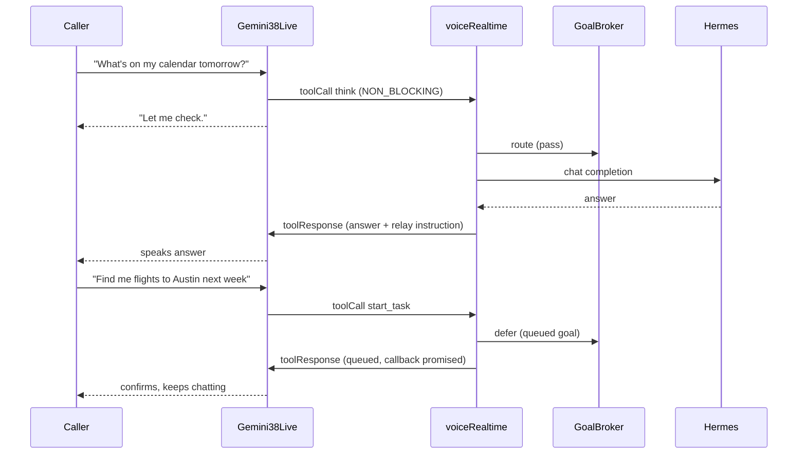
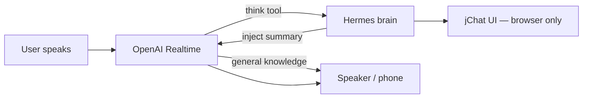
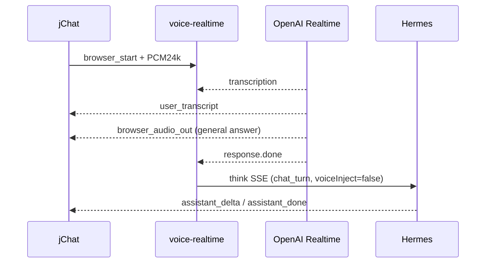
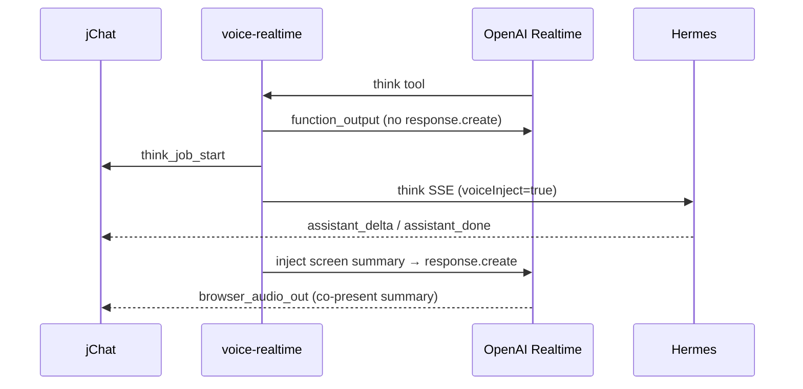
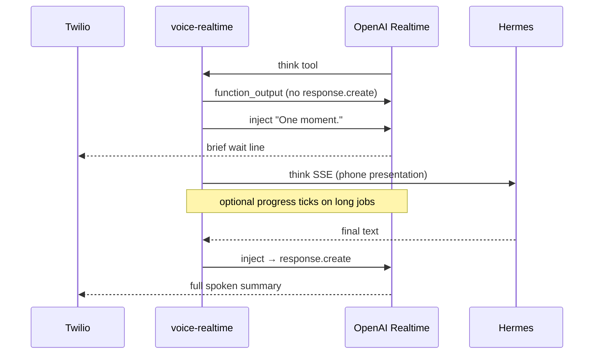

# Voice: when to think vs what to say

Joshu voice uses **OpenAI Realtime S2S** (`packages/voice-realtime`) for all speech — phone (Twilio) and browser (jChat / jMail). Two decisions happen on every turn:

| Concern | Question | Primary decider |
| --- | --- | --- |
| **A. When to think** | Should Hermes (the brain) run? | OpenAI Realtime — via the `think` tool + session orchestration |
| **B. What to say** | What does the user hear? | OpenAI Realtime audio — scripted by Realtime itself or by injected Hermes results |

See also [voice-realtime.md](voice-realtime.md) (service architecture), [web-voice.md](web-voice.md) (browser wiring), [self-host.md](../self-host.md) (identity and persona).

**Two tool paths.** Which one runs depends on the model (`nativeAsyncTools` on the S2S client; logged at call start as `tool mode=native_async|legacy`):

| Path | Models | Who speaks while the brain works |
| --- | --- | --- |
| **Native async** | Gemini 3.8 Live (`gemini-3.8-live*`) | The model — tools are `NON_BLOCKING`, results come back as function responses it speaks |
| **Legacy** | OpenAI Realtime, Gemini 3.1 Flash Live | Joshu — silent tool ack, "One moment.", progress ticks, injected result |

The native path is described first. Everything from [Actors](#actors) down describes the **legacy** path, which is kept but frozen.

---

## Native async path (Gemini 3.8 Live)

The voice model follows three rules (prompt: `buildVoiceSystemPrompt(..., { nativeAsyncTools: true })` in [`joshuIdentity.ts`](../../packages/voice-realtime/src/joshuIdentity.ts)):

| Request | Model does | Backend |
| --- | --- | --- |
| General knowledge / small talk | Answers itself | none |
| Anything about the owner (files, calendar, email, memory, quick personal action) | Calls `think`; may say one short ack ("Let me check"), never owner facts before the result | Broker `route` → Hermes (`runJoshuThinkDetailed`), same as legacy |
| Long work (browsing, travel, multi-step research) | Calls `start_task` with a self-contained objective, confirms it is queued | Broker `defer` → Kanban worker; callback / channel delivery as usual |

**Phone `think` has a 10 s budget.** It runs as a Joshu **inline job** ([`inlineJobs.ts`](../../src/realtimeGoals/inlineJobs.ts)): broker `route`, then Hermes, counted as an in-flight turn (no gateway restart under it). Within the budget the model gets the answer as usual. Past it the function result is `{ status: "working" }` — the model says it is still working (never a guess) — and the session long-polls the job; when it lands, the call claims it and speaks it as a `late_answer` turn at the next pause. If the caller hangs up first, the session detaches the job and Joshu's owner outbox texts the answer (a Joshu restart mid-job becomes "I restarted before I could finish …"). Results carry `delivered` — the sends Joshu actually made (links texted when the answer is claimed) — and the model may only claim a send listed there. Saying "I texted it" while a job is still running logs `ANTIPATTERN delivery-claim-before-result`; if the result shows nothing was sent, it arrives with a `correction` ([`deliveryClaimGuard.ts`](../../packages/voice-realtime/src/deliveryClaimGuard.ts)). Browser voice and embedded apps keep the direct stream.

Follow-ups on queued work (status, answers, changes, "never mind") go to `think`, whose broker `route` binds them to the active branch. The broker classifier also stays as a safety net inside `think`: work it classifies as `queue` is still queued if the model under-calls `start_task`.



**Implementation:** [`nativeToolRunner.ts`](../../packages/voice-realtime/src/nativeToolRunner.ts) runs the tool and builds the function response; both sessions deliver it with `sendFunctionResult`. Phone answers still go through `speakableWithLinksTexted` (links are texted, never read), and an answer that lands after hang-up is texted.

**Principle:** Gemini 3.8 Live owns the conversation — turn-taking, fillers and half sentences, barge-in, when to reply, goodbyes ([Live API overview](https://ai.google.dev/gemini-api/docs/live-api)). Joshu code only does what the model cannot: passphrase security, running tools, audio plumbing, and telling the model facts it cannot see (what was sent, whether a tool call is running).

**What the native path does not do** (legacy-only): silent `triggerResponse: false` tool acks, the handler "One moment." line, progress ticks (`VOICE_HERMES_PROGRESS_*`), injecting results as a user turn, dropping or cancelling organic audio while a job runs, organic-reply nudges, pre-user muting on unlocked calls, `ANTIPATTERN spoke-before-think`, reprompts on unclear STT, the post-unlock "restate your request" gate, transcript-based wrap-up detection, and VAD sensitivity / silence overrides (Gemini defaults apply). Cancels are local mutes — no interrupt is sent, because 3.8 voices an aborted generation as "a system error occurred".

**Tool calls Joshu declines** (locked, passphrase-only quote) get an ordinary completed result with a plain factual answer: `{"status":"done","answer":"Passphrase accepted. It was not a request, so there is nothing to look up."}`. 3.8 treats anything else as a failed tool and later tells the caller "a system error occurred". In a callback replay test, `nothing_to_do` with instructions caused the error in 3 to 4 of 6 runs, and `done` with an answer caused it in 1 of 18 runs.

**Joshu-authored turns never cut the model off.** Injected turns (callback results, goal replies, control lines) wait until the model finishes its current reply (`sendClientTurn` → `whenModelIdle`, bounded 12 s): a `turnComplete: true` turn interrupts active generation, which 3.8 also reports as a system error.

**Goal callbacks:** the unlock context says the call is outbound ("Joshu called the owner… they did not call you"), and the result is injected as `callback_answer` / `callback_question` so the model opens with why it called. Without that, the model "forgot why it called".

**Hang-up:** phone declares `end_call`; the model says goodbye and calls it, Joshu hangs up once the goodbye has played (unfinished answers are texted).

**Still Joshu-owned** (security / plumbing): passphrase lock with pre-rendered clips (the model is muted until unlock and then told via context that the call is open — it cannot hear the clips), barge-in Twilio buffer clears, dictation buffering, goal-callback delivery.

**Background work context.** The broker snapshot (active, blocked, recently finished goals) is added to the Live session as non-turn context (`appendContext`) — on phone only **after** passphrase unlock, on browser at session start.

**Protocol notes** ([`geminiLiveClient.ts`](../../packages/voice-realtime/src/geminiLiveClient.ts)):

- `turnComplete` no longer means idle. Tool calls can arrive after it; the interaction ends at `interactionStatus: IDLE` (`onInteractionIdle` lists every tool call, including late ones). `response.done` still fires per generation, because the interaction stays `IN_PROGRESS` for the whole tool run and holding it would delay the ack's audio tail.
- Extended Thinking: `thinkingConfig.thinkingLevel` from `GEMINI_LIVE_PHONE_THINKING_LEVEL` (default `low`) / `GEMINI_LIVE_THINKING_LEVEL`. `MINIMAL` is unsupported. Plain 3.8 Live gets no thinking config.
- Result `scheduling` (`WHEN_IDLE` etc.) is opt-in via `GEMINI_LIVE_RESULT_SCHEDULING` — Extended Thinking rejects it.
- Long calls: `sessionResumption` handles + `contextWindowCompression` (sliding window); `goAway` or an unexpected drop reconnects with the latest handle (`session resumed` in logs).

**Work claims with no tool call.** When the model says it is checking or working on something ("Let me check your", "I'm still looking into this") and the interaction ends (`interactionStatus: IDLE`) with no tool call and no running tool call, the session logs `ANTIPATTERN work-claim-without-tool` and adds a non-turn note: no tool call is running, the words started nothing, call `think` or `start_task` now if the owner asked for something. After a finished reply it also asks the model for a turn (`requestOrganicResponse`), at most once per owner utterance; after a reply the owner cut off, it adds the note only. Phone and browser share [`workClaimGuard.ts`](../../packages/voice-realtime/src/workClaimGuard.ts). Why: an owner "um" made Gemini stop "Let me check your" before the `think` call went out, and the model then said "I'm still looking" for eight minutes with `joshuJobCount: 0`. Design and alternatives: [`voice-agent-tools.md`](../technical-reference/voice-agent-tools.md).

**Eval signal:** grep `owner-fact-before-result candidate` — what the model said while its tool was still running. A short ack is expected; owner facts there are the hallucination to fix (prompt / tool descriptions), not to mask in code.

## Actors

> **Legacy path** from here down (OpenAI Realtime, Gemini 3.1 Flash Live). The native async path above replaces the handler-owned speech described below.



- **Realtime** — live speech-to-speech model (`gpt-realtime-2`). Handles VAD, transcription, casual replies, and spoken output.
- **Brain (Hermes)** — files (gbrain MCP), Hindsight memory, tools, writes. Invoked via `runJoshuThink()` in [`brainThink.ts`](../../packages/voice-realtime/src/brainThink.ts).
- **Orchestration** — [`twilioRealtimeSession.ts`](../../packages/voice-realtime/src/twilioRealtimeSession.ts) (phone) and [`browserRealtimeSession.ts`](../../packages/voice-realtime/src/browserRealtimeSession.ts) (browser) connect Realtime events to Hermes jobs and speech injects.

The `think` tool is registered in [`realtimeTools.ts`](../../packages/voice-realtime/src/realtimeTools.ts). Realtime is instructed (via system prompt) to call it for **this user's** files, memory, desktop, and personal tasks — **not** for general world knowledge it already knows.

---

## Realtime vs brain (desktop / files)

Two layers — easy to confuse in conversation:

| Layer | Sees desktop? | Role |
| --- | --- | --- |
| **OpenAI Realtime** (voice) | No direct filesystem view | Hear/speak, call `think`, read injected results |
| **Hermes** (`think` → gbrain, tools) | Yes (ArozOS Desktop, `joshu's files`, etc.) | Actual file/memory/work |

On a **phone call**, Realtime is literally blind to the desktop. A common failure mode is the model **saying** it has no access (or giving a generic intro), then **still** calling `think` in the same `response.done` — the user hears a refusal, then “checking…”, then the real answer.

**Mitigations (code + prompts):**

- Phone system prompt — [`buildVoiceSystemPrompt(..., "phone")`](../../packages/voice-realtime/src/joshuIdentity.ts): call `think` immediately on personal tasks; never apologize for lacking access; the tool **is** desktop access.
- `think` tool description — [`realtimeTools.ts`](../../packages/voice-realtime/src/realtimeTools.ts): zero spoken preamble; do not claim you lack access.
- Phone handler — after `think`, `sendFunctionOutput` with `triggerResponse: false`, then a single `injectProgressMessage("One moment.")` (Joshu speaks the wait line, not an extra model ack from tool JSON).
- Detection — [`twilioRealtimeSession.ts`](../../packages/voice-realtime/src/twilioRealtimeSession.ts) logs `ANTIPATTERN spoke-before-think` when audio + `think` share one response (regex `LIMITATION_DENIAL_RE` flags likely denials).

**Local grep:**

```bash
grep 'ANTIPATTERN spoke-before-think\|THINK START'   # dev logs
```

If the first desktop question still gets a wrong spoken line, check whether `think` was invoked on that turn (`tool invoke think`) or only on a **follow-up** utterance after barge-in.

---

## A. When to think

### Who decides

**OpenAI Realtime** chooses whether to call `think`, guided by:

- System prompt — [`buildVoiceSystemPrompt()`](../../packages/voice-realtime/src/joshuIdentity.ts) (`web` vs `phone` surface)
- Tool description — personal/user work only
- Conversation context — Realtime passes `intent`, `summary`, and should pass `user_quote` (verbatim utterance). Joshu also backfills from STT `pendingUserQuote` / last user transcript when Realtime omits it, so Hermes/Langfuse get a `User said:` line whenever speech was captured.

Joshu code does **not** regex-classify utterances. It reacts to Realtime's tool call. On browser, casual turns sync S2S speech to the attached surface without invoking Hermes.

### Phone — Hermes only when Realtime calls `think`

```
User speaks → Realtime transcribes
           → Realtime answers directly  OR  calls think
           → if think: runJoshuThink(presentation: "phone")
           → if no think: no Hermes at all
```

Transcripts update a local turn log for context; they **never** start Hermes on their own.

### Phone — who triggers the next Realtime response

PSTN uses **server VAD** by default (`VOICE_PHONE_VAD_SILENCE_MS=500`) with **`create_response: false`** ([`PHONE_VAD`](../../packages/voice-realtime/src/twilioRealtimeSession.ts)): short silence ends the turn, then Joshu waits for transcript and calls `requestOrganicResponse()`. Optional **`semantic_vad`** — use `VOICE_PHONE_VAD_EAGERNESS=high` for latency (`low` waits longer). Logs include `transcriptAfterSpeechStopMs` per turn.

| Transcript ([`userInputGate.ts`](../../packages/voice-realtime/src/userInputGate.ts)) | Action |
| --- | --- |
| `empty` | Ignore (VAD only) |
| `unclear` | `injectRepromptMessage()` — ask to repeat |
| `clear` | Log `turn #N USER → …`, append transcript, `requestOrganicResponse()` |

Unexpected **organic** `response.create` while Joshu did not initiate speech is **cancelled** (echo/noise guard). Turn-level logs: `turn #N`, `resp #M`, `SPEECH START` / `SPEECH OUT source=…`.

### Phone — think passphrase (PSTN only)

When `TWILIO_THINK_PASSWORD` is set (required for PSTN), **Joshu** gates the **entire call** — Gemini/Realtime does not decide unlock:

```
User speaks → STT transcript
           → Joshu fuzzy-matches passphrase (clips only; model muted)
           → if match: unlock clip, wait for a new request (ignore leftover passphrase audio)
           → if wrong (clear): attempt++; at 3 → goodbye + hang up
           → if Realtime calls any tool while locked: silent deny (no clip, no unlock)
           → first non-passphrase turn after unlock: normal chat / think → Hermes
```

| Concern | Detail |
| --- | --- |
| **No ungated mode** | Greeting asks for passphrase; no general chat until unlock |
| **Failed attempts** | 3 clear wrong tries hang up the call (unclear/filler does not count) |
| **Tools while locked** | Silent deny — never unlock from `think` args (Gemini wrapping the passphrase in a tool call once raced the clips) |
| **Declared tools** | PSTN declares `think` + dictation (`PHONE_TOOL_NAMES`), plus `save_owner_mobile` on a call with an owner mobile offer ([`voice-realtime.md`](voice-realtime.md#owner-mobile-offer)) — advertising `open_desktop` made the model narrate fake app opens |
| **Owner UI** | [Telephone](../telephone-arozos-app.md) app — view number / change passphrase (settings file override) |
| **STT tolerance** | [`phonePassphrase.ts`](../../packages/voice-realtime/src/phonePassphrase.ts) — apostrophe normalization, compact-string similarity, per-token fuzzy + phonetic match, so a word heard as a similar-sounding word still counts |
| **Wrong-language STT** | Gemini Live auto-detects language (cannot pin `en-US`). Non-ASCII transcripts are **unclear** and do not burn attempts ([`userInputGate.ts`](../../packages/voice-realtime/src/userInputGate.ts)). |
| **Unlock source** | **Caller transcript only.** Tool `user_quote` / `summary` must not unlock. |
| **Secrets in Hermes** | Passphrase redacted from think context; passphrase-only turns are dropped |
| **After unlock** | Clip *"Unlocked. What can I do for you?"* Gemini stays muted until the next non-passphrase utterance |

Full call UX (greeting, 60s/90s timers, owner caller): [voice-realtime.md — Phone security and call UX](voice-realtime.md#phone-security-and-call-ux-pstn-only).

### Browser — S2S for casual speech; Hermes only on `think`

Two paths, **one outcome per spoken turn** (deduped in `browserRealtimeSession.ts`):

| Situation | Hermes (brain) | Surface (jChat today) | Voice |
| --- | --- | --- | --- |
| S2S answers casually (no `think`) | **Not invoked** | S2S output transcription (`assistant_delta` / `assistant_done`) | S2S organic speech |
| S2S calls `open_desktop` | **Not invoked** | `desktop_action` → opens app/file silently | S2S may speak briefly |
| S2S calls `think` | On tool call | Full brain stream via `assistant_delta` / `assistant_done` | Brief phrase + co-present summary after inject |
| **Dictation** (`start_dictation` → … → `finish_dictation`) | **Once** at finish | Full formatted write via Hermes | Silent while buffering; brief “Ready” / “One moment” / co-present summary |

Casual example: *"How are you?"* — S2S speaks; jChat shows what S2S said. No duplicate Hermes paragraph.

Deep-work example: *"List folders on my desktop"* — S2S calls `think`; Hermes runs with Realtime's `intent`/`summary`; surface gets the full streamed answer; voice gets a short co-present summary after inject.

### Dictation sessions (lists, notes, rambling)

Multi-pause speech fails if each VAD turn stays **organic** — STT may hear every site or sentence, but Hermes never writes. Joshu owns a **dictation buffer** instead:

```
start_dictation(destination, format) → buffer every user transcript → finish_dictation
                                                                      ↓
                                                         one Hermes job (format + store)
```

| Piece | Detail |
| --- | --- |
| **Tools** | `start_dictation`, `finish_dictation`, `cancel_dictation` — [`realtimeTools.ts`](../../packages/voice-realtime/src/realtimeTools.ts) |
| **Buffer** | [`dictationSession.ts`](../../packages/voice-realtime/src/dictationSession.ts) — chunks kept server-side; organic S2S speech suppressed while active |
| **Formats** | `cleanup` (lists / light edit), `reformulate` (meeting notes / rambling → clear prose), `auto` (Hermes chooses) |
| **Start** | Explicit dump cue in **recent STT only** (`looksLikeExplicitDictationStart` in [`dictationSession.ts`](../../packages/voice-realtime/src/dictationSession.ts)). The model's `user_quote` cannot arm the buffer. |
| **Done** | Model calls `finish_dictation`, or user says a clear done phrase (*that's it*, *I'm done*, …) |
| **Surfaces** | Browser + PSTN (same tools; phone has no `open_desktop`) |

Dictation is a **wait until I'm done** mode, not “they probably have a list.” The caller has to say so:

| Starts dictation | Stays on `think` |
| --- | --- |
| *I'm about to tell you a bunch of things, just wait for me to finish* | *I want to give you some calendar reminders* |
| *Don't interrupt — I have a list* | *What's on my calendar* / *add a reminder for Tuesday* |
| *Start dictation* / *take this down* | *Make a list of the websites we talked about* |

Inferred `start_dictation` is rejected (`not_explicit`); the model is told to `think` instead. On PSTN, leftover STT after unlock also cannot arm the buffer (`restate_after_unlock_required`). Logs: `rejected start_dictation (…)`.

**Why not `think` per chunk:** pauses between list items end the Realtime turn; the model often never calls `think`, and organic sync can be empty. Spoken lists in web voice failed this way before the dictation buffer existed.

Dedup rules (avoid double Langfuse traces):

| Event | Action |
| --- | --- |
| User transcript arrives | Store quote; arm organic surface sync — do not start brain yet |
| Realtime `response.done` + `think` | Start (or upgrade) one brain job; `voiceInject=true` |
| Realtime `response.done`, no `think` | Finalize organic surface sync from S2S transcription |
| Late transcript after `think` already started | Skip starting a second brain job — **but** if the in-flight job still lacks `userQuote`, backfill STT onto it before Hermes runs |

Surface wire events live in [`voiceSurfaceSync.ts`](../../packages/voice-realtime/src/voiceSurfaceSync.ts) — jChat consumes them today; future desktop shells can subscribe the same protocol.

Hermes session key: `voice-think:{surfaceSessionId}:{jobId}`.

### Langfuse: voice `think` vs typed jChat

| Path | Trace root input |
| --- | --- |
| Typed jChat | Full owner text |
| Voice `think` (fixed) | `Intent:` + `Conversation summary:` + **`User said:`** (Realtime `user_quote` or STT backfill) |
| Voice `think` (legacy gap) | Intent + summary only — Realtime paraphrased, no verbatim quote → Langfuse looked incomplete |

Helpers: [`buildThinkUserMessage`](../../packages/voice-realtime/src/brainThink.ts) / [`resolveThinkUserQuote`](../../packages/voice-realtime/src/brainThink.ts). Browser STT race: Realtime often calls `think` before the transcript event lands — `browserRealtimeSession` backfills onto the in-flight job during `enrichAppSurface` and again at Hermes start. Phone falls back to the last user transcript line when `user_quote` is missing.

---

## B. What to say (voice output)

All audible output is **OpenAI Realtime audio**. The question is who writes the script.

### Three ways Realtime is asked to speak

Implemented in [`openaiRealtimeClient.ts`](../../packages/voice-realtime/src/openaiRealtimeClient.ts):

| Trigger | Mechanism | Typical use |
| --- | --- | --- |
| **Organic** | `requestOrganicResponse()` (phone) or Realtime auto (browser) | General knowledge, casual replies |
| **Call control** | `injectControlMessage()` → `response.create` | Phone greeting, passphrase prompts, session timeout (exact short line) |
| **After `think`** | `sendFunctionOutput` (`triggerResponse: false`) + `injectProgressMessage("One moment.")` on phone | One handler-owned wait line; avoids model hallucinating from tool JSON |
| **After brain completes** | `injectAssistantMessage()` → `response.create` | Hermes result → spoken summary |
| **During long jobs** | `injectProgressMessage()` | "Still checking.", etc. (phone + browser) |
| **Unclear audio (phone)** | `injectRepromptMessage()` | Ask caller to repeat |

Inject wording uses [`speechPresentation.ts`](../../packages/voice-realtime/src/speechPresentation.ts):

- **`screen`** (browser) — *"Full answer is on the user's screen — speak a brief co-present summary (1–3 sentences)."*
- **`voice_only`** (phone) — *"User has no screen — speak a clear, complete summary they can act on."*

Hermes itself uses different system prompts per surface (`buildThinkSystemPrompt(..., "screen" | "phone")` in `brainThink.ts`): markdown on screen, plain speakable text on phone.

### Phone — voice is the only output channel

| Turn type | What the user hears |
| --- | --- |
| General knowledge | Realtime speaks directly |
| `think` path | ① Handler injects **"One moment."** (no `response.create` on tool output) → ② optional progress ticks → ③ full actionable summary when Hermes finishes |

Phone handler ([`twilioRealtimeSession.ts`](../../packages/voice-realtime/src/twilioRealtimeSession.ts)):

```typescript
oa.sendFunctionOutput(call.callId, JSON.stringify({ status: "accepted", ... }), {
  triggerResponse: false,
});
oa.injectProgressMessage("One moment.");
```

The model must **not** speak in the same response as `think` (prompt + tool description). Letting Realtime `response.create` on raw function output tended to produce duplicate or contradictory acks.

When Hermes completes, the full phone-formatted answer is injected and Realtime speaks it.

### Browser — voice and screen are decoupled on `think` only

| Turn type | Surface (jChat today) | Voice |
| --- | --- | --- |
| Casual / general knowledge | S2S transcription (what you heard) | S2S organic speech |
| `think` path | Hermes full answer via `assistant_delta` | At most one brief phrase when calling `think`; co-present summary after inject |

Browser: the model may say one short line when invoking `think`; **no** second ack from tool output (`triggerResponse: false`):

```typescript
// browserRealtimeSession.ts
oa.sendFunctionOutput(call.callId, JSON.stringify({ status: "accepted", ... }), {
  triggerResponse: false,
});
```

Voice inject only when `voiceInject=true` (the `think` path). Organic turns update the surface from S2S transcription only — no parallel Hermes job.

---

## Side-by-side summary

| | **Phone** | **Browser** |
| --- | --- | --- |
| **A: When to think** | Only when Realtime calls `think` | Only when S2S calls `think` |
| **A: Hermes trigger** | Realtime tool call only | `think` tool call (or reconcile when `response.done` reports think) |
| **B: General knowledge speech** | Realtime only | S2S speaks; surface shows S2S transcript |
| **B: After `think` wait line** | Handler `injectProgressMessage("One moment.")`; tool output suppressed | Model may say one brief phrase when calling `think`; tool output suppressed |
| **B: After Hermes completes** | Full phone summary aloud | Brief co-present summary; full text on screen |
| **B: Hermes output mode** | `presentation: "phone"` | `presentation: "screen"` |

---

## End-to-end sequences

### Browser — general question (no `think`)



### Browser — personal question (`think`)



### Phone — personal question (`think`)



---

## Key source files

| File | Role |
| --- | --- |
| [`openaiRealtimeClient.ts`](../../packages/voice-realtime/src/openaiRealtimeClient.ts) | Realtime WS; tool output; inject + progress speech |
| [`geminiLiveClient.ts`](../../packages/voice-realtime/src/geminiLiveClient.ts) | Gemini Live WS; native async tools, interaction status, session resumption |
| [`realtimeTools.ts`](../../packages/voice-realtime/src/realtimeTools.ts) | Tool defs; PSTN uses `PHONE_TOOL_NAMES` (`think` + dictation, + `start_task` natively); native defs are `NON_BLOCKING` |
| [`nativeToolRunner.ts`](../../packages/voice-realtime/src/nativeToolRunner.ts) | Native path: run `think` / `start_task`, build the function response |
| [`dictationSession.ts`](../../packages/voice-realtime/src/dictationSession.ts) | Multi-turn voice buffer + format guidance for Hermes |
| [`brainThink.ts`](../../packages/voice-realtime/src/brainThink.ts) | Hermes SSE delegate; broker origin, `route` / `defer` / context calls |
| [`speechPresentation.ts`](../../packages/voice-realtime/src/speechPresentation.ts) | Inject wording (screen vs voice_only) |
| [`joshuIdentity.ts`](../../packages/voice-realtime/src/joshuIdentity.ts) | Realtime + think system prompts |
| [`twilioRealtimeSession.ts`](../../packages/voice-realtime/src/twilioRealtimeSession.ts) | Phone orchestration + passphrase gate + dictation |
| [`browserRealtimeSession.ts`](../../packages/voice-realtime/src/browserRealtimeSession.ts) | Browser orchestration + chat sync + dictation |
| [`userInputGate.ts`](../../packages/voice-realtime/src/userInputGate.ts) | PSTN transcript classify (clear / unclear / empty) |
| [`phonePassphrase.ts`](../../packages/voice-realtime/src/phonePassphrase.ts) | Phone think-passphrase fuzzy match |
| [`thinkPassword.ts`](../../packages/voice-realtime/src/thinkPassword.ts) | Resolve passphrase (Telephone settings.json → env) |

---

## Avoiding duplicate spoken acknowledgments

*(Legacy path. On the native path the model owns its single ack; there is no handler wait line to collide with.)*

**Symptom:** User hears two “I’m looking that up” lines (or a denial plus a check).

**Causes:**

| Surface | Typical cause |
| --- | --- |
| **Phone (older)** | System prompt told the model to say “I’m thinking” **and** `sendFunctionOutput` triggered `response.create` on tool JSON |
| **Phone (current)** | Model speaks a denial or preamble **in the same turn** as `think` — grep `ANTIPATTERN spoke-before-think` |
| **Browser** | Model brief phrase at `think` + (historically) second ack from tool output — browser uses `triggerResponse: false` |

**Current policy:**

- **Phone:** Model silent on the `think` turn; Joshu injects **one** “One moment.”; progress ticks only after that finishes.
- **Browser:** At most **one** short phrase when calling `think`; no second ack from tool output.

---

## OpenAI Platform observability

Joshu uses a **direct WebSocket** to `wss://api.openai.com/v1/realtime?model=…` ([`openaiRealtimeClient.ts`](../../packages/voice-realtime/src/openaiRealtimeClient.ts)). That traffic is **not** the same as `POST /v1/chat/completions`.

| Where you look | What you see |
| --- | --- |
| [platform.openai.com/logs](https://platform.openai.com/logs) (Chat Completions / Responses) | Usually **no** per-turn Realtime session rows |
| [Organization usage](https://platform.openai.com/settings/organization/usage) | Spend / activity for **`gpt-realtime-2`**, often under **audio** — filter **All projects**, today (UTC) |
| **Langfuse** (if enabled for Hermes) | **`think` / Hermes jobs only** — not OpenAI Realtime audio |
| **Local `[voice-realtime]` logs** | Best trace for voice: `openai session ready`, `THINK START`, `speech-instruct`, `ANTIPATTERN` |

**API key** resolved in [`config.ts`](../../packages/voice-realtime/src/config.ts): `OPENAI_API_KEY` → `VOICE_TOOLS_OPENAI_KEY` → `HINDSIGHT_API_LLM_API_KEY`. Env load order ([`loadEnv.ts`](../../packages/voice-realtime/src/loadEnv.ts)): repo `.env` → `.env.twilio.local` → `~/.hermes/.env` (**last wins**). `dev-arozos` exports only `OPENAI_API_KEY` / `VOICE_TOOLS_OPENAI_KEY`. If usage is missing in the dashboard org you expect, confirm the key on the call matches that org/project.

`TWILIO_PHONE_SYSTEM_PROMPT` **replaces** the built-in phone prompt entirely when set — keep the desktop-access and no-preamble rules if you override.

Verbose OpenAI events: `VOICE_REALTIME_DEBUG=true`. See [voice-realtime.md — Logging](voice-realtime.md#logging).
